# ethernet-switch

A parameterised, store-and-forward Ethernet Layer-2 switch core in synthesizable
SystemVerilog, with a self-checking regression and a LibreLane (OpenLane 2) flow
down to GDSII.

**English** | [简体中文](README.zh-Hans.md)

The generic RTL defaults to **four ports** with parameter overrides; the DE2-115
board shell is **two ports** and the Vivado template is **eight ports**. The RTL
is grouped under `switch/`, `monitor/`, `console/`, `perips/`, `mems/` and
`common/`, and `rtl/es_defs.sv` pulls the common and per-domain declaration
libraries together in dependency order.

This document is written to be read front to back by someone who has never
opened the repository, and to be used as a reference afterwards. It explains
what every block does, *why* it is built that way, how a frame travels through
the design clock by clock, and how to build, test and change the project
without breaking it.

---

## Contents

* [1. Start here](#1-start-here)
  - [1.1 What a Layer-2 switch actually does](#11-what-a-layer-2-switch-actually-does)
  - [1.2 What this repository gives you](#12-what-this-repository-gives-you)
  - [1.3 What it deliberately does not do](#13-what-it-deliberately-does-not-do)
  - [1.4 The 60-second tour](#14-the-60-second-tour)
* [2. Quick start](#2-quick-start)
  - [2.1 What you need](#21-what-you-need)
  - [2.2 Five commands](#22-five-commands)
  - [2.3 What success looks like](#23-what-success-looks-like)
  - [2.4 Windows and WSL](#24-windows-and-wsl)
* [3. Repository map](#3-repository-map)
  - [3.1 Directory layout](#31-directory-layout)
  - [3.2 Every module, and what it owns](#32-every-module-and-what-it-owns)
  - [3.3 How the declaration libraries work](#33-how-the-declaration-libraries-work)
* [4. Architecture](#4-architecture)
  - [4.1 Four layers](#41-four-layers)
  - [4.2 One core, three pin front-ends](#42-one-core-three-pin-front-ends)
  - [4.3 One clock, clock enables instead of clocks](#43-one-clock-clock-enables-instead-of-clocks)
  - [4.4 How much bandwidth a beat buys](#44-how-much-bandwidth-a-beat-buys)
* [5. The receive path](#5-the-receive-path)
  - [5.1 Octets to beats, and the FCS check](#51-octets-to-beats-and-the-fcs-check)
  - [5.2 The parser as a state machine](#52-the-parser-as-a-state-machine)
  - [5.3 Stitching a 14-octet header out of 8-octet beats](#53-stitching-a-14-octet-header-out-of-8-octet-beats)
  - [5.4 How the frame length is resolved](#54-how-the-frame-length-is-resolved)
  - [5.5 The ingress policy](#55-the-ingress-policy)
  - [5.6 Buffering, and why a rejected frame costs one pointer move](#56-buffering-and-why-a-rejected-frame-costs-one-pointer-move)
* [6. The forwarding database](#6-the-forwarding-database)
  - [6.1 Shape of the table](#61-shape-of-the-table)
  - [6.2 A lookup, clock by clock](#62-a-lookup-clock-by-clock)
  - [6.3 Learning without losing an entry](#63-learning-without-losing-an-entry)
  - [6.4 Ageing](#64-ageing)
  - [6.5 Flush, occupancy, and what the table is not](#65-flush-occupancy-and-what-the-table-is-not)
* [7. The fabric](#7-the-fabric)
  - [7.1 The guarantees](#71-the-guarantees)
  - [7.2 Admission, in one inequality](#72-admission-in-one-inequality)
  - [7.3 Round-robin, and why the wrap is written out](#73-round-robin-and-why-the-wrap-is-written-out)
  - [7.4 One-to-many by construction](#74-one-to-many-by-construction)
  - [7.5 Head-of-line blocking](#75-head-of-line-blocking)
  - [7.6 How the transmit statistics avoid the obvious bug](#76-how-the-transmit-statistics-avoid-the-obvious-bug)
* [8. The transmit path](#8-the-transmit-path)
  - [8.1 Descriptors and beats never drift](#81-descriptors-and-beats-never-drift)
  - [8.2 The frame sequencer](#82-the-frame-sequencer)
  - [8.3 Preamble, padding, FCS, inter-frame gap](#83-preamble-padding-fcs-inter-frame-gap)
  - [8.4 Why the FCS runs one octet ahead](#84-why-the-fcs-runs-one-octet-ahead)
* [9. The life of one frame](#9-the-life-of-one-frame)
* [10. The frame descriptor](#10-the-frame-descriptor)
* [11. Statistics](#11-statistics)
* [12. Telemetry and console](#12-telemetry-and-console)
* [13. Parameters and configuration recipes](#13-parameters-and-configuration-recipes)
* [14. PHY interfaces](#14-phy-interfaces)
* [15. Board shells](#15-board-shells)
* [16. Building and testing](#16-building-and-testing)
* [17. Physical implementation](#17-physical-implementation)
* [18. Working on the design](#18-working-on-the-design)
* [19. Troubleshooting](#19-troubleshooting)
* [20. Glossary](#20-glossary)
* [21. Where to read next](#21-where-to-read-next)

---

## 1. Start here

### 1.1 What a Layer-2 switch actually does

An Ethernet frame is a byte string with a fixed shape:

```
+----------------+----------------+-----------+---------------------+-----+
| destination    | source         | type or   | payload             | FCS |
| MAC (6 octets) | MAC (6 octets) | length(2) | 46 .. 1500 octets   |  4  |
+----------------+----------------+-----------+---------------------+-----+
```

A **Layer-2 switch** connects several Ethernet segments and decides, per frame,
which segment(s) the frame should leave on. It does that using only the
destination MAC address, and it *learns* which addresses live behind which port
by watching source addresses. Three things follow from that:

* A frame to a **known** unicast address goes out of exactly one port.
* A frame to a **broadcast** address (`ff:ff:ff:ff:ff:ff`) or to an
  **unknown** unicast address is **flooded** to every port except the one it
  arrived on.
* A frame that arrives on the port it is addressed to is consumed, not
  forwarded - otherwise a unicast would leak onto every other segment.

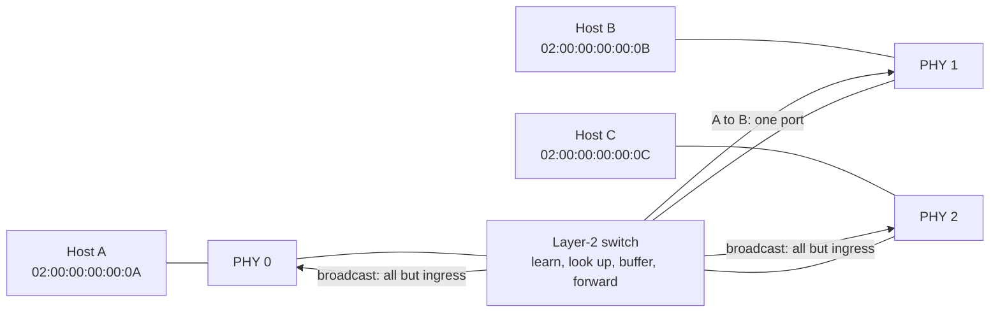

A switch that forwards a frame *before* the whole frame has arrived is called
**cut-through**; one that receives the whole frame, checks it, and only then
forwards it is called **store-and-forward**. This core is store-and-forward, and
that single choice is the reason it can guarantee that a corrupt frame is never
forwarded, that a frame is never retracted from an egress buffer, and that the
forwarding decision is made exactly once.

### 1.2 What this repository gives you

| Piece | Where | What it is |
|---|---|---|
| Switching core | `rtl/switch/` | the framer, parser, forwarding database, fabric and statistics |
| Pin front-ends | `rtl/switch/es_switch_{gmii,mii,rmii}.sv` | three selectable top modules, one per MAC interface |
| Generic top | `es_switch_gmii` | the default top: GMII-style octet pins, four ports by default |
| Board shells | `board/de2_115/`, `board/vivado/` | FPGA-specific tops with pins, clocks, PHYs and user I/O |
| Telemetry | `rtl/monitor/` | 64-bit per-port counters, rates, queue load, PHY state, MAC-table reader |
| Console | `rtl/console/` | ASCII command shell over the UART (`help`, `status`, `port`, `mac`) |
| Peripherals | `rtl/perips/` | UART, LCD, MDIO, 88E1111 management, key debounce |
| Shared storage/logic | `rtl/mems/`, `rtl/common/` | FIFOs, register banks, CRC-32, ratio engine, BCD, synchroniser |
| Regression | `tb/` | self-checking benches: block level, fabric, full switch, all three front-ends, board shells |
| CI contract | `ci/`, `Makefile` | pinned toolchain, lint, elaboration, simulation, synthesis gates |
| Physical flow | `librelane/` | LibreLane + sky130A configuration down to GDSII |

Everything under `rtl/` is **synthesizable**. Nothing in `rtl/` depends on a
testbench, a vendor primitive, a PLL or a memory compiler: the design reads,
elaborates, synthesises and routes with open-source tools alone, which is what
`make synth` and the CI `gds` job prove.

### 1.3 What it deliberately does not do

| Not included | Why it is out of scope |
|---|---|
| PCS / PMA / SerDes | the PHY is a separate chip or hard macro; this core starts at the MAC interface |
| 802.3x pause frames | flow control needs a negotiation state machine and a transmit scheduler that can stop mid-queue |
| Spanning tree / RSTP | a control protocol above Layer 2; flooding loops are the integrator's responsibility |
| VLAN filtering, rewriting, QinQ push/pop | the parser *recognises* 802.1Q / 802.1ad so it can find the real EtherType, but it does not filter or rewrite tags |
| QoS, priority queues, scheduling | every frame is best effort, one queue per egress port |
| Cut-through forwarding | incompatible with "never forward a frame that fails its FCS" |
| IP routing, ARP, DHCP | strictly Layer 2 |
| Asynchronous clock domains | the core is single-clock by construction; a board shell that needs CDC adds it *outside* the core |

The features that *are* included are the ones that are hard to get right and
that every switch needs to be correct: frame-boundary handling, buffering with
no descriptor/payload skew, source-address learning that cannot lose an entry
under simultaneous access, and a fabric that cannot interleave two frames into
one egress buffer.

### 1.4 The 60-second tour

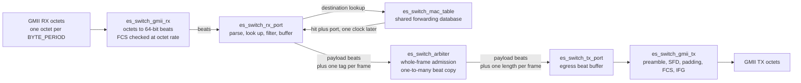

1. **Octets arrive.** The receive adapter turns the octet stream into 64-bit
   *beats* and checks the FCS as the octets stream by.
2. **The header is parsed.** Destination and source MAC, plus the length or
   EtherType field, are stitched out of the first one or two beats.
3. **The CAM is asked.** The destination address is looked up while the payload
   is still arriving; the answer is ready one clock later.
4. **The verdict is frozen.** The ingress policy turns the lookup result into a
   destination bitmask. Bad frames are rewound out of the buffer and never
   described.
5. **The source is learned.** A validated source address is queued into the
   forwarding table, without ever losing a simultaneous learn from another port.
6. **The fabric grants the whole frame.** Every destination must have room for
   *all* beats and a free length descriptor before the first beat moves.
7. **Beats fan out.** One beat is written to every port in the mask in the same
   clock; flooding is not a special case.
8. **The frame is re-serialised.** Preamble, SFD, padded client data, a freshly
   computed FCS, and a 12-octet inter-frame gap.

---

## 2. Quick start

### 2.1 What you need

| Tool | Version | Used for |
|---|---|---|
| Icarus Verilog | 12 or newer | simulation (`vvp`), RTL elaboration |
| Verilator | 5.x | lint with `-Wall`, every warning is an error |
| yosys | any recent release | `make synth`; the synthesis frontend the flow uses |
| GNU make, bash | any | the gates |
| Docker (optional) | any | the LibreLane physical flow |

On a Debian/Ubuntu machine:

```sh
sudo apt install iverilog verilator yosys build-essential
```

### 2.2 Five commands

```sh
ci/check-toolchain.sh   # about 0.1 s: do the tools match what the gates assume?
make lint               # about 1 s:   Verilator -Wall, all five tops
make rtl                # about 1 s:   Icarus elaboration of the RTL alone
make unit               # tens of s:   block-level benches and the fabric regression
make sim                # minutes:     four ports at 10/100/1000/1000 Mbit/s
```

Then, before you consider a change finished:

```sh
make param              # 3 ports, 50 MHz, a port count that is not a power of two
make mii                # full switch through the MII pin front-end
make rmii               # full switch through the RMII pin front-end
make vivado             # eight-port board template
make synth              # yosys; not part of `all`, but it is a CI gate
```

`make all` runs `lint mii rmii vivado unit sim param`. It deliberately does
**not** run `synth`: synthesis is slow, needs yosys, and is the gate you run
once before declaring victory rather than on every iteration.

### 2.3 What success looks like

Each self-checking bench ends with an explicit verdict. A block-level bench
prints one `PASS` line per check and then `sw_crc32_tb: PASSED (N checks)`; the
system bench prints a summary like this:

```text
======================================================================
 checks executed : 158
 errors reported  : 0
======================================================================
 TESTBENCH PASSED
```

A failure prints `*** ERROR` (and, for a block-level check, `FAIL` with the
expected and observed values) and ends with `$fatal`, so the process exits
non-zero. There is no such thing as a silent pass.

### 2.4 Windows and WSL

The toolchain normally lives in WSL. A small wrapper runs a command there:

```sh
bash wsl.sh "make lint"
```

CI runs on Linux directly and never needs `wsl.sh`. A local
`ci/check-toolchain.sh` reports the distribution rather than asserting it - only
CI sets `ASSERT_OS=1` - so a WSL distribution newer than the CI toolchain image
is not an error locally.

---

## 3. Repository map

### 3.1 Directory layout

| Path | What is in it |
|---|---|
| `rtl/es_defs.sv` | the umbrella header: shared widths, the statistics map, and includes of every domain library |
| `rtl/switch/` | the switch itself: framer, parser, CAM, fabric, egress, three top wrappers |
| `rtl/monitor/` | telemetry capture, snapshot cache, page policy, display formatting |
| `rtl/console/` | the ASCII command shell and its command modules |
| `rtl/perips/` | UART, LCD, MDIO, 88E1111 PHY management, key debounce |
| `rtl/mems/` | FWFT FIFO, 1R1W RAM, parallel register bank |
| `rtl/common/` | CRC-32, two-stage synchroniser, bin-to-BCD, serial ratio engine |
| `tb/` | self-checking testbenches; never synthesised, never linted by CI |
| `sim/` | alternative runner scripts (Verilator, Questa/ModelSim) and `.f` source lists; the Makefile remains the canonical gate |
| `board/de2_115/quartus_ii/` | Quartus II project: board top, pin assignments, SDC, `build.bat` |
| `board/vivado/` | eight-port MII Vivado template (see the status note in §15) |
| `ci/` | the toolchain contract (`check-toolchain.sh`) and the toolchain image definition (`toolchain/Dockerfile`) |
| `librelane/` | flow configuration, timing constraints, and its own README |
| `Makefile` | every gate; the target list is documented in its own header |
| `AGENTS.md` | the style and portability contract - read it before changing `rtl/` |

### 3.2 Every module, and what it owns

**Switch domain**

| Module | File | Responsibility |
|---|---|---|
| `es_switch_core` | `switch/es_switch_core.sv` | interface-agnostic datapath: port instances, CAM, fabric, statistics aggregation, elaboration-time checks |
| `es_switch_gmii_rx` | `switch/es_switch_gmii_rx.sv` | octet stream to 64-bit beats, plus the FCS check |
| `es_switch_rx_port` | `switch/es_switch_rx_port.sv` | header parse, CAM lookup, ingress policy, buffering, descriptor generation |
| `es_switch_mac_table` | `switch/es_switch_mac_table.sv` | the shared forwarding database: `NUM_SETS` x `NUM_WAYS`, parallel reads, serialised learn queue, ageing |
| `es_switch_arbiter` | `switch/es_switch_arbiter.sv` | round-robin scheduling, whole-frame admission, one-to-many beat copy, transmit accounting |
| `es_switch_tx_port` | `switch/es_switch_tx_port.sv` | egress beat buffer, per-frame length descriptors, completion reporting |
| `es_switch_gmii_tx` | `switch/es_switch_gmii_tx.sv` | beats to a wire-legal frame; FCS generated one octet ahead of the wire |
| `es_switch_mii_adapter` | `switch/es_switch_mii_adapter.sv` | MII nibbles to and from the canonical octet stream |
| `es_switch_rmii_adapter` | `switch/es_switch_rmii_adapter.sv` | RMII 2-bit chunks to and from the canonical octet stream |
| `es_switch_gmii` | `switch/es_switch_gmii.sv` | default top: GMII pins passed straight to the core |
| `es_switch_mii` | `switch/es_switch_mii.sv` | MII top: per-port adapter, 10/100 Mbit/s only |
| `es_switch_rmii` | `switch/es_switch_rmii.sv` | RMII top: per-port adapter, 10/100 Mbit/s only |

**Monitor and console**

| Module | File | Responsibility |
|---|---|---|
| `es_monitor_core` | `monitor/es_monitor_core.sv` | atomic snapshot capture, 64-bit counter extension, serial rate calculation, CSR service |
| `es_monitor_cache` | `monitor/es_monitor_cache.sv` | low-priority CSR scanner: reads the sequence word before and after the image, publishes only when the two match |
| `es_monitor_page` | `monitor/es_monitor_page.sv` | debounced page and flush controls; page wraps over `NUM_PORTS + 1` |
| `es_monitor_display` | `monitor/es_monitor_display.sv` | seven-segment and LCD field formatting |
| `es_console_core` | `console/es_console_core.sv` | line assembly, command dispatch, response serialisation |
| `es_console_cmd_help` | `console/es_console_cmd_help.sv` | `help` |
| `es_console_cmd_status` | `console/es_console_cmd_status.sv` | `status` |
| `es_console_cmd_port` | `console/es_console_cmd_port.sv` | `port <n>` |
| `es_console_cmd_mac` | `console/es_console_cmd_mac.sv` | `mac all`, `mac <n>` |
| `es_console_snapshot` | `console/es_console_snapshot.sv` | copies a snapshot so a slow UART cannot mix windows |

**Shared infrastructure**

| Module | File | Responsibility |
|---|---|---|
| `es_common_crc32` | `common/es_common_crc32.sv` | octet-serial IEEE 802.3 FCS generation and checking from one computed table |
| `es_common_sync_2ff` | `common/es_common_sync_2ff.sv` | two-stage synchroniser for a single asynchronous bit |
| `es_common_bin_to_bcd` | `common/es_common_bin_to_bcd.sv` | binary to packed BCD for the display |
| `es_common_ratio` | `common/es_common_ratio.sv` | serial multiply/divide used for pps and bit/s |
| `es_mems_sync_fifo` | `mems/es_mems_sync_fifo.sv` | FWFT FIFO with frame-granular rewind and hard flush |
| `es_mems_ram_1r1w` | `mems/es_mems_ram_1r1w.sv` | one-read one-write RAM |
| `es_mems_reg_bank` | `mems/es_mems_reg_bank.sv` | parallel register bank with per-entry write enables |
| `es_perips_uart` | `perips/es_perips_uart.sv` | UART with 5-8 data bits, parity, 1/2 stop bits, RTS/CTS |
| `es_perips_lcd` | `perips/es_perips_lcd.sv` | HD44780-style character LCD driver |
| `es_perips_mdio` | `perips/es_perips_mdio.sv` | MDIO master |
| `es_perips_phy_88e1111` | `perips/es_perips_phy_88e1111.sv` | 88E1111 configuration, autonegotiation and status polling |
| `es_perips_key_debounce` | `perips/es_perips_key_debounce.sv` | vector key debounce |

### 3.3 How the declaration libraries work

Every RTL file starts with the same three lines, and the reason is a synthesis
frontend restriction rather than style:

```systemverilog
`include "es_defs.sv"
`include "switch/es_switch_defs.sv"
`default_nettype none
```

`rtl/es_defs.sv` declares the shared widths and the statistics map, then
includes the domain libraries in dependency order:

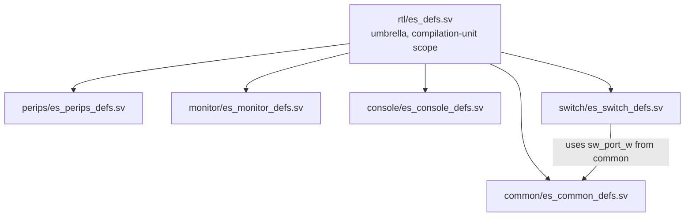

Why not a `package`? Because the synthesis frontend used by the physical flow
rejects packages in three separate places, and **neither simulator notices**:

* a package item is not a *constant range*, so a width taken from a package is
  rejected in a port declaration, before the body is parsed;
* a package function has to be called as `pkg::f(x)`; an unscoped call is not
  resolved at all;
* no form of `import` is accepted - not in the module header, not in the body.

Compilation-unit scope has none of those restrictions: the names are visible in
parameter defaults, port ranges, bodies and function argument lists alike, and
there is still exactly one definition of every constant. See
[§18.2](#182-the-three-hard-yosys-restrictions) and
[`AGENTS.md`](AGENTS.md#21-the-three-hard-yosys-restrictions).

---

## 4. Architecture

### 4.1 Four layers

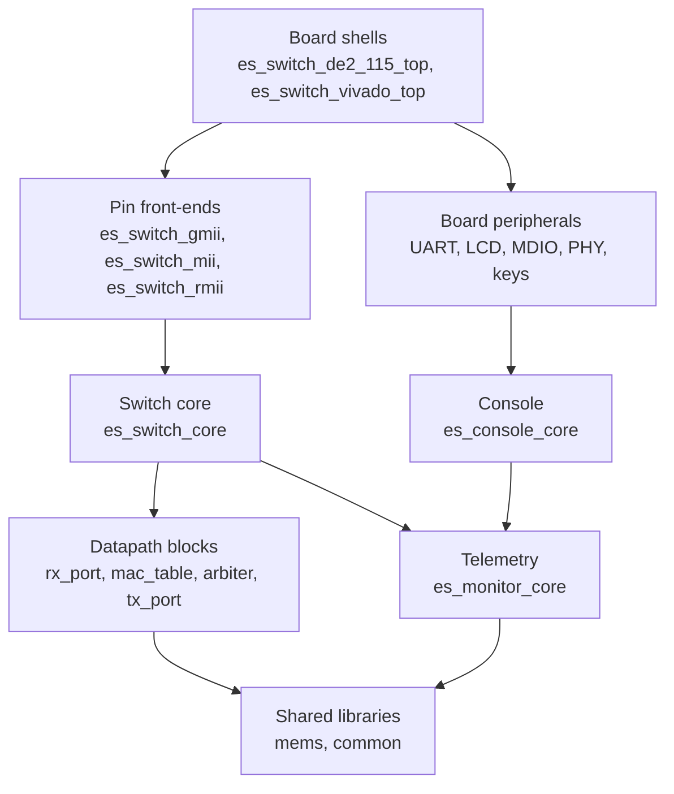

* The **core** knows nothing about pins, clocks or PHYs. It speaks one
  canonical, clock-enable-qualified octet stream per port.
* A **wrapper** adapts a physical MAC interface onto that stream. Three exist,
  and exactly one is elaborated per build.
* A **board shell** adds what a board needs: oscillator, reset sampling, PHY
  management, displays, buttons and a UART.
* The **monitor** observes the core and serves a read-only CSR; the **console**
  is a client of that CSR. Neither can stall forwarding.

### 4.2 One core, three pin front-ends

| Top module | Pins | Symbol width | Line rates | Notes |
|---|---|---|---|---|
| `es_switch_gmii` | `gmii_rx_en_i`, `gmii_rx_data_i`, `gmii_tx_en_o`, `gmii_tx_data_o` | 8-bit octets | 10 / 100 / 1000 Mbit/s | the default top |
| `es_switch_mii` | `mii_rx_dv_i`, `mii_rx_er_i`, `mii_rxd_i`, `mii_tx_en_o`, `mii_tx_er_o`, `mii_txd_o` | two 4-bit nibbles | 10 / 100 Mbit/s | 1000 Mbit/s is rejected at elaboration |
| `es_switch_rmii` | `rmii_crs_dv_i`, `rmii_rxd_i`, `rmii_tx_en_o`, `rmii_txd_o` | four 2-bit chunks | 10 / 100 Mbit/s | 1000 Mbit/s is rejected at elaboration |

All three forward the same parameters, the same statistics bus and the same
telemetry ports. `make lint`, `make rtl` and `make synth` each elaborate **all
five** tops - the three wrappers plus the two board shells - because a top that
is never compiled silently rots.

The interface is selected by *which wrapper is the elaborated top*, not by a
parameter. That is why only the pins of the selected interface exist in a given
build: there is nothing to leave unconnected, and no dead pin list to maintain.

### 4.3 One clock, clock enables instead of clocks

Every port shares a single `clk_i`. There are **no clock-domain crossings
anywhere** in the core, which is a deliberate choice with two consequences.

**A port's line rate is a clock enable, not a clock.** The only elaboration-time
constant a port needs is `BYTE_PERIOD`: the number of `clk_i` cycles that make
up one octet time. It is derived from the core clock and the configured speed:

```systemverilog
period = (clk_freq_hz * 8 + baud / 2) / baud;   // rounded to nearest, minimum 1
```

| Core clock | 10 Mbit/s | 100 Mbit/s | 1000 Mbit/s |
|---|---|---|---|
| 125 MHz | 100 | 10 | 1 |
| 50 MHz | 40 | 4 | 1 &dagger; |
| 200 MHz | 160 | 16 | 2 &dagger; |

A slower core clock does not change the datapath at all; it stretches the enable
period. Two things follow:

* **The core clock sets the per-port ceiling.** At 125 MHz, `BYTE_PERIOD = 1`
  is already 125 Mbaud, so no port can exceed 1 Gbit/s however it is
  configured.
* &dagger; **An octet period has to be a whole number of clocks, so a core clock
  that does not divide the octet time cannot be represented.** 1000BASE-T needs
  an 8 ns octet time, which is 2.5 clocks at 50 MHz and 1.6 at 200 MHz. The
  function rounds and then clamps to 1, so those ports are driven *faster* than
  the configured line rate - 400 Mbit/s at 50 MHz, 800 Mbit/s at 200 MHz. The
  lower rates are exact at all three clocks above, because 8 ns divides into
  40 ns and 160 ns. `make param` is 50 MHz and deliberately runs 100/100/10
  Mbit/s, so it does not hit this. **A core clock and a port speed that are not
  commensurate will not give you the line rate you asked for** - the honest fix
  is a fractional or DDS clock enable, which this design does not have.

> **Beginner trap.** If you build a 1000 Mbit/s port on a 50 MHz clock, the
> switch runs and every testbench passes, but the port is 2.5x faster than the
> PHY expects. Nothing inside the design can detect this; the arithmetic simply
> cannot represent 2.5 clocks. Choose a core clock that is a multiple of
> 125 MHz for gigabit ports.

### 4.4 How much bandwidth a beat buys

The internal datapath is 64 bits wide. One **beat** is eight octets, with octet
0 in `[63:56]`. At line rate a 1 Gbit/s port therefore delivers one beat every
**eight** core clocks, not one per clock:

| Quantity | Value at 125 MHz core | Derivation |
|---|---|---|
| Octet rate of a 1 Gbit/s port | 125 M octets/s | 1e9 / 8 |
| Beat rate of a 1 Gbit/s port | 15.625 M beats/s | 125 M / 8 |
| Fraction of clocks used by one 1 Gbit/s port | 12.5% | 15.625 / 125 |
| Fabric capacity | 125 M beats/s | one beat per clock |
| Four ports at 1 Gbit/s, all receiving | 62.5 M beats/s (50%) | 4 x 15.625 |
| Eight ports at 1 Gbit/s, all receiving | 125 M beats/s (100%) | 8 x 15.625 |

That last row is the important one: the shared beat bus is sized for the
aggregate, and at eight gigabit ports it is exactly saturated. The default
four-port build has 2x headroom. Fan-out costs nothing extra - one beat is
written to every destination in the same clock - so a broadcast is one fabric
transaction, not N.

Every buffer in the design is measured in these beats, so it helps to know the
conversion:

| Frame on the wire | Beats | Where it fits |
|---|---|---|
| 64 octets | 8 | the 802.3 minimum frame, and the unit behind the `TX_FIFO_DEPTH / 8` rule |
| 128 octets | 16 | |
| 512 octets | 64 | exactly the reduced instance's FIFO depth |
| 1518 octets | 190 | the default `RX_FIFO_DEPTH` / `TX_FIFO_DEPTH` is 256, so one maximum frame plus 66 beats of headroom |

---

## 5. The receive path

### 5.1 Octets to beats, and the FCS check

`es_switch_gmii_rx` does three jobs in one module: it re-times the incoming octet
stream, assembles 64-bit beats, and runs the CRC.

**Re-timing.** The adapter runs a free-running phase counter of `BYTE_PERIOD`
states and samples the octet on the **last** cycle of each octet time. Sampling
late gives a full clock of hold margin without a FIFO and without a CDC. The
counter is free-running so that it stays phase-aligned with the PHY even while
the link is idle.

**Why a full beat is held.** The end of a frame is only observable from the
de-assertion of the octet enable. A PHY may hold that enable high for the
remainder of the final octet time - several clocks on a 10 Mbit/s port - so a
beat that was emitted eagerly would leave the pipeline before the end-of-frame
marker existed, and the marker would arrive with nothing to attach to. The
adapter therefore *holds* a full beat until the next octet proves the frame
continues, or until the link goes idle proves it ended. That costs one octet
time of latency and no throughput: the beat is released on the same clock the
next octet is sampled, so one beat still leaves every eight octets.

| Situation | What the assembler does |
|---|---|
| 8 octets accumulated, 9th arrives | release the beat as a normal beat, start a new beat with the 9th |
| 8 octets accumulated, link goes idle | release the beat with `eof` and the FCS verdict |
| 1..7 octets accumulated, link goes idle | release a partial beat with `eof`, `octets = count` |
| link idle | hold the assembler cleared; the CRC is re-seeded |

**The FCS check** runs on the same octet strobe as the assembler, so the CRC
always advances at the octet rate. The LFSR is re-seeded on every idle cycle,
so the first octet of a frame is absorbed with no separate start-of-frame
handshake. After the last octet - including the four received FCS octets - a
good frame leaves the residue `0xDEBB20E3` in the register.

> **Why `0xDEBB20E3` and not `0xC704DD1B`?** The textbook magic residue belongs
> to the MSB-first formulation of the polynomial. This design uses the reflected
> LFSR (`0xEDB88320`), whose registers hold the bit-reversed residue. Using the
> non-reflected constant with a reflected LFSR rejects every valid frame - which
> is exactly the mismatch `sw_crc32_tb` exists to catch.

The output is an unconditional beat stream (no ready/valid handshake). The
receive port in front of it always drains its beat FIFO, so a beat cannot be
dropped, which is what lets the adapter sustain full line rate.

### 5.2 The parser as a state machine

`es_switch_rx_port` owns the elastic beat FIFO, the parser, the ingress buffers
and the statistics for one port.

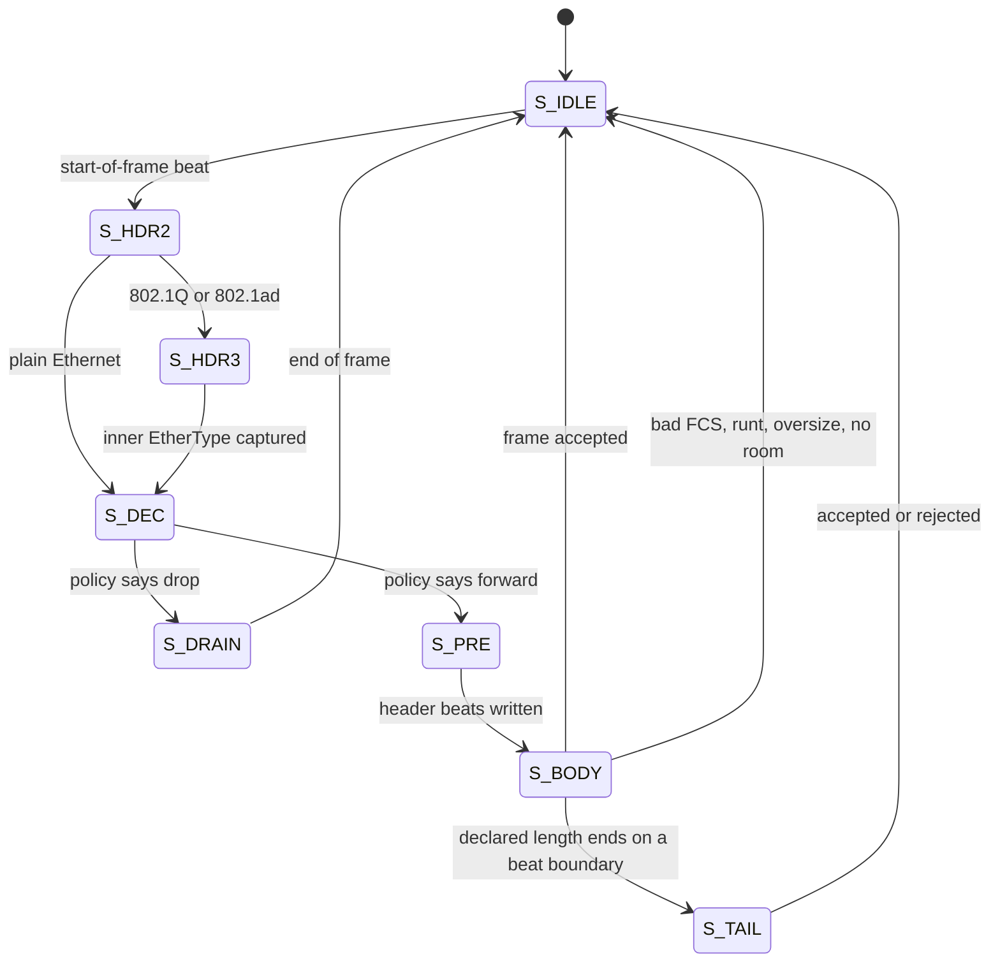

| State | What happens | Why it is a separate state |
|---|---|---|
| `S_IDLE` | wait for `sof`; capture beat 0 and the destination MAC; issue the CAM request | the request must be issued in the same clock the address is visible |
| `S_HDR2` | capture beat 1: source MAC and length/EtherType | the header does not fit in one beat |
| `S_HDR3` | capture beat 2: inner EtherType of a tagged frame | an 802.1Q tag pushes the real type four octets further |
| `S_DEC` | the CAM answer is registered; the forwarding verdict is frozen | the verdict must not depend on later beats |
| `S_PRE` | push the captured header beats into the payload FIFO | the beats were captured in registers, not left in the FIFO |
| `S_BODY` | stream payload beats | the common case |
| `S_TAIL` | the payload is complete; only an FCS beat is left | the last beat may carry no client data at all |
| `S_DRAIN` | discard the rest of a rejected frame | a frame must be consumed to its end even when dropped |

One detail that is easy to get wrong: in `S_DEC` and `S_PRE` the parser must
**not** pop the elastic FIFO. In `S_DEC` the head is the first payload beat,
which will be written to the payload FIFO in `S_BODY`; popping it there would
silently drop it. In `S_PRE` the header beats are already in registers and are
being pushed from there, so the FIFO head must stay put.

### 5.3 Stitching a 14-octet header out of 8-octet beats

The MAC header is 14 octets and a beat is 8, so the header never aligns. Octet 0
of a beat lives in `[63:56]`:

```
beat 0:  [63:56] dst[0]  [55:48] dst[1]  ...  [23:16] dst[5]  [15:8] src[0]  [7:0] src[1]
beat 1:  [63:56] src[2]  [55:48] src[3]  [47:40] src[4]  [39:32] src[5]  [31:16] l2type  [15:0] payload
```

| Field | Source | Slice |
|---|---|---|
| destination MAC | beat 0 | `w_data[63:16]` |
| source MAC octets 0-1 | beat 0 | `w_data[15:0]` |
| source MAC octets 2-5 | beat 1 | `w_data[63:32]` |
| length or EtherType | beat 1 | `w_data[31:16]` |
| inner EtherType (tagged) | beat 2 | `w_data[63:48]` |

A tagged frame adds a third beat:

```
beat 1:  ... l2type = 0x8100 | 0x88A8   tci[0..1]   payload[0..5]
beat 2:  inner_type[0..1]                payload[6..13]
```

Getting this split wrong shifts every header field by two octets and produces a
switch that looks like it works: addresses are plausible, the frame is
forwarded, and only a careful check of *which* port it left on reveals the
error. That is why the split is written out at the site in the code rather than
left to a reader.

### 5.4 How the frame length is resolved

There are two kinds of value in the length/EtherType field, and the parser has
to tell them apart:

| Field value | Meaning | How the frame size is known |
|---|---|---|
| `<= 1500` | 802.3 *length*: the MAC client data length | known from the header, and the parser holds the frame to it |
| `> 1500` | an EtherType: the payload type | **unknown** until the PHY de-asserts the enable; measured on the wire |

The boundary is exactly 1500, which is the largest legal 802.3 length. Values
1501..1535 are not valid EtherTypes either, but the parser treats everything
above 1500 as a type and measures the frame, which rejects such a frame by its
length rather than by its (meaningless) type.

For an EtherType frame the length is `octets received - 4` (the FCS). The
measured value is what goes into the descriptor and what the egress serialiser
is told to send.

Frames whose length field contradicts what actually arrived are rejected exactly
as a real bridge does: shorter than the minimum or shorter than declared is a
**runt**, longer than declared or longer than `MAX_FRAME_LEN` is **oversize**.
A frame that cannot fit in the payload buffer is also reported as oversize,
because it can never be a legal frame at this configuration.

### 5.5 The ingress policy

The policy is evaluated once, in `S_DEC`, and produces a destination bitmask
plus a `flood` flag. It is where a bridge's behaviour actually lives:

| Condition | Result |
|---|---|
| source MAC is this port's own address | dropped - a reflected frame |
| destination is this port's own address, arriving on this port | dropped - it is *for* this port, and flooding it would leak a unicast onto every other segment |
| destination is `ff:ff:ff:ff:ff:ff` | flooded to every port except the ingress |
| destination is a group (multicast) address | flooded only if the policy allows it |
| destination is a unicast address known to the CAM | sent to that one port, minus the ingress port; dropped if that port *is* the ingress port |
| destination is an unknown unicast | flooded or dropped, per policy |

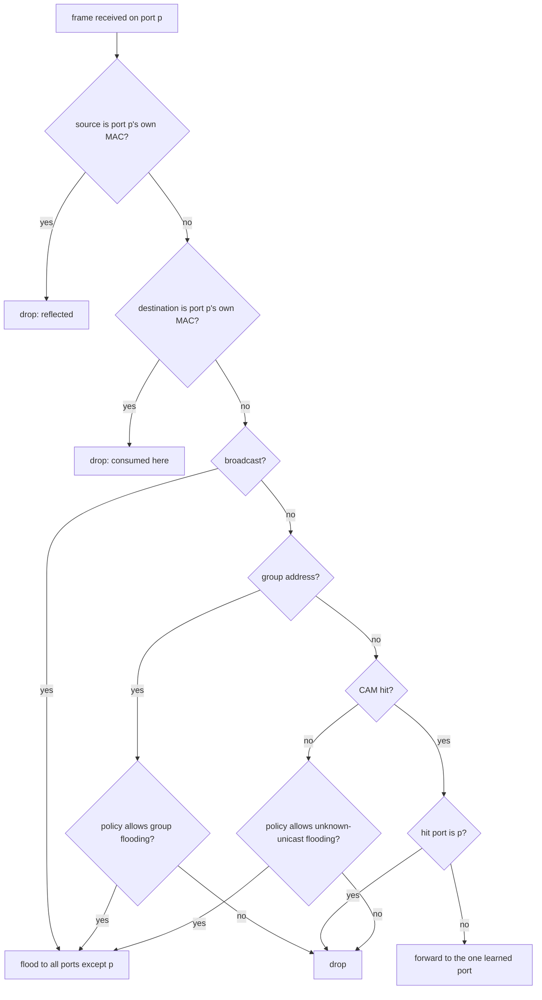

The policy is a module parameter **with a run-time override**, selected by
`cfg_ovr_i`. The elaboration-time default comes from `FLOOD_MODE` and
`LEARNING_EN`; when `cfg_ovr_i` is high the values on `flood_mode_i` and
`learning_en_i` are used instead. The same RTL therefore serves a hub
(`FLOOD_MODE = 2`, learning off) and a learning switch (`FLOOD_MODE = 1`,
learning on) with no rebuild.

> **Why the "destination is my own address" rule matters.** The port's own
> address can never be in the CAM, because the source rule prevents it from
> ever being learned. Without this test the address would miss the lookup, be
> treated as an unknown unicast, and be flooded out of every other port - a
> frame addressed to port 2 silently appearing on ports 0 and 1.

### 5.6 Buffering, and why a rejected frame costs one pointer move

The parser appends payload to the payload FIFO as it goes. That is what makes
store-and-forward cheap: the frame is already buffered by the time the verdict
is known, so nothing has to be copied again.

A frame that turns out to be bad is **rewound** out of the buffer with a single
write-pointer rollback, not read back:

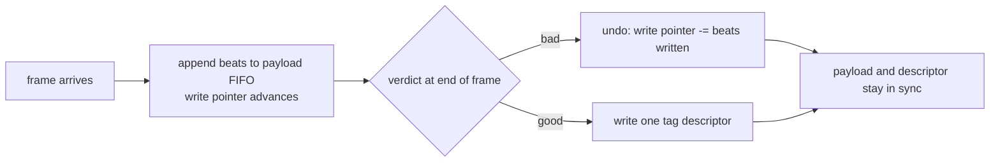

`es_mems_sync_fifo` provides this as the `undo_i` / `undo_cnt_i` port. Entries
already read by the consumer are never touched, so the rewind is safe while the
read side is running. The descriptor FIFO is written **only** for a frame that
passed, so payload and descriptor cannot lose frame synchronisation whatever
the receive conditions are.

A hard `flush_i` is also provided, but the receive port only accepts it while
the parser is not driving a payload write - a flush must never cut a frame in
half.

---

## 6. The forwarding database

### 6.1 Shape of the table

`es_switch_mac_table` is one **shared** CAM serving every port: `NUM_SETS`
buckets of `NUM_WAYS` entries. Neither has to be a power of two - the hash takes
a real modulo and the replacement pointer is bounded explicitly.

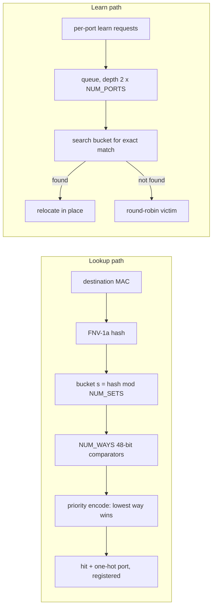

Default geometry is 128 buckets x 4 ways = **512 entries**. The entry is
`{valid, port, MAC}`:

| Field | Width | Notes |
|---|---|---|
| valid | 1 | cleared on flush and on ageing expiry |
| port | `sw_port_w(NUM_PORTS)` | 2 bits at four ports, 3 bits at eight |
| MAC | 48 | first transmitted octet in the most significant byte |

### 6.2 A lookup, clock by clock

Every port reads the bucket its own address hashes to, so all `NUM_PORTS`
lookups resolve in parallel and the receive path never arbitrates for a lookup.

| Clock | What happens |
|---|---|
| *t* | the receive port asserts `req_i` with the destination MAC; the hash and the bucket fetch are combinational |
| *t* | the `NUM_WAYS` comparators evaluate; the priority encoder picks the lowest matching way |
| *t+1* | `hit_o` and `port_o` are valid |

That is the whole reason there is no lookup latency to hide in the parser: one
clock of latency is absorbed by the header parse, which takes two or three
clocks anyway.

The search is deliberately split across two combinational blocks - one that
reads the table and produces per-way match bits, one that reduces them. A single
`always_comb` with a "found yet?" accumulator would read a variable it writes,
put that variable in its own implicit sensitivity list, and re-trigger forever;
simulation time would stop advancing and the run would hang. The synthesised
hardware is identical.

### 6.3 Learning without losing an entry

A CAM has one write port, but every port can finish a frame in the same clock.
Requests are therefore collected into an internal queue and drained one per
clock:

* the queue depth is `2 * NUM_PORTS`, not `NUM_PORTS`. A depth of exactly
  `NUM_PORTS` is on the edge: the queue fills completely and the next request
  is dropped. One spare slot per port absorbs a burst of simultaneous learns.
* the lowest-numbered requesting port wins inside a clock, which makes the
  behaviour deterministic.
* a learn request that cannot be queued is dropped and is visible in the learn
  counter's behaviour, rather than corrupting an entry.

Insertion first **searches the bucket for an exact match** and relocates the
station if it is there. A station that moves to another port therefore does not
leave a stale duplicate behind. Only a genuine insertion advances the
round-robin replacement pointer:

| Event | Table write | Replacement pointer | Occupancy |
|---|---|---|---|
| new station, empty way | write the way | advance | +1 |
| new station, all ways full | overwrite the victim | advance | unchanged |
| station moves to another port | rewrite the matching way | **unchanged** | unchanged |
| ageing expires an entry | clear the valid bit | unchanged | -1 |
| flush | clear everything | reset | 0 |

Occupancy is maintained by the same clock that writes the table, so it cannot
drift away from what the table actually holds. It moves in both directions, and
a flush clears it outright rather than applying a pre-flush delta that would
underflow.

### 6.4 Ageing

Ageing is **off by default** (`CAM_AGE_EN = 0`). When enabled, a slow divider
paces a pointer that walks the whole table, one entry per tick. Each entry
stores a *countdown* to expiry rather than an age counter:

* the countdown is reloaded with `CAM_AGE_LIMIT` on every learn or re-learn;
* it is decremented once per sweep of that entry;
* a countdown of zero means "expire now".

That formulation makes `CAM_AGE_LIMIT = 0` degenerate to "expire on the first
sweep after the last refresh" with no special case. The effective idle timeout
is:

```
timeout_clocks = CAM_AGE_CYCLES * NUM_SETS * NUM_WAYS * (CAM_AGE_LIMIT + 1)
```

With the defaults (1,000,000 x 128 x 4 x 5) that is 2.56e9 clocks, about
**20.5 seconds** at 125 MHz.

Refreshing is implicit: the source address is re-learned on every accepted
frame, which reloads the countdown. There is no separate "refresh" command.

### 6.5 Flush, occupancy, and what the table is not

* `cam_flush_i` invalidates every entry and clears the occupancy counter. The
  monitor reports the flush request directly rather than counting it, because it
  is a one-shot software action, not an event the table can observe.
* The table is a **register file**, not a memory. A memory with several
  distributed readers plus per-entry writers in a generate loop is more than
  Icarus will settle: the write enable and the data are both correct, the store
  simply never lands, and a learned entry silently never appears. Declaring the
  entries as registers keeps every reader an ordinary continuous assignment.
  An FPGA tool re-infers block RAM from the identical per-entry `always_ff`
  blocks when the table is large enough.
* It is a **learned-address cache**, not a list of attached devices. Entries
  expire only when ageing is enabled, and a station that has gone quiet stays
  in the table otherwise. The console reports it that way, and so should you.

---

## 7. The fabric

`es_switch_arbiter` is where the failures live, so it is worth being explicit
about what it guarantees.

### 7.1 The guarantees

| Guarantee | Mechanism | Failure it prevents |
|---|---|---|
| One frame in flight | a grant is only issued while `xfer_active` is low | two frames' beats interleaving in one egress FIFO |
| Whole-frame admission | every destination is checked for all beats **and** a free descriptor before the first beat moves | a frame stranded in a buffer with nothing to serialise it |
| One-to-many by construction | a grant produces a mask; one beat is written to every port in it | flooding as a special case that can be wrong |
| The first beat is flagged | `dst_fr_o` is asserted for beat 0 only | an egress queueing the wrong number of length descriptors |
| Head-of-line protection is opt-in | `STALL_LIMIT` bounds the wait, then drops | one congested egress stalling every other port forever |

### 7.2 Admission, in one inequality

Before a transfer starts, the arbiter evaluates, for every destination `j` in the
frame's mask:

```
slot[j]  AND  free_beats[j] >= ceil(frame_len / 8)
```

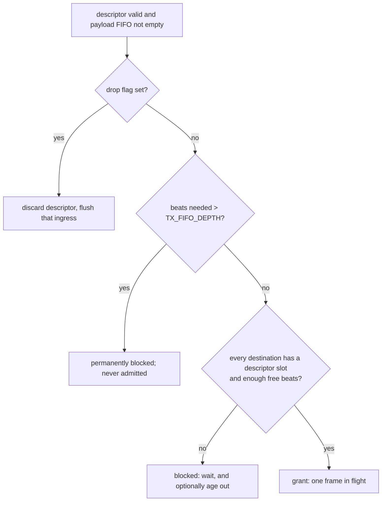

Both halves of the check are necessary, and checking only the first is the
classic bug:

* the beat FIFO holds `TX_FIFO_DEPTH / 8` minimum-length frames - 32 at the
  default 256 - while only `LEN_FIFO_DEPTH` (8) descriptors exist;
* a frame whose descriptor write is dropped can never be transmitted, because
  the serialiser starts a frame on a descriptor;
* it sits in the buffer forever, the port serialises the eight frames it does
  have descriptors for, then goes idle with dead payload behind it, and once the
  beat FIFO fills up *every* frame listing that port fails admission.

On a switch whose ports flood to one another, that is a single frame wedging the
whole fabric. That is why `es_switch_tx_port` reports two separate capacity
numbers - `free_o` (beats) and `slot_o` (one more whole frame) - and why the
arbiter consumes both.

Because the check is made once, up front, and only one frame is ever in flight,
a transfer can never stall mid-frame and can never drop beats. The serialiser
runs without a single stall.

### 7.3 Round-robin, and why the wrap is written out

A pointer remembers which port was served last; the scan starts there and wraps
once around the port list, so no port can be starved. `rr_order[slot]` is
`(rr_ptr + slot) mod NUM_PORTS`, built as one packed vector so that a port count
that is not a power of two still wraps correctly - integer arithmetic, not a
mask.

The pointer itself is updated with an explicit wrap:

```systemverilog
rr_next = (grant_idx == PW'(NUM_PORTS - 1)) ? '0 : (grant_idx + PW'(1));
```

A `PW`-bit counter only wraps to zero when `NUM_PORTS` is a power of two. With
three ports the truncation lands on port 3, which does not exist. The modulo in
`rr_order` still visits every real port, so the scheduler stays fair and the
defect never shows up - it would only resurface the moment the wrap was used for
anything else. Writing the wrap out removes the latent bug.

### 7.4 One-to-many by construction

A grant produces a destination **mask**, and one beat is written to every port
in that mask in the same clock:

```systemverilog
dst_wr_en_o = beat_dst;                       // the whole mask, one clock
for (j = 0; j < NUM_PORTS; j++)
    dst_wr_data_o[j*64 +: 64] = beat_word;    // the same beat to every port
```

Flooding is therefore not a special case that has to be kept correct; it is what
the fabric does. A broadcast is one pass through the fabric and N writes, not N
passes.

### 7.5 Head-of-line blocking

A blocked head frame prevents the port behind it from being served, which is
head-of-line blocking. `STALL_LIMIT` bounds it: after that many arbitration
cycles with no grant, the head frame is discarded and its ingress queue flushed.
The default is `0`, meaning stall forever and never drop.

The feature is disabled **explicitly** (`STALL_LIMIT != 0`), not by letting a
threshold underflow to a value the counter never reaches. A 16-bit counter
compared against `16'(0) - 16'd1` would be 0xFFFF, which is a property of the
counter rather than of the intent, and it breaks the moment the counter is
widened. The guard is a constant expression, so the disabled configuration
costs nothing in hardware.

### 7.6 How the transmit statistics avoid the obvious bug

`TX_FRAMES` counts **frame copies injected into a transmit port**, so its unit
is (frame, destination), not (frame, grant).

* Counting on the first beat of each copy is right. Counting on `grant_now`
  counts **grants**: it fires once per frame however many ports receive it, so a
  broadcast to three ports is one instead of three. Counting on every beat would
  count one frame many times.
* The first-beat flag is one bit *per destination*, so it is reduced with a
  population count. Collapsing it with `|` counts grants: a broadcast to three
  ports is three copies on the wire but one grant.

```systemverilog
tx_copy_b[gc]  = beat_write && beat_fr[gc];      // per destination
tx_copies      = count_copies(tx_copy_b);        // popcount
cnt_tx_frames <= cnt_tx_frames + tx_copies;
cnt_tx_octets <= cnt_tx_octets + len * tx_copies; // shift-add, not a multiplier
```

`count_copies` and `octets_x_copies` are **functions**, not accumulating
`always_comb` blocks. A block that writes an accumulator and then reads it back
puts that signal in its own sensitivity list and never settles; a function has
no sensitivity list at all. `octets_x_copies` is also written as a shift-add
rather than `len * copies`, because both operands would be 32-bit vectors and a
synthesis tool would build a full 32x32 multiplier for a value that only ever
reaches `NUM_PORTS`.

---

## 8. The transmit path

### 8.1 Descriptors and beats never drift

`es_switch_tx_port` buffers beats in one FIFO and per-frame lengths in a smaller
one:

* the length descriptor is written **once per frame**, qualified by `wr_fr_i`,
  while every beat of the frame has its own write pulse;
* a frame starts when a descriptor is available **and** the serialiser has
  finished the previous inter-frame gap;
* the descriptor is popped at the same moment the beats start, so the two
  streams cannot drift apart.

The fabric guarantees that the complete frame fits before it starts writing, so
the serialiser never stalls. `done_o` marks the end of the last FCS octet
window - "this MAC finished serialising the frame", not "the peer received it".

### 8.2 The frame sequencer

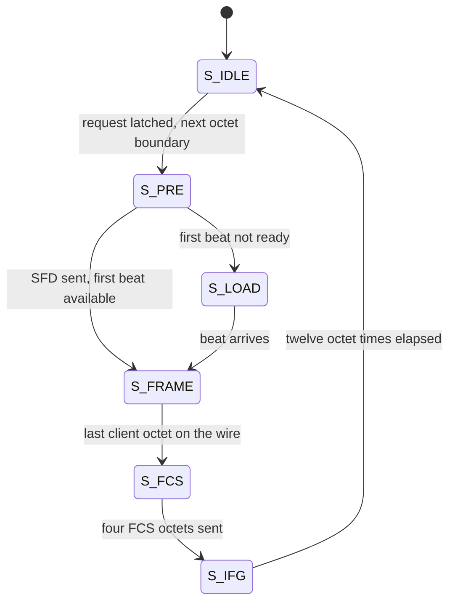

A request is **latched**, not acted on immediately. Starting at once would make
the first octet window shorter than `BYTE_PERIOD`, because a request can arrive
anywhere inside a window. A MAC that starts a frame on a partial octet time is
not GMII-legal, and it forces the receiver to guess where the octet boundaries
are. Waiting for the next octet boundary makes every window of the frame exactly
`BYTE_PERIOD` clocks long at every line rate.

`S_LOAD` is a safety net for a beat source that is not ready; the store-and-
forward fabric never needs it.

### 8.3 Preamble, padding, FCS, inter-frame gap

What actually goes on the wire, in order:

| Field | Length | Generated by |
|---|---|---|
| preamble | 7 octets of `0x55` | `es_switch_gmii_tx` |
| start-of-frame delimiter | 1 octet `0xD5` | `es_switch_gmii_tx` |
| destination MAC + source MAC + type/length | 14 octets, or 18 with an 802.1Q tag | payload, from the ingress buffer |
| MAC client data | the descriptor's `len` octets, zero-padded up to `SW_MIN_PAYLOAD` (46) | payload |
| FCS | 4 octets, least significant octet first | `es_switch_gmii_tx` |
| inter-frame gap | at least 12 octet times | `es_switch_gmii_tx` |

`len` is the MAC client data length the parser measured: the header included,
the FCS excluded. `MAX_FRAME_LEN` bounds it. The pad path only matters when
`es_switch_gmii_tx` is used stand-alone, because the parser never forwards a
frame shorter than `SW_MIN_FRAME_LEN`.

The padding is **covered by the FCS**, because it is generated before the CRC
absorbs the octets. A frame that is padded after the FCS would be rejected by
every receiver.

`oct_en_o` is driven combinationally from the state, so it is asserted for
exactly the windows in which `oct_d_o` holds data. Registering it would delay it
by one clock relative to the octet register and cost the first preamble octet.
The sequencer is written so that leaving a state never coincides with loading an
octet - in particular the last FCS octet is loaded one full octet time before
the inter-frame gap starts.

### 8.4 Why the FCS runs one octet ahead

The CRC generator absorbs exactly the octet being registered onto `oct_d_o` at
the same clock edge. Therefore, when the last client octet has left the MAC, the
LFSR already holds the final result, and the first FCS octet can be driven on
the very next octet time:

```
octet time    ...  n-1      n         n+1   n+2   n+3   n+4
wire          ...  data     data      FCS0  FCS1  FCS2  FCS3
CRC absorbs   ...  data     data      -     -     -     -      <- settled at n
```

No bubble, no extra pipeline register on the critical path. The enable is
qualified with the octet strobe (`crc_en = crc_en_n && tick`), which is essential
at every rate below 1000 Mbit/s: the combinational enable stays asserted for the
whole octet window - ten clocks at 100 Mbit/s, a hundred at 10 Mbit/s - and an
unqualified enable would absorb the same octet once per clock, giving every
frame a wrong FCS.

---

## 9. The life of one frame

This walks one unicast frame from port 0 to port 3 and names the guarantee that
is exercised at each step.

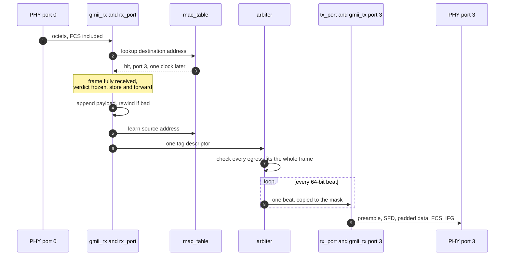

1. **Octets arrive.** `es_switch_gmii_rx` samples the stream on a free-running
   phase counter, checks the FCS as the octets stream by, and assembles 64-bit
   beats. The last beat is deliberately held until the next octet or the link
   idle, so the end-of-frame marker cannot be lost.
2. **The header is parsed.** The parser stitches the destination and source
   addresses out of the first one or two beats (three if tagged) and resolves
   the frame size - from the legacy length field when the header carries one,
   otherwise measured on the wire.
3. **The CAM is asked.** The lookup is issued while the payload is still
   streaming into the buffer, and the answer arrives one clock later.
4. **The verdict is frozen.** The frame is fully received *before* the
   forwarding decision is committed. A frame that fails the FCS, length or
   ingress-policy checks is rewound out of the payload FIFO with a single
   write-pointer rollback, and no descriptor is ever written for it.
5. **The source address is learned.** The validated source address is handed to
   the CAM's learn queue; if another port learned in the same clock, this
   request waits one cycle in the queue and neither is lost. An address already
   present is relocated, not duplicated.
6. **The fabric grants the whole frame.** The arbiter pops the descriptor,
   verifies that every egress port in the mask has payload room for all beats
   *and* a free length descriptor, and only then starts the transfer. One frame
   is in flight at a time; a new grant cannot race the last beat of the previous
   frame.
7. **Beats fan out.** Each payload beat is written to every port in the mask in
   the same clock. The first beat is flagged so the egress knows which
   descriptor the beats belong to.
8. **The frame is re-serialised.** `es_switch_tx_port` waits until a descriptor
   is available and the inter-frame gap has elapsed, pops the descriptor at the
   same moment the beats start, and `es_switch_gmii_tx` emits preamble, SFD, the
   padded client data and a freshly computed FCS.

A broadcast is the same walk with a multi-bit mask at step 6. The fabric counts
it as N copies - one per port that received it - on the first beat of each copy.

**Latency.** Store-and-forward means the frame must be fully received before it
can be forwarded, so the latency is at least the ingress serialisation time plus
the egress serialisation time plus the fabric and buffering overhead:

```
latency ~= (frame_octets / ingress_octet_rate)
         + (frame_octets / egress_octet_rate)
         + fabric and arbitration overhead
         + 12 octet times of inter-frame gap
```

For a 1518-octet frame between two 1 Gbit/s ports that is about 12.1 us in,
12.1 us out, and a few microseconds of buffering and arbitration - roughly
26 us, against about 2.5 us for a 64-octet frame. There is no cut-through mode
to fall back on; that is the price of "never forward a corrupt frame".

---

## 10. The frame descriptor

Every buffered frame is described by one **tag** word in a per-port descriptor
FIFO, travelling alongside the payload. The field offsets are defined once in
`es_switch_defs.sv` as `sw_tag_*_lsb()` helpers and read by both ends, so the two
cannot drift apart.

```
bit   TAGW-1                                       0
    +----------------+-------------+-------+------+-----+
    | dst_mask       | len         | src   |flood |drop |
    | NUM_PORTS bits | SW_LEN_W=11 | PW    | 1    | 1   |
    +----------------+-------------+-------+------+-----+
```

| Field | Width | Offset helper | Meaning |
|---|---|---|---|
| `dst_mask` | `NUM_PORTS` | `sw_tag_dstm_lsb` | the egress bitmask the ingress filter decided, already frozen |
| `src` | `sw_port_w(NUM_PORTS)` | `sw_tag_src_lsb` | ingress port index, for observability |
| `len` | `SW_LEN_W` (11) | `sw_tag_len_lsb` | MAC client data length, FCS excluded |
| `flood` | 1 | `sw_tag_flood_lsb` | set when `dst_mask` came from a flooding decision |
| `drop` | 1 | `sw_tag_drop_lsb` | defensive: the descriptor describes a frame the fabric should discard |

Total width:

| `NUM_PORTS` | `dst_mask` | `src` | `len` | `flood` | `drop` | `TAGW` |
|---|---|---|---|---|---|---|
| 2 | 2 | 1 | 11 | 1 | 1 | 16 |
| 3 | 3 | 2 | 11 | 1 | 1 | 18 |
| 4 | 4 | 2 | 11 | 1 | 1 | 19 |
| 8 | 8 | 3 | 11 | 1 | 1 | 24 |

`drop` is always zero in the current design. The ingress filter rejects a frame
*before* buffering it - that is what the rewind in `es_mems_sync_fifo` is for -
so a descriptor is only ever written for a frame that passed. The fabric retains
the ability to discard such a descriptor, and the field extraction is live, not
dead code left behind by accident: a design that buffered first and filtered
later would need it.

---

## 11. Statistics

A 14-counter read-only bus, summed across ports at the top level, 32 bits per
counter, selected by `sw_stat_id_e`. Counters are named for the *event* they
record, not for the block that happens to own them.

| ID | Counter | Counted where | Meaning and caveat |
|---|---|---|---|
| 0 | `RX_FRAMES` | rx_port | frames accepted by the ingress filter and forwarded into the fabric |
| 1 | `RX_OCTETS` | rx_port | MAC client octets of those frames, FCS excluded |
| 2 | `RX_FILTERED` | rx_port | frames dropped by the ingress policy |
| 3 | `RX_CRC_ERR` | rx_port | frames failing the FCS |
| 4 | `RX_RUNT` | rx_port | frames shorter than the minimum, or shorter than declared |
| 5 | `RX_OVERSIZE` | rx_port | frames longer than the configured maximum, or longer than declared |
| 6 | `RX_OVERFLOW` | rx_port | frames dropped because an ingress buffer was exhausted |
| 7 | `TX_FRAMES` | arbiter | frame **copies** injected into transmit ports, counted on the first beat of each copy |
| 8 | `TX_OCTETS` | arbiter | client octets injected, multiplied by the replication factor |
| 9 | `TX_STALLED` | arbiter | frames discarded by the head-of-line protection |
| 10 | `CAM_HIT` | mac_table | lookups that resolved to a port |
| 11 | `CAM_MISS` | mac_table | lookups that fell through to flooding |
| 12 | `CAM_LEARN` | mac_table | insertions written into the table |
| 13 | `CAM_FLUSH` | core | reported straight from the flush request line, not counted |

Things worth knowing before you quote these numbers:

* **`RX_OVERFLOW` is not `RX_OVERSIZE`.** An overflow points at a buffer that is
  too small for the traffic; an oversize frame points at a bad frame. Summing
  them hides which problem you have.
* **`TX_FRAMES` counts copies, not grants.** A broadcast to three ports is three
  copies, and counting grants would report it as one.
* **Two ports hitting in the same clock are both counted.** The tally is a
  population count of per-port qualifiers, not a sequencing loop.
* **`RX_OCTETS` excludes the FCS**, `TX_OCTETS` excludes preamble, FCS and IFG.
  The telemetry ABI has a separate, completion-based transmit counter that counts
  a different event (frames that finished serialising, not frames admitted), so
  the two are not directly comparable.
* **Error categories are not disjoint.** A frame can be both malformed and
  short; the parser applies a fixed priority and increments one category.

The full telemetry ABI - 64-bit per-port counters, rates, queue/load snapshots,
PHY metadata and a separate MAC-table reader - is documented in
[`docs/monitor.md`](docs/monitor.md) (Chinese: [`docs/monitor.zh-Hans.md`](docs/monitor.zh-Hans.md)).

---

## 12. Telemetry and console

### 12.1 The snapshot model

The monitor does not expose live counters directly. Every `REFRESH_INTERVAL_MS`
(default 500 ms) it:

1. captures the raw counters and extends every 32-bit counter into 64 bits, so
   wraps are preserved even across long windows;
2. computes rates serially through one shared multiplier/divider;
3. publishes the whole image **atomically** with a new sequence number.

A reader that wants a coherent view reads the sequence word, reads its fields,
reads the sequence again, and retries if it changed. The display scanner does
exactly that; the console copies the scanner's finished image, so a slow UART
cannot mix two windows either.

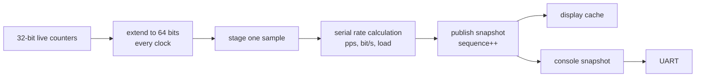

No request, display, UART or management handshake can stall forwarding. The
monitor is a read-only observer.

### 12.2 The CSR map, in one page

| Region | Address | Contents |
|---|---|---|
| system record | `0x0000_0000` | status, port count, reserved words, uptime, window, sequence, CAM state |
| per-port record `p` | `0x1000_0000 + p*256` | PHY status, queue occupancy and peaks, load, 14 counter pairs, four rate pairs |
| MAC entry `i` | `0x2000_0000 + i*16` | MAC[31:0], MAC[47:32], port, valid |
| live timestamp | `0x0000_00f0` / `f4` / `f8` | live clock low/high and flush generation |

* Values are little-word-first: a 64-bit field occupies two consecutive 32-bit
  words, low word first.
* Assert `mon_req_i` with a byte address and accept it when `mon_ready_o` is
  high; data is meaningful only while `mon_valid_o` is high.
* Ordinary reads respond in one clock. MAC reads can take additional clocks;
  requests must respect ready.
* Unmapped or misaligned reads return zero.

The per-port PHY status byte is the same on `phy_status_i` and in the snapshot:

| Bit | Meaning |
|---|---|
| 0 | PHY status valid |
| 1 | link up |
| 2 | full duplex |
| 4:3 | speed: 0 = 10M, 1 = 100M, 2 = 1000M, 3 = reserved |
| 5 | management error |
| 7:6 | reserved, zero |

A port whose status is not valid has no known link capacity, so its load reads
zero; the validity and link bits are what distinguish "idle" from "unknown".

The important semantic details:

* **TX completion, not admission.** The telemetry transmit counters advance when
  the MAC finishes the last FCS octet, so queued copies are not reported as
  transmitted. An administratively disabled egress completion is excluded.
* **The telemetry octet count comes from the completion's client-data length**
  (`done_len_o`), so preamble, FCS and IFG are excluded. `stat_o`'s `TX_OCTETS`
  counts injection instead of completion; the two answer different questions.
* **Load is per mille of the link capacity**, separately for RX and TX, and is
  zero when the PHY reports unknown or down. Read the validity and link bits
  before interpreting a zero.
* **Queue occupancy is in 64-bit beats**, not packets, and does not include the
  beat currently being serialised or descriptor slots.
* **The MAC list is a live view, not an atomic dump.** Entries can move or
  expire during a traversal; the console prints start/end clocks and flush
  generations so an interrupted scan is visible.

### 12.3 The console

The board shell and `es_console_core` accept compile-time parameters:

| Parameter | Default | Allowed |
|---|---|---|
| `UART_BAUD_RATE` | 115200 | any rate whose rounded integer period is at least 4 clocks and within 2% |
| `UART_DATA_BITS` | 8 | 5..8 for the UART; 7 or 8 for the ASCII console |
| `UART_PARITY` | none | none, odd, even |
| `UART_STOP_BITS` | 1 | 1 or 2 |
| `UART_FLOW_CONTROL` | none | none or RTS/CTS (active low) |

Commands are lowercase ASCII terminated with CR, LF or CRLF:

```text
help
status
port 0
mac all
mac 0
```

* `status` reports the aggregate and every port.
* Port numbers are zero-based decimal.
* Values are named hexadecimal integers with `0x` prefixes; `_pps`,
  `_bit_per_second`, `_permille` and `_octets` carry the units.
* One command is processed at a time. A line longer than 32 bytes is drained to
  its terminator and rejected; input while busy is discarded with a diagnostic.
* Parity, framing and overflow errors are counted separately from command
  errors, so a bad cable is distinguishable from a bad command.

`cts` is checked between characters, never inside one, and `rts` is deasserted
while a command is being processed. A host without flow control should wait for
the complete response before sending the next command.

---

## 13. Parameters and configuration recipes

### 13.1 The parameter table

| Parameter | Default | Meaning and constraint |
|---|---|---|
| `NUM_PORTS` | 4 | number of ports; any value >= 1, not necessarily a power of two |
| `CLK_FREQ_HZ` | 125 000 000 | core clock; sets every port's octet period |
| `PORT_MAC` | `'0` | 48 bits per port, port *p* at `[48*p +: 48]`; an all-zero port gets `02:00:00:00:00:<p>` |
| `PORT_SPEED` | all 1000BASE-T | 2 bits per port, port *p* at `[2*p +: 2]`: 0 = 10, 1 = 100, 2 = 1000 Mbit/s, 3 = down |
| `MAX_FRAME_LEN` | 1518 | largest frame accepted, FCS excluded |
| `RX_FIFO_DEPTH` | 256 | payload beats per ingress port; must be >= `ceil(MAX_FRAME_LEN/8)`, i.e. 190 at the default |
| `TX_FIFO_DEPTH` | 256 | payload beats per egress port; same rule, 190 at the default |
| `TAG_FIFO_DEPTH` | 16 | descriptors buffered per ingress port |
| `WF_DEPTH` | 16 | elastic beat FIFO between the octet adapter and the parser |
| `FLOOD_MODE` | 1 | 0 = block unknown unicast, 1 = flood it, 2 = flood unknown group too |
| `LEARNING_EN` | 1 | source-address learning default |
| `STALL_LIMIT` | 0 | cycles a head-of-line frame may wait before being dropped; 0 never drops |
| `CAM_SETS` `CAM_WAYS` | 128, 4 | forwarding table geometry; 512 entries |
| `CAM_AGE_EN` | 0 | ageing off by default |
| `CAM_AGE_CYCLES` | 1 000 000 | clocks between two ageing steps |
| `CAM_AGE_LIMIT` | 4 | ageing countdown reload value |
| `REFRESH_INTERVAL_MS` | 500 | telemetry sampling interval, must be positive; all three wrappers forward it |

`LEN_FIFO_DEPTH` (default 8) is a parameter of `es_switch_tx_port`, not of the
top-level core. It is the number of frames that can be queued in an egress
port's descriptor FIFO, and it is the resource the fabric's `slot_o` check
protects. If you instantiate `es_switch_tx_port` directly, size it deliberately.

> **Frame-size units.** `MAX_FRAME_LEN` and `SW_MIN_FRAME_LEN` are compared
> against the measured MAC client data length, FCS excluded. With the shipped
> constants the accepted window is 64..1518 octets of client data, i.e. 68..1522
> octets on the wire. A standard 64-octet Ethernet frame carries 60 octets of
> client data, so it falls below `SW_MIN_FRAME_LEN` and is classified as a runt;
> if your traffic includes minimum-size frames, revisit that constant and the
> testbench that pins it, deliberately and together.

### 13.2 Why the per-port parameters are flat vectors

`PORT_MAC` and `PORT_SPEED` are packed vectors, not unpacked array parameters,
because unpacked array parameters are not universally supported - Icarus among
others does not implement them - and the cost of the packed form is zero. A
mis-sized buffer is reported at elaboration time, in simulation, where a
mis-parameterised instance is actually built; the synthesised netlist never sees
the check.

### 13.3 Recipes

**A plain learning switch (the default).** Four ports, all gigabit, flooding on,
learning on, ageing off:

```systemverilog
es_switch_gmii #(
    .NUM_PORTS  (4),
    .PORT_SPEED ({4{2'd2}})
) u_switch ( ... );
```

**A hub.** Flood everything, learn nothing:

```systemverilog
es_switch_gmii #(
    .FLOOD_MODE  (2'd2),
    .LEARNING_EN (1'b0)
) u_switch ( ... );
```

**Two 100 Mbit/s ports on a 50 MHz board** - the DE2-115 configuration:

```systemverilog
es_switch_mii #(
    .NUM_PORTS   (2),
    .CLK_FREQ_HZ (50_000_000),
    .PORT_SPEED  ({2'b01, 2'b01})
) u_switch ( ... );
```

`BYTE_PERIOD` is then 4 clocks per octet, and the MII adapter splits each octet
into two nibble windows of 2 clocks.

**Eight ports at 100 Mbit/s** - the Vivado template. Note that eight ports at
gigabit on a 125 MHz clock would saturate the beat bus exactly (see §4.4); the
shipped template is MII at 100 Mbit/s.

**A bigger frame.** If you raise `MAX_FRAME_LEN`, raise the FIFO depths with it:
`RX_FIFO_DEPTH` and `TX_FIFO_DEPTH` must be at least `ceil(MAX_FRAME_LEN/8)`,
and `SW_LEN_W` (11 bits) caps the field at 2047 octets. The elaboration check
warns if the buffers are too small, but it cannot resize them for you.

---

## 14. PHY interfaces

### 14.1 The contract all three share

Every port presents the same canonical, clock-enable-qualified octet stream,
synchronous to `clk_i`:

* one octet is transferred every `BYTE_PERIOD` clocks;
* the enable is asserted for the whole octet time and the data is stable for the
  same window;
* the enable is de-asserted for at least one clock during the inter-frame gap.

The preamble and the start-of-frame delimiter are removed by the PHY on receive
and re-inserted on transmit, exactly as a real MAC does. The stream therefore
starts with the first octet of the destination MAC and ends with the four FCS
octets.

> **What the wrappers do not contain.** There is no `RX_CLK`, `TX_CLK` or
> `REF_CLK` pin, and no PLL. The adapters are *synchronous models*: they expect
> a stream that is already in the `clk_i` domain. Capturing a real PHY's own
> clock is the job of a board shell, and a shell that cannot meet the
> single-clock contract needs asynchronous FIFOs around the core - nothing
> inside the switch changes.

### 14.2 MII and RMII adapters

| Property | MII | RMII |
|---|---|---|
| Symbol width | 4 bits (nibble) | 2 bits (dibit) |
| Symbols per octet | 2 | 4 |
| `BYTE_PERIOD` | must be even and >= 2 | must be a multiple of 4 and >= 4 |
| Receive framing | `RX_DV` high for whole octet times | `CRS_DV` high for whole octet times |
| Line rates | 10 / 100 Mbit/s | 10 / 100 Mbit/s |
| 1000 Mbit/s | rejected at elaboration | rejected at elaboration |

The receive side of the MII adapter **parks** its window counter while the link
is idle, so every frame's windows are counted from that frame's own `DV` rise -
no front-end or testbench has to land a frame on any particular grid. The
assembled octet is presented for one full octet time, one octet behind the wire,
and a presentation down-counter keeps the *last* octet stable for a full
`BYTE_PERIOD` after the link went idle, which is what `es_switch_gmii_rx`
samples on.

`RX_ER` while the link is enabled sets a sticky flag that suppresses the enable
from that octet onwards, so an errored frame is truncated at the adapter instead
of entering the fabric. It is then rejected downstream as a runt or a CRC error,
never forwarded.

---

## 15. Board shells

### 15.1 DE2-115: a real two-port switch

`board/de2_115/quartus_ii/` is a complete Quartus II project for the Terasic
DE2-115 (Cyclone IV E, `EP4CE115F29C7`):

| Item | Value |
|---|---|
| Ports | 2, MII, 100 Mbit/s full duplex |
| Core clock | 50 MHz directly from `CLOCK_50`, **no PLL** |
| Octet period | 4 core clocks at 100 Mbit/s |
| PHY | two Marvell 88E1111, MDIO addresses 16 and 17 |
| Reset | `KEY0`, sampled through two registers; hold it through startup |
| Board settings | JP1 must select **MII**; JP7 stays at the default 2.5 V |
| Console | 115200 8N1, no flow control by default |

**Build and program.** Install Quartus II 13.0sp1/13.1 Web Edition with Cyclone IV
E device support, then:

```bat
build.bat
build.bat C:\altera\13.1\quartus
```

The GUI can open `ethernet_switch.qpf`; the product is
`output_files/ethernet_switch.sof`. The QSF holds the sources, pin assignments
and I/O standards, the SDC the clock and board constraints. Some boards use the
C8 speed grade - change `DEVICE` in the QSF to match the part actually fitted.
The link peer must autonegotiate 100 Mbit/s full duplex.

What the shell adds around the core:

* **PHY management.** After reset it waits 20 ms, probes each MDIO address,
  advertises only 100 Mbit/s full duplex, restarts autonegotiation, then polls
  every 100 ms. `BMSR` is read twice to handle latch-low bits, followed by
  register 17 to confirm speed, duplex and resolution. Transmit and receive are
  enabled only after 100 Mbit/s full duplex is confirmed; an unknown, silent or
  incompatible PHY is not reported as healthy.
* **Displays.** `HEX7..4` show RX pps and `HEX3..0` show TX pps; above 10000 the
  value is divided by 1000 and `LEDG4/5` indicate the unit. The LCD shows RX on
  the top line and TX on the bottom, six decimal digits plus a `k` suffix, and
  dashes when there is no valid sample.
* **LEDs.** Green: heartbeat, sample/PHY ready, per-port enable, kpps units,
  page indicator. Red: per-port activity (100 ms hold), port error, PHY
  management error, console error, queue peak at 224/256 beats, and four load
  bars in 10% steps.
* **Buttons.** `KEY0` holds reset, `KEY1` flushes the MAC table, `KEY2`/`KEY3`
  move between the aggregate and per-port pages and wrap. Function keys are
  debounced for 20 ms; pressing both page keys does not change page.

> **Board-level honesty.** The RX path samples the PHY's asynchronous data
> directly, with no asynchronous FIFO, so this shell does **not** claim a closed
> RX clock-domain crossing. The TX clock is generated by a negative-edge divider,
> and the SDC budget (5 ns setup, 5 ns skew) is below the IEEE generic 15 ns
> requirement. The last Quartus run could not complete on the development
> machine because of a Remote Desktop licence restriction
> (`Error (292032)`), so fitting, resource usage, timing and on-board operation
> are **not** verified for the current revision. Treat the board project as a
> working design that still needs a licensed compile and a hardware bring-up.

### 15.2 Vivado: the eight-port template

`board/vivado/` is an eight-port MII template at 50 MHz / 100 Mbit/s. Its top,
`es_switch_vivado_top`, is pure RTL and part of the same gates: `make lint`,
`make rtl`, `make synth` and `make vivado` all elaborate it, and `make unit`
runs its regression. That regression floods from every ingress to seven
egresses, then exchanges a ring of directed frames including port 7 to port 0,
drives reset between clock edges to expose a missing synchroniser, and checks
that MDIO is not driven when idle.

The **physical PHY adaptation is unfinished**: the reserved PHY clocks are not
phase-locked to the core, and the XDC pin locations and timing are placeholders.
The regression proves the synchronous MII frame contract; it is not a CDC, PHY
initialisation or physical MII timing test.

---

## 16. Building and testing

### 16.1 What each gate is for

| Gate | Tool | What it catches that the others do not | Typical failure signature |
|---|---|---|---|
| `ci/check-toolchain.sh` | shell | a tool that has crossed a major version since the gates were written | names the tool and the expected version |
| `make lint` | Verilator `--lint-only -Wall` | width mismatches, unused signals, latches, incomplete case coverage, implicit sensitivity | a warning; **any warning fails the build** |
| `make rtl` | Icarus `-g2012`, RTL only | anything that only elaborates because a testbench declares a missing signal | undeclared identifier, port mismatch |
| `make unit` | Icarus + `vvp` | block-level behaviour, fabric behaviour | `FAIL` with expected/observed values |
| `make mii` / `rmii` | Icarus + `vvp` | the adapted pins driving the real datapath | a frame missing or corrupt at the PHY model |
| `make vivado` | Icarus + `vvp` | the eight-port board shell, reset behaviour, MDIO tri-state | a port that never forwards, or MDIO driven when idle |
| `make sim` | Icarus + `vvp` | system behaviour at four mixed line rates | a frame on the wrong port, a lost frame, a bad FCS |
| `make param` | Icarus + `vvp` | a port count that is not a power of two, a different core clock | corrupt frames from a wrong `BYTE_PERIOD` |
| `make synth` | yosys `read_verilog -sv` | everything the simulators accept and silicon will not | a parse error on the first declaration |
| CI job `gds` | LibreLane 3.0.14, sky130A | timing, hold, DRC, LVS | a flow step failure, behind manual approval |

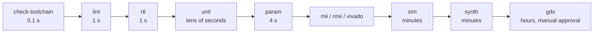

The gates are ordered by how fast they fail. Run them in that order; a lint
error is cheaper to fix than a simulation that hangs.

`sim/` carries an alternative runner set for a second opinion: `sim/run_lint.sh`
lints the RTL and the testbench with Verilator, `sim/run_verilator.sh <top>`
builds and runs one bench with Verilator `--binary --timing`,
`sim/run_questa.sh <top>` does the same with Questa/ModelSim, and
`sim/run_all.sh` runs the suite through either. Re-running a difficult failure
on a second simulator is the fastest way to separate a design bug from a
simulator quirk. The Makefile and CI remain the canonical gates - note that
`run_verilator.sh` passes `-Wno-fatal`, so warnings there are reported but do
not fail the run; `make lint` is the gate that does.

### 16.2 The testbench inventory

| Target | Bench | What it proves |
|---|---|---|
| `make unit` | `sw_crc32_tb` | the CRC residue, seed and bit order against known vectors |
| | `sw_sync_fifo_tb` | FWFT behaviour, full/empty, rewind, flush |
| | `sw_mac_table_tb` | lookup, relocation, replacement, ageing, flush, occupancy |
| | `sw_mii_tb` | nibble assembly and serialisation against the contract |
| | `sw_rmii_tb` | dibit assembly and serialisation against the contract |
| | `sw_flood_tb` | multi-frame flooding with a small CAM; run at line rate and with one 10 Mbit/s port |
| | `sw_uart_tb` | framing, parity, stop bits, RTS/CTS |
| | `sw_phy_monitor_tb` | 88E1111 register sequence against a wire-level model |
| | `sw_monitor_tb` | sampling arithmetic, 32-to-64-bit wrap, MAC word coherence |
| | `sw_monitor_interval_tb` | non-integral sampling windows |
| | `sw_monitor_ui_tb` | page wrap for 1/2/3/5 ports, HEX and LCD formatting |
| | `sw_console_tb` | the real UART console, command dispatch, error diagnostics |
| | `sw_tx_completion_tb` | transmit completion, padding, disabled-egress exclusion |
| | `sw_shared_tb` | the shared primitives (CRC, ratio, BCD, page) |
| | `check_monitor_params.sh` | rejected parameter combinations |
| `make mii` | `tb_sw_switch_mii` | two 100 Mbit/s MII ports: flood, then known unicast both ways, no reflection |
| `make rmii` | `tb_sw_switch_rmii` | two RMII ports at 100 and 10 Mbit/s from one 50 MHz clock |
| `make vivado` | `tb_sw_vivado_top` | eight ports, flood to seven, ring of directed frames, reset recovery |
| `make sim` | `tb_sw_switch` | 15 tests, 158 checks, four ports at 10/100/1000/1000 Mbit/s |
| `make param` | `sw_switch_param_tb` | the same RTL at 3 ports, 50 MHz, 10/100/100 Mbit/s |

`tb_sw_switch` is the main regression, and its test list is worth reading before
you change behaviour:

| # | Test | What it exercises |
|---|---|---|
| 1 | reset and idle | no frame is emitted before reset is released |
| 2 | unicast after learning | lookup, forwarding, no flooding |
| 3 | broadcast flooding | the all-ones mask, minus the ingress |
| 4 | unknown-unicast flooding | the miss path |
| 5 | unknown-unicast filtering | `FLOOD_MODE = 0` |
| 6 | group address handling | the I/G bit and the group policy |
| 7 | station moves port | relocation, no duplicate entry |
| 8 | self-reflected frame | the source-address filter |
| 9 | 802.1Q tagged forwarding | the three-beat header |
| 10 | runt / oversize / bad FCS / truncated | rejection and rewind |
| 11 | minimum and maximum frame sizes | padding, FCS coverage, buffer bounds |
| 12 | simultaneous back-to-back traffic | the fabric under queueing |
| 13 | statistics counters | the event mapping |
| 14 | CAM flush | invalidation and recovery |
| 15 | learning disabled at run time | the `cfg_ovr_i` path |

Each frame observed on an egress port is compared with the frame that was
injected - destination, source, length, preamble and FCS - against a reference
model the testbench maintains itself. The PHY model re-assembles the octet
stream independently, so a design and testbench that share a wrong assumption
still fail.

### 16.3 How to debug a failure

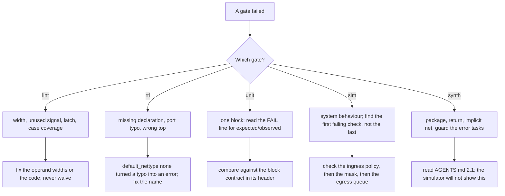

Practical hints:

* **A simulation that hangs with time standing still** is almost always an
  `always_comb` that reads a variable it writes, or a memory read inside
  `always_comb`. Move the accumulator into a function, or stage the read into a
  flat vector with continuous assignments.
* **A learned entry that never appears** is usually a loop-indexed store into an
  unpacked array. Use per-entry `always_ff` blocks in a generate loop.
* **A stale read** is an unpacked array indexed with a run-time value. Use a
  packed vector.
* **Lint passes locally but fails in CI** is the Verilator version difference.
  Fix the widths; do not add a waiver.
* **A frame that repeats forever** is a descriptor that was re-read because the
  tag FIFO was not popped in the clock the fabric registered it.
* **An egress port that wedges after a few frames** is a missing `slot_o` check:
  the beat FIFO had room, the descriptor FIFO did not.

### 16.4 Definition of done

Before you call a change finished:

- [ ] `ci/check-toolchain.sh`, `make lint`, `make rtl`, `make unit`, `make sim`,
      `make param` all pass.
- [ ] `make synth` elaborates and synthesises all five tops.
- [ ] A behavioural change has a test that fails without it.
- [ ] No new `verilator lint_off`, and no new `initial` block.
- [ ] New shared constants are in the appropriate `es_*_defs.sv` library.
- [ ] New module parameters are `localparam`-derived and documented in the port list.
- [ ] A change to `librelane/config.json` is recorded in `librelane/README.md`.
- [ ] The file header still describes what the module is for.

### 16.5 The CI pipeline

CI runs on a **self-hosted** runner, and the split of responsibility is worth
knowing before you change anything there: the host provides Docker and nothing
else, and the EDA toolchain comes from a container image this repository builds.

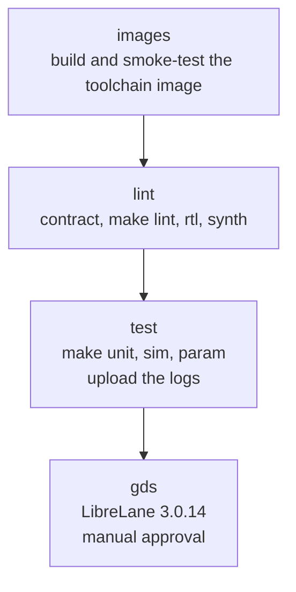

| Job | What it does |
|---|---|
| `images` | builds `ci/toolchain/Dockerfile` into the runner's local Docker store and smoke-tests it for the six required tools |
| `lint` | runs `ci/check-toolchain.sh` with `ASSERT_OS=1`, then `make lint`, `make rtl` and `make synth` inside that image |
| `test` | runs `make unit`, `make sim` and `make param`; uploads the simulation logs as an artifact, **even when the job fails** |
| `gds` | runs the LibreLane flow behind a manual approval, and uploads the GDSII and the full run directory |

Why the pin is the Dockerfile rather than a registry tag: a distribution build
carries security updates, and a third-party APT repository in the supply path of
the job that gates every commit is not worth a newer linter. `EXPECTED_OS` plus
`ASSERT_OS=1` makes the pin real - a toolchain image whose base distribution
moved fails the job **by name**, rather than quietly changing what `make lint`
reports.

The image has to be glibc-based (Debian or Ubuntu), not Alpine: a container job
runs its JavaScript action steps with a Node binary bind-mounted from the
runner, and that binary does not start against musl. It also needs `git`, `bash`,
`make` and the three EDA tools on `PATH`; the smoke test in `images` names the
missing tool, which is a much clearer failure than a broken-looking runner.

The `test` job runs `make unit` (which itself depends on the eight-port board
regression), `make sim` and `make param`. The MII and RMII system smoke
regressions are part of `make all` and are expected to be run locally, so run
them before you push a front-end change.

---

## 17. Physical implementation

`librelane/` holds the flow configuration and timing constraints and runs under
a pinned LibreLane container against the open-source `sky130A` PDK.

```sh
mkdir -p .cache/librelane
docker run --rm \
  --user "$(id -u):$(id -g)" \
  -e HOME=/work/.cache/librelane \
  -v "$PWD:/work" -w /work \
  ghcr.io/librelane/librelane:3.0.14 \
  librelane --pdk sky130A -s sky130_fd_sc_hd librelane/config.json
```

**Pin the tag.** The image is a Nix closure, so the toolchain is exactly the one
the flow was released with. The RTL is elaborated against the yosys inside that
image, so a floating `latest` makes a GDSII irreproducible: two runs of the same
commit can disagree because the frontend changed underneath them.

### 17.1 What the flow actually builds

The physical run elaborates a **reduced** instance of the core, deliberately.
The full-size parameters need a commercial-grade flow and a memory compiler to
be practical; the reduced instance is what proves the design reads, elaborates,
synthesises and routes end to end on the open-source PDK.

| | module defaults (what the regression exercises) | `SYNTH_PARAMETERS` (this run) |
|---|---|---|
| `MAX_FRAME_LEN` | 1518 | 256 |
| `RX_FIFO_DEPTH` / `TX_FIFO_DEPTH` | 256 beats | 64 beats |
| `TAG_FIFO_DEPTH` | 16 | 8 |
| `WF_DEPTH` | 16 | 8 |
| `CAM_SETS` x `CAM_WAYS` | 128 x 4 | 16 x 2 |
| synthesised cells | 663 923 | 132 678 |
| flip-flops | 168 593 | 42 748 |
| cell area (sky130) | 3.59 mm² | 1.911 mm² |

Those figures were measured with LibreLane 2.4.2. A 3.0 run ships a different
yosys, OpenROAD and ABC, so re-measure rather than re-derive them.

The reduced instance stays self-consistent: `sw_beats_of(256)` is 32 beats and
the buffers are 64, so the design's own elaboration checks stay quiet and the
core still accepts every frame up to 256 octets.

> **What this run is not.** It is not a claim that the full configuration has
> been placed and routed. It proves the design completes the whole flow on the
> open-source PDK at a size the flow can finish. The full-size figures are what
> a full-size implementation would start from; they need a commercial flow, a
> much longer run and a memory compiler.

### 17.2 Two configuration details that bite

* **`CLOCK_PERIOD = 10` (100 MHz).** The RTL default is 8 ns and the design does
  not close at 8 ns on the free open-source PDK: the forwarding table is a
  128x4 set-associative CAM with a single-clock read port, and the ingress
  buffer chains a FIFO read, a parser state machine and a 64-bit write. 10 ns is
  a defensible target and keeps CI meaningful. A period that is too small shows
  up as a routing failure, never as a wrong GDSII.
* **`RT_MIN_LAYER` / `RT_MAX_LAYER` are `met1` / `met5`.** These are *tech LEF*
  layer names. Getting them wrong leaves the RC layer list empty several steps
  later, and OpenROAD fails with `[RSZ-0015] layer NULL not found` - a message
  that points nowhere near `config.json`.

`constraints/io.sdc` is read by OpenSTA, which implements a subset of SDC. Three
constructs that are unremarkable in PrimeTime abort OpenSTA while reading the
file: `remove_from_collection`, `set_driving_cell` naming a cell that is not in
the library, and the one-argument `set_max_transition` shorthand. The file
therefore names its ports explicitly, names a `sky130_fd_sc_hd__buf_1` driving
cell, and spells out the transition-limit object list.

The CI `gds` job runs the same container behind a **manual approval**, because
it is the only job that produces an artefact someone might act on. See
[`librelane/README.md`](librelane/README.md) for the 2.4-to-3.0 migration table
and the full measurement history.

---

## 18. Working on the design

### 18.1 The rules that are not style

[`AGENTS.md`](AGENTS.md) is the style and portability contract. Four tools read
this code - Verilator, Icarus, yosys and Quartus - and the strictest of them is
not the simulator. The rules below exist because the alternative has already
broken this design in a way a testbench could not see.

One convention is worth learning before reading any module, because it is used
without exception:

| Form | Meaning | Example |
|---|---|---|
| `clk_i`, `rst_ni` | the clock, and the active-low synchronous reset | |
| `<name>_i` / `<name>_o` | port direction | `beat_valid_i`, `gmii_d_o` |
| `<name>_q` | a registered value | `len_q`, `cam_hit_q` |
| `<name>_d`, `<name>_n` | the combinational *next value* | `count_d`, `crc_en_n` |
| `S_XXX` | an FSM state in a `typedef enum` | `S_PRE`, `S_TAIL` |
| `es_<domain>_*` / `sw_*` | a design module / a shared declaration | `es_mems_sync_fifo`, `sw_is_unicast` |
| `cnt_*`, `stat_o` | a statistic | `cnt_tx_octets` |
| `unused_*` | a deliberate dummy consumer for a signal nothing reads | `unused_crc_ok` |

### 18.2 The three hard yosys restrictions

These are parse errors, and all three are invisible to Icarus and Verilator, so
a change that violates one passes every local test and then fails in the flow.

**1. No `package`, and no `import` in any form.**

```systemverilog
// rejected: a package item is not a constant range for the frontend
package sw_pkg;
  localparam int unsigned W = 8;
endpackage

// accepted: compilation-unit scope in es_defs.sv
localparam int unsigned SW_W = 8;
```

A width taken from a package is rejected in a port declaration before the body
is parsed. Neither `module X import pkg::*; (...)` nor `import pkg::*;` in a
body is accepted.

**2. No `return` in any function.**

```systemverilog
// rejected
function automatic int f(input int a);
  return a + 1;
endfunction

// accepted: assign to the function name
function automatic int f(input int a);
  f = a + 1;
endfunction
```

**3. `-sv` is mandatory on `read_verilog`.** The `.sv` extension does not imply
it, and without it the parse dies on the first declaration with a message that
looks like a package problem and is not one. `make synth` passes it, and
LibreLane passes it itself.

### 18.3 Width discipline

**Every operand of an arithmetic or bitwise operator must have the same width,
and that width must be the one you mean.**

```systemverilog
// wrong: the literal makes this a 32-bit operation; a is zero-extended
count <= count + 1;

// right: a sized constant of the counter's own width
count <= count + W'(1);
```

Consequences of getting it wrong:

* on an older Verilator it is a `WIDTHEXPAND` warning that fails the build;
* on a newer one it is silent, so you cannot rely on the linter to tell you;
* the synthesised adder is wider than it needs to be, and the result is
  truncated at a width nobody chose.

Other width rules:

* `W'(x)` is a conversion, not a linter silencer. Decide the correct width and
  make the expression produce it.
* Where a value must wrap, write the wrap out (`cond ? '0 : cur + W'(1)`) - a
  counter that wraps by overflow is only correct when the count is a power of
  two.
* Where a feature is disabled by a parameter, disable it explicitly
  (`if (PARAM != 0) ...`), never by letting a threshold underflow.
* Do not use `*` between two 32-bit vectors to express "count x count". Write
  the shift-add, or narrow the operand, as `octets_x_copies` does.

### 18.4 Process rules

* `always_ff @(posedge clk_i)` for state, `always_comb` for combinational logic.
  Never `always @*`, never a bare `always`.
* Non-blocking `<=` in `always_ff`, blocking `=` in `always_comb` and in
  functions.
* Every `always_comb` assigns every output before anything else and has a
  `default` in every `case`.
* **Never let an `always_comb` read a variable it writes.** That puts the
  variable in the block's own implicit sensitivity list; the block re-triggers
  on its own output forever and the simulation hangs with time standing still -
  which looks like a dead clock and nothing else. Put accumulators in a
  function.
* **Never index a memory with a run-time value inside `always_comb`.** Stage the
  read into a flat vector with continuous assignments.
* **Writes into an unpacked array go through per-entry `always_ff` blocks in a
  generate loop.** A loop-indexed store is dropped silently by Icarus.
* Reset is synchronous, active low, named `rst_ni`, and the first branch of
  every `always_ff` that has state.

### 18.5 What must never appear in `rtl/`

Delays (`#`), `fork`/`join`, `wait`, `disable`, `real`, `$display`/`$finish`,
dynamic arrays, queues, classes, assertions in the datapath, `import`, and
`initial`. There is no `initial` block left in `rtl/`.

Two narrow, documented exceptions exist:

* `es_common_crc32.sv` computes its lookup table in a function rather than an
  `initial` block. The table form met Quartus, whose constant evaluator needs
  tens of CPU-minutes *per instance* on an initial-block-initialised memory; the
  function computes the identical value everywhere.
* `es_switch_core.sv` and the MII/RMII wrappers report elaboration-time parameter
  checks with `$error`/`$warning` inside `` `ifndef SYNTHESIS ``, because yosys
  has no implementation for them and aborts on a design that contains one.

### 18.6 The Quartus traps

`board/de2_115/quartus_ii/` is compiled by Quartus II, whose Verilog frontend
accepts forms the other three reject *and* rejects forms the other three accept.
Four traps, all invisible to Verilator, Icarus and yosys:

| Trap | Symptom | Rule |
|---|---|---|
| inline genvar (`for (genvar g = 0; ...)`) | syntax error | declare `genvar g;` separately |
| bare module-level `for` | `syntax error ... expecting "endmodule"` | wrap every module-level loop in `generate ... endgenerate` |
| a comment whose first word is `synthesis` | `Unrecognized synthesis attribute "flow"` | never start a comment with a tool-pragma keyword |
| `initial`-initialised memory | 27 CPU-minutes per instance without completing | compute elaboration-time tables in a function |

### 18.7 Adding a block, a parameter, a counter

**A new block.** One file per module, `es_<domain>_<block>.sv`, matching the
module name. Start from the standard header (file, description, interface
contract), include `es_defs.sv` and the domain library, assert
`` `default_nettype none `` after the includes and restore `` `default_nettype wire ``
before `` `endif ``. Put the constants it owns in the owning `es_*_defs.sv`, not
in the module and not in `es_defs.sv` unless they are cross-domain.

**A new parameter.** Module parameters are the configuration surface and must
stay a short, documented list. Anything derived goes through a `localparam`, so
the width is stated exactly once. Per-port quantities are flat packed vectors,
not unpacked arrays. Add an elaboration-time check under `ifndef SYNTHESIS` if a
wrong value would otherwise show up as mysterious frame loss.

**A new statistics counter.** Appending an ID to `sw_stat_id_e` and bumping
`SW_STAT_COUNT` is not enough by itself: the monitor's counter block is a fixed
14 pairs at words 8..35, and the rate block starts at word 36. A fifteenth
counter would overlap the rate block, so a new counter is an ABI change: extend
the monitor word map, the console formatting and `docs/monitor.md` in the same
commit, and bump `SW_MON_ABI_VERSION`. Every block that does not own the new
counter must drive it to zero: the monitor ORs the receive and transmit per-port
buses together, and `stat_o` sums across ports, so an undriven field would
accumulate whatever the other blocks happen to leave there.

### 18.8 Reading order for a newcomer

1. This README, §1 and §4, for the shape of the thing.
2. `rtl/es_defs.sv` and `rtl/switch/es_switch_defs.sv` - the vocabulary.
3. `es_switch_gmii_rx` → `es_switch_rx_port` → `es_switch_arbiter` →
   `es_switch_tx_port` → `es_switch_gmii_tx`, in that order.
4. `es_switch_mac_table` once the datapath makes sense.
5. `tb/sw_gmii_if.sv` and `tb/tb_sw_switch.sv` to see what "correct" means.
6. `AGENTS.md` before you change a line.

---

## 19. Troubleshooting

| Symptom | Most likely cause | Where to look |
|---|---|---|
| Every unicast is flooded and nothing is ever learned | the I/G bit is being read from the wrong position, so every address looks like a group address | `SW_MAC_IG_BIT` (bit 40), `sw_is_unicast` |
| Frames are forwarded but every FCS is bad | wrong CRC residue, wrong seed, or padding generated after the FCS | `es_common_crc32`, `es_switch_gmii_tx` |
| A 1000 Mbit/s port runs at 400 Mbit/s on a 50 MHz core | `BYTE_PERIOD` rounded 2.5 clocks down to 1 | `sw_byte_period`, §4.3 |
| The same frame repeats forever | the tag FIFO was not popped in the clock the fabric registered the descriptor | `src_tag_rd_en_o`, the prefetch register in the arbiter |
| An egress port wedges after a few frames | the beat FIFO had room but the descriptor FIFO did not | `slot_o`, `LEN_FIFO_DEPTH` |
| Simulation hangs, time does not advance | `always_comb` accumulator, or a memory read inside `always_comb` | §18.4 |
| A learned station never appears | loop-indexed store into an unpacked array | `es_switch_mac_table`, use the per-entry generate loop |
| A lookup returns a stale port | unpacked array indexed with a run-time value | use a packed vector |
| Lint is clean locally, red in CI | Verilator version difference | fix the operand widths, §18.3 |
| `make synth` fails on a port width | a width came from a package | §18.2 |
| Quartus fails at a generate loop | inline genvar or implicit generate | §18.6 |
| LibreLane says `Unknown key` | a renamed or removed flow variable | `librelane/README.md` migration table |
| The board shows dashes and no traffic | PHY not negotiated to 100FD, or MDIO address wrong | board README, PHY management |
| Console prints nothing | baud divisor out of range, or the wrong data bits | `es_perips_uart` elaboration checks |

---

## 20. Glossary

| Term | Meaning here |
|---|---|
| **beat** | one 64-bit word of the internal datapath = 8 octets, octet 0 in `[63:56]` |
| **BYTE_PERIOD** | number of `clk_i` cycles that make up one octet time on a port |
| **CAM** | content-addressable memory; here, the set-associative forwarding table |
| **CDC** | clock-domain crossing; this core has none |
| **clock enable** | a strobe that qualifies a synchronous transfer, used instead of a second clock |
| **CSR** | control/status register; the read-only telemetry interface |
| **cut-through** | forwarding before the whole frame has arrived; **not** implemented |
| **elaboration** | turning parameterised RTL into a concrete instance; where parameter checks run |
| **FCS** | frame check sequence, the 32-bit CRC at the end of a frame |
| **flooding** | sending a frame out of every port except the one it arrived on |
| **FWFT** | first-word-fall-through: the head of a FIFO is visible before it is popped |
| **head-of-line blocking** | a blocked head frame preventing the frames behind it from being served |
| **IFG** | inter-frame gap; at least 12 octet times of idle between frames |
| **MDIO** | the two-wire management interface to a PHY |
| **MII / GMII / RMII** | MAC-to-PHY interfaces with 4-bit / 8-bit / 2-bit symbol widths |
| **PDK** | process design kit; `sky130A` here |
| **PHY** | the physical-layer transceiver, outside this core |
| **Runt** | a frame shorter than the 802.3 minimum, or shorter than its header declared |
| **SFD** | start-of-frame delimiter, `0xD5`, the last octet of the 8-octet preamble |
| **store-and-forward** | receive and validate the whole frame before forwarding it |
| **tag** | the frame descriptor word that travels beside the payload |

---

## 21. Where to read next

| Document | What it covers |
|---|---|
| [`AGENTS.md`](AGENTS.md) | the full style and portability contract, the tool flow, width discipline, testbench rules |
| [`docs/monitor.md`](docs/monitor.md) | the complete telemetry ABI, word by word |
| [`docs/monitor.zh-Hans.md`](docs/monitor.zh-Hans.md) | the same, in Chinese |
| [`librelane/README.md`](librelane/README.md) | running the physical flow, every configuration value, the 2.4-to-3.0 migration |
| [`board/de2_115/quartus_ii/README.md`](board/de2_115/quartus_ii/README.md) | board pins, displays, MDIO, console, clocking limits |
| `rtl/*/es_*_defs.sv` | the constants, and the comments that explain why they have those values |

## License

See [LICENSE](LICENSE).
