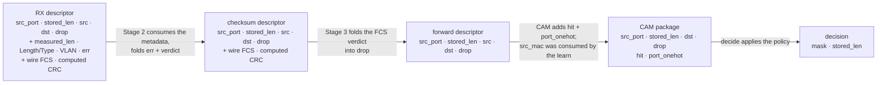

# ethernet-switch

A parameterised Ethernet Layer-2 switch in synthesizable SystemVerilog, built as a **five-level, frame-concurrent pipeline** over an 8-bit byte-stream boundary, with a self-checking regression and a LibreLane 3.0 (OpenLane 2) flow down to GDSII.

**English** | [简体中文](README.zh-Hans.md)

The generic RTL defaults to **four ports** (parameter-overridable). The DE2-115 board shell has **two** and the Vivado template **eight**. The design is grouped under `rtl/common/`, `rtl/mac/`, `rtl/mems/`, `rtl/perips/`, `rtl/switch/`, with `rtl/es_defs.sv` as the umbrella header pulling the declaration libraries together in dependency order. There is no monitoring, statistics, command or indicator path anywhere in the design.

---

## Contents

[1 Boundary](#1-mac-boundary) · [2 Pipeline](#2-pipeline-architecture) · [3 Drop rules](#3-frame-admission-and-drop-rules) · [4 CAM](#4-cam-behaviour) · [5 Tops](#5-five-top-level-modules) · [6 Parameters](#6-parameters) · [7 Ports](#7-ports-and-the-rate-model) · [8 Map](#8-repository-map) · [9 Gates](#9-build-gates-and-verification) · [10 Constraints](#10-rtl-hard-constraints) · [11 Boards](#11-board-shells-and-the-physical-flow) · [12 Migration](#12-migration-from-the-previous-architecture) · [13 Limits](#13-known-limitations)

---

## 1. MAC boundary

Each port uses an 8-bit `valid/ready` stream with `sof/eof/err`. The receive MAC finds the seven preamble octets and SFD, reconstructs octets, and supplies the four original FCS octets as 32-bit sideband on EOF. The first FCS octet occupies bits 7:0. The transmit MAC generates preamble, any required pad, FCS and IFG. The switch stages share one core clock, independent of the PHY symbol rate.

## 2. Pipeline architecture

The fabric instantiates stages 1–3 and 5 **once per port**; stage 4 is **shared** and crossbar-shaped. Every stage handoff is a `valid/ready` descriptor transfer, and frame bytes move only through the FIFOs named below — never across a stage boundary.

```mermaid
flowchart LR
    subgraph lane["Per ingress lane - × NUM_PORTS"]
        direction TB
        RXMAC["MAC RX adapter<br>preamble / SFD hunt,<br>wire FCS as EOF sideband"] --> S1["Stage 1 - es_switch_stage_1_rx<br>admission at SOF, header parse,<br>byte FIFO + descriptor FIFO"]
        S1 -->|"RX descriptor"| S2["Stage 2 - es_switch_stage_2_validate<br>nine parallel header and length checks"]
        S2 -->|"checksum descriptor"| S3["Stage 3 - es_switch_stage_3_checksum<br>CRC32 absorb on the write tap,<br>compare with the wire FCS"]
    end
    S3 -->|"forward descriptor, one per port"| CAM
    subgraph st4["Stage 4 - es_switch_stage_4_lookup (shared)"]
        direction LR
        CAM["cam_stage lanes<br>destination lookup + source learn,<br>same clock, read-first"] --> DEC["decide<br>hit / flood / drop policy"]
        DEC --> SCHED["scheduler<br>whole-frame round-robin grants,<br>atomic byte-credit reservation"]
        SCHED --> COPY["copy engine per source lane<br>one byte per clock"]
    end
    COPY --> S5["Stage 5 - es_switch_stage_5_tx<br>one TX queue per egress,<br>whole-frame commit"]
    S5 --> TXMAC["MAC TX adapter<br>preamble, pad, FCS, IFG"]
    S1 -. ingress byte FIFO .-> COPY
    S1 -. CRC write tap .-> S3
```



1. **`es_switch_stage_1_rx`** reserves byte and descriptor capacity at SOF for each ingress. It writes bytes to the ingress FIFO and publishes the parsed descriptor at EOF, or on the first definitive receive error. It drains the rest of an aborted frame and caps the stored length at `MAX_FRAME_LEN`. The MAC discards the whole frame when admission fails.
2. **`es_switch_stage_2_validate`** evaluates nine header and length checks in parallel and folds the receive-error bit and its verdict into the descriptor's single drop bit. A rejected frame retains the exact number of bytes stored, so its prefix is reclaimed in order.
3. **`es_switch_stage_3_checksum`** accumulates CRC32 on the RX write tap, compares the captured result with the original FCS and folds that verdict into the same drop bit. It preserves the ordered reclamation count on failure.
4. **`es_switch_stage_4_lookup`** looks up and learns only accepted frames. Each ingress drains rejected and filtered frames in FIFO order. Round-robin whole-frame grants reserve all target destinations and their byte credits together. Disjoint copies can run concurrently.
5. **`es_switch_stage_5_tx`** commits each frame when its EOF enters the egress queue. The transmitter can drain one complete frame while the fabric copies the next.

### 2.1 Stage by stage

**Stage 1 — receive, parse, buffer.** Admission at SOF requires the byte FIFO to hold a full `MAX_FRAME_LEN` frame plus a free descriptor slot. Frame size is unknown at SOF — only an 802.3 length field would reveal it early — so the reservation is worst-case and no admitted byte is ever dropped. The `S_IDLE / S_FRAME / S_DRAIN` FSM stops storing on the first definitive receive error or the first byte past the length cap and drains the remainder without storing it. `es_switch_stage_1_rx_parse` shifts in destination (octets 0–5), source (6–11) and Length/Type (12–13), deriving the VLAN flag from the completed EtherType. `crc_write_o` qualifies exactly the bytes written to the FIFO, so the Stage 3 accumulator sees the frame the descriptor describes.

**Stage 2 — validate.** Nine checks run in parallel on the descriptor: receive error, length outside `[MIN_FRAME_LEN, MAX_FRAME_LEN]`, truncated first VLAN header, non-unicast source, source or destination equal to the port MAC, identical source and destination, all-zero source or destination, Length/Type in the 1501–1535 gap, and 802.3-length mismatch against the padded declared length (§3). The verdict is OR-ed with the receive-error bit into the drop bit; `stored_len` is untouched so the queued prefix is still reclaimed byte-exactly.

**Stage 3 — FCS verdict.** The CRC32 accumulator absorbs one octet per write-tap byte. SOF selects the seed, so the register needs no reset value, and the accumulator output includes the current beat, so a descriptor published on the EOF beat already carries the final CRC. The output verdict ORs the incoming drop bit with `wire FCS != computed CRC` and writes it back into that bit — everything downstream reads one reject bit. The comparison completes before the frame can act on the CAM (§3).

**Stage 4 — lookup, decide, copy.** `cam_stage` runs one lane per port, each issuing a combinational destination lookup **and** a source learn in the same clock; lookup is read-first, so a same-edge learn is invisible to that clock's lookups. A lane whose learn the table refused keeps `valid` asserted and lowers `ready` for that clock — no learn is ever silently dropped. The table is `CAM_SETS × CAM_WAYS` with the XOR-fold hash and round-robin victims described in §4. `decide` applies the forwarding policy per lane: broadcast → all ports but the source; group → flood only in `FLOOD_MODE=2`; unicast hit → the learned port; unicast miss → flood unless `FLOOD_MODE=0`; rejected frame → empty mask. A decision is always published — a zero mask means *read and discard*, because the bytes must still be drained. The scheduler grants whole frames round-robin, only when **every** targeted egress queue has byte credit (`tx_free >= stored_len`), so queues are reserved atomically before the first byte moves; grants with disjoint destination masks run concurrently, and two lanes never write one queue. One copy engine per source lane reads its own ingress byte FIFO at one byte per clock.

**Stage 5 — transmit queues.** Each egress queue is a fall-through FIFO whose frame counter increments only when a frame's EOF byte is enqueued and decrements when the MAC consumes that EOF, so `valid` exposes **only complete frames**. The depth is clamped to at least `2 × MAX_FRAME_LEN`, so a full frame can always be committed while another drains.

### 2.2 Descriptor evolution

Each stage narrows the descriptor to what its consumer reads: a field is carried exactly once and stripped at the boundary after its last reader. The frame bytes never travel with the descriptor — they stay in the ingress byte FIFO until the copy engine claims them.



| Boundary | Width (bits) |
|---|---|
| Stage 1 → 2 RX descriptor | `202 + PW` |
| Stage 2 → 3 checksum descriptor | `172 + PW` |
| Stage 3 → 4 forward descriptor | `108 + PW` |
| CAM lane → decide package | `61 + PW + N` |
| decide → scheduler decision | `N + 11` |

`PW = es_port_w(NUM_PORTS)`, `N = NUM_PORTS`; at the default four ports that is 204 / 174 / 110 / 67 / 15 bits.

### 2.3 Frame concurrency

Descriptors remain stable under backpressure. The payload stays in the ingress byte FIFO until its descriptor reaches the copy engine. Copying a frame takes one cycle per byte and atomically reserves space on every selected egress, so a slow destination can delay a broadcast before copying but cannot interrupt its transmission on another port.

The pipeline is frame-concurrent: while one lane receives frame E, earlier frames from other lanes sit in validate, checksum and lookup simultaneously, and every egress queue drains independently. Up to `NUM_PORTS` copies run at once — one engine per source lane, limited by destination overlap, not by a global arbiter.

```mermaid
sequenceDiagram
    autonumber
    participant S as Stage 4 scheduler
    participant A as Egress queue A (fast MAC)
    participant B as Egress queue B (slow MAC)
    Note over S: broadcast descriptor arrives:<br>mask = A + B, stored_len = len
    S->>A: credit check, tx_free >= len
    S->>B: credit check, tx_free >= len
    Note over S,B: all-or-nothing: every queue is reserved<br>before the first byte is copied
    S->>A: copy len bytes, one per clock
    S->>B: copy len bytes, one per clock
    Note over A: EOF commit makes the frame visible;<br>the MAC drains it while the next frame is copied
    Note over B: a slow MAC delays the grant before copying starts -<br>it never interrupts a frame already committed elsewhere
```

### 2.4 Invariants

* Descriptors are stable under backpressure: fields never change between `valid` and `ready`.
* No admitted byte is ever dropped; a rejected or filtered frame's stored prefix is drained in FIFO order before the lane's next frame reaches the CAM.
* The CAM lookup is read-first; a learn on the same edge is visible only from the next clock.
* A learn is never silently dropped: the table backpressures the excess through `learn_ready_o`.
* A whole-frame grant reserves every selected egress through EOF before the first byte is copied.
* A frame is visible to its egress MAC only after its EOF byte is queued.
* The FCS verdict completes before the frame can act on the CAM.

## 3. Frame admission and drop rules

`MIN_FRAME_LEN` and `MAX_FRAME_LEN` count bytes from the destination MAC through the last payload or padding byte, excluding FCS. The minimum defaults to 60. The configured maximum is inclusive and is checked at the first excess byte.

Validation rejects receive errors, lengths outside the configured range, truncated first VLAN headers, group source addresses, source or destination equal to the ingress port MAC, identical source and destination, all-zero source or destination, and Length/Type values 1501–1535. For untagged 802.3 frames, the received length must equal the larger of 60 and 14 plus the declared length. The FCS check runs before any CAM action.

## 4. CAM behaviour

* `NUM_PORTS` combinational lookups and `NUM_PORTS` learns run in the **same clock**. Lookup is **read-first**: a learn on the same edge is not visible to that clock's lookups.
* `CAM_SETS × CAM_WAYS` entries, a pure XOR-fold bucket hash (no multiplier, divider or wide adder chain) with a constant-index priority mux for bucket selection, set-associative with a round-robin victim pointer. Exact-tag matches relocate in place and do not advance the pointer.
* If more learns than `NUM_WAYS` land in one bucket in one clock, `learn_ready_o` backpressures the excess for one clock; `cam_stage` keeps `valid` asserted until the learn is granted. **Silently dropping a learn is forbidden.**
* Parallelism is fixed by `NUM_PORTS`: one CAM lookup and one learn lane per port, and one copy engine per source port (each reading its own ingress byte FIFO). There are no separate lane-count knobs. Bucket selection is a constant-index priority mux and the hash is a pure XOR fold, so `synth -flatten` stays tractable.

## 5. Five top-level modules

The three interface tops are named `es_*_top` and live in `rtl/`; the two board tops keep their names. `lint`, `rtl` and `synth` elaborate **all five**, so a wrapper that is never compiled cannot silently rot.

| Top | Interface | Instance | Notes |
|---|---|---|---|
| `es_gmii_top` | GMII, 8-bit pins | ASIC / default | `DESIGN_NAME` for LibreLane |
| `es_mii_top` | MII, 4-bit nibbles | DE2-115 shell | rejects a 1000 Mbit/s port at elaboration |
| `es_rmii_top` | RMII, 2-bit dibits | — | rejects 1000 Mbit/s; needs a divisible `BYTE_PERIOD` |
| `es_switch_de2_115_top` | 2 × MII PHY pins | Quartus II board | 50 MHz, 100 Mbit/s, MDIO PHY management |
| `es_switch_vivado_top` | 8 × MII template | Vivado board | 50 MHz, 100 Mbit/s, `link_up_i` tied high |

## 6. Parameters

Every wrapper exposes the same configuration surface (board shells fix some of it as `localparam`):

| Parameter | Default | Meaning |
|---|---|---|
| `NUM_PORTS` | 4 | number of ports |
| `CLK_FREQ_HZ` | 125 MHz (GMII) / 50 MHz (MII, RMII) | core clock frequency |
| `PORT_SPEED` | `2'd2` GMII / `2'd1` MII,RMII | per-port `es_speed_e`, packed `N*2` bits |
| `PORT_MAC` | `'0` | per-port MAC, packed `N*48`; zero derives a local address |
| `MIN_FRAME_LEN` | 60 | minimum accepted client bytes, excluding FCS |
| `MAX_FRAME_LEN` | 1518 | maximum accepted client bytes |
| `SLOTS` | 2 | frame slots per ingress buffer |
| `SLOT_BYTES` | 2048 | bytes per slot; total RX byte capacity is `SLOTS*SLOT_BYTES` |
| `DESC_DEPTH` | 8 | descriptor FIFO depth |
| `TX_QUEUE_DEPTH` | 256 | minimum per-port TX FIFO depth |
| `CAM_SETS` | 128 | CAM sets |
| `CAM_WAYS` | 4 | CAM ways per set |
| `LEARNING_EN` | 1 | enable source learning |
| `FLOOD_MODE` | `2'd1` | flooding policy (below) |
| `IFG_OCTETS` | 12 | inter-frame gap in octets |

**Simulation vs synthesis defaults.** The table above is the *simulation* default. When `SYNTHESIS` is defined — which both `make synth` and LibreLane do — `es_switch_defs.sv` supplies a reduced geometry (`MAX_FRAME_LEN=256`, `SLOTS=1`, `SLOT_BYTES=512`, `TX_QUEUE_DEPTH=64`, `CAM_SETS=16`, `CAM_WAYS=2`). The effective TX depth is max(TX_QUEUE_DEPTH, 2 × MAX_FRAME_LEN), giving 512 bytes per port in synthesis and 3036 bytes with full simulation defaults. LibreLane restates the same reduced values in `SYNTH_PARAMETERS`.

`FLOOD_MODE`: **0** = forward broadcast only; **1** = also flood unknown unicast (default); **2** = also flood unknown group/multicast. `LEARNING_EN` and `FLOOD_MODE` are pure elaboration parameters — there is no run-time control path.

## 7. Ports and the rate model

The handshake is `<src>_o_valid/<src>_o_ready` ↔ `<dst>_i_valid/<dst>_i_ready`; RX carries `sof/eof/err/fcs`, TX carries `sof/eof`. GMII top ports: `clk_i`, `rst_ni`, `link_up_i[N]`, `gmii_rx_en_i[N]`, `gmii_rx_data_i[N*8]`, `gmii_tx_en_o[N]`, `gmii_tx_data_o[N*8]`. MII/RMII tops replace the data buses with their nibble/dibit pins and RX_ER signals.

A port needs one elaboration-time constant, `BYTE_PERIOD = es_byte_period(CLK_FREQ_HZ, PORT_SPEED[p])`: the number of `clk_i` cycles per octet. At 125 MHz that is 1 (1000BASE-T), 10 (100BASE-TX), 100 (10BASE-T); at 50 MHz a 100 Mbit/s port is 4. Line rate is expressed with **clock enables, not extra clock domains** — the whole design is single-clock and free of clock-domain crossings.

## 8. Repository map

```
rtl/common/     CRC-32, DFF/pipe-stage primitives
rtl/mac/        byte-stream framers, GMII/MII/RMII adapters, serialisers
rtl/mems/       FWFT FIFO, 1R1W RAM, parallel register banks
rtl/perips/     MDIO and 88E1111 PHY management
rtl/*.sv        the three interface tops: es_gmii_top / es_mii_top / es_rmii_top
rtl/switch/     five pipeline stages, CAM and fabric
tb/             self-checking regressions (never synthesised, never linted)
board/          DE2-115 (Quartus II) and Vivado 8-port MII shells, each with a TB
ci/             toolchain contract (check-toolchain.sh)
librelane/      config.json + constraints/io.sdc + flow README
Makefile        every gate; the target list is in its own header
AGENTS.md       authoritative rules for RTL, testbenches and the flow
```

## 9. Build, gates and verification

Run the gates in this order; they are ordered by how fast they fail.

```sh
ci/check-toolchain.sh   # the tools match the versions the gates assume
make lint               # Verilator -Wall; any warning is an error
make rtl                # Icarus elaboration of the five tops, RTL only
make unit               # block-level + staged-fabric regressions
make mii rmii vivado board-unit   # the four PHY/board front ends
make sim                # GMII system regression, complete wire frames
make param              # 3 ports, non-power-of-two CAM (96 × 3)
make param-scan         # 4/8/16/32/48 ports × CAM geometries
make synth              # yosys; needs yosys on PATH, NOT part of `make all`
make all                # everything above except `synth`
```

| Gate | Tool | What it catches that the others do not |
|---|---|---|
| `make lint` | Verilator `--lint-only -Wall` | width mismatches, unused signals, latches, incomplete case coverage; any warning fails |
| `make rtl` | Icarus `-g2012`, RTL only | anything that only elaborates because a TB declares a missing signal |
| `make unit` / `sim` / `param` | Icarus + `vvp` | behaviour |
| `make synth` | yosys `read_verilog -sv` | everything the simulators accept and the silicon flow will not |
| CI job `gds` | LibreLane 3.0.14, sky130A | timing, hold, DRC, LVS against standard cells |

`make param-scan` covers port counts **4/8/16/32/48** and CAM combinations `(16,2) (96,3) (64,1) (32,4) (128,4) (64,2) (48,5)`; all seven run the full scenario suite and pass. The scan samples *geometries*, not scenarios - a full cross-product of scenarios, port counts and every CAM set/way pair would exceed the CI time budget.

**`make all` does not include `make synth`** — run it separately before calling a change done; it is the only gate that enforces the synthesis restrictions. CI runs on a **self-hosted** Linux runner in four jobs — `images`, `lint`, `test`, `gds` — with LibreLane **3.0.14**; the `gds` job is gated behind a manual approval. On Windows the EDA tools live in WSL, so every command is wrapped:

```sh
bash wsl.sh "make lint"
bash wsl.sh "make synth"
```

CI uses Linux directly and never needs `wsl.sh`. Definition of done is in `AGENTS.md` §5: no new `verilator lint_off`, no new `initial` block, all gates green.

## 10. RTL hard constraints

Not style preferences — several exist because the alternative already broke this design in a way a testbench could not see.

* **Three yosys bans.** (1) no `package` and no `import` in any form — shared declarations live at compilation-unit scope in `es_defs.sv`; (2) no `return` in any function — assign to the function name instead (IEEE 1800-2017 13.3); (3) `read_verilog` **must** use `-sv`; the `.sv` extension does not imply it. All three are invisible to Icarus and Verilator.
* **Verilator `-Wall` with zero warnings, and no new `lint_off` waivers.** Fix the finding rather than silencing it. `-Wno-DECLFILENAME` is a command-line convention, not a suppressed defect.
* **Reset is synchronous, active low, named `rst_ni`, and is the first branch of every `always_ff` with state.** No asynchronous reset anywhere.
* **A packed vector for anything indexed at run time.** Icarus returns stale data for a run-time-indexed unpacked array; unpacked arrays are only for constant-indexed memories/register files.
* **Register files are written by per-entry `always_ff` blocks in a generate loop** with constant indices, never a loop-indexed store.
* Elaboration-time parameter checks use `$error` / `$warning` inside `` `ifndef SYNTHESIS ``, because yosys has no implementation for them.
* Every operand of an arithmetic/bitwise operator has the same, intended width; `always_comb` assigns every output first and carries a `default` in every `case`; Quartus needs explicit `generate`, separately declared genvars and function-computed elaboration-time tables. See `AGENTS.md` for the full rules.

## 11. Board shells and the physical flow

* **DE2-115** — `board/de2_115/quartus_ii/README.md`: dual-port 100 Mbit/s MII, 50 MHz, 88E1111 PHY management over MDIO, KEY0 reset, TX_CLK dividers. Its board TB `force`s `phy_enabled` to bypass MDIO management because no external MDIO PHY responder is modelled; it does **not** validate MDIO management.
* **Vivado** — `board/vivado/README.md`: eight-port MII template. `configure.tcl` reattaches RTL via `glob`, stale `.xpr` source nodes are cleared, and physical PHY clock capture / CDC remain unfinished board-integration work.
* **LibreLane** — `librelane/README.md`: `config.json`, the `SYNTH_PARAMETERS` change record, `io.sdc`, the 2.4 → 3.0 migration table and the CI `gds` approval gate.

## 12. Migration from the previous architecture

This release is a full datapath rewrite. The former wide-beat, single-frame global-arbiter design and all of its monitoring, status, command and indicator paths have been removed in favour of the byte-stream frame-concurrent pipeline above. Configuration is now purely elaboration-time (`FLOOD_MODE`, `LEARNING_EN`); `link_up_i` is only a data gate. The three interface tops are now named `es_gmii_top` / `es_mii_top` / `es_rmii_top`; the two board tops keep their names.

## 13. Known limitations

* The LibreLane build elaborates a **reduced** instance (`SYNTH_PARAMETERS`); it proves the flow reads, synthesises and routes the design at a size it can finish. It is not a claim that a full-size configuration was placed and routed, and this document does not claim a GDSII has been taped out.
* The Vivado shell's physical PHY clock capture, CDC and timing adaptation are explicitly **unfinished**; `make vivado` models the synchronous MII boundary only and does not test real PHY CDC or board timing.
* The DE2-115 board TB bypasses MDIO management (`phy_enabled` is forced); PHY management is not verified by that bench.
* `make synth` uses the locally installed yosys, which need not be the exact version inside the LibreLane image; cell/area figures therefore differ.
