# ethernet-switch

一个可参数化的存储转发式（store-and-forward）以太网二层交换机核心，使用可综合的
SystemVerilog 编写，附带自校验回归测试和一条基于 LibreLane（OpenLane 2）的、直至
GDSII 的物理实现流程。

[English](README.md) | **简体中文**

通用 RTL 默认 **四端口**，支持参数覆盖；DE2-115 板级壳是 **双端口**，Vivado 模板是
**八端口**。RTL 按 `switch/`、`monitor/`、`console/`、`perips/`、`mems/`、`common/`
分层，`rtl/es_defs.sv` 按依赖顺序把公共声明与各职责域的声明库统一导入。

本文档为两类读者而写：第一次打开本仓库、希望从头读到尾的人；以及之后把它当参考手册
查阅的人。它会说明每个模块做什么、**为什么**要这样做、一帧数据如何一拍一拍地穿过
设计，以及如何构建、测试和修改本项目而不把它弄坏。

---

## 目录

* [1. 从这里开始](#1-从这里开始)
  - [1.1 二层交换机到底做什么](#11-二层交换机到底做什么)
  - [1.2 本仓库提供什么](#12-本仓库提供什么)
  - [1.3 它刻意不做什么](#13-它刻意不做什么)
  - [1.4 六十秒速览](#14-六十秒速览)
* [2. 快速上手](#2-快速上手)
  - [2.1 需要什么](#21-需要什么)
  - [2.2 五条命令](#22-五条命令)
  - [2.3 成功是什么样子](#23-成功是什么样子)
  - [2.4 Windows 与 WSL](#24-windows-与-wsl)
* [3. 仓库地图](#3-仓库地图)
  - [3.1 目录结构](#31-目录结构)
  - [3.2 每个模块及其职责](#32-每个模块及其职责)
  - [3.3 声明库如何工作](#33-声明库如何工作)
* [4. 架构](#4-架构)
  - [4.1 四层结构](#41-四层结构)
  - [4.2 一个内核，三种引脚前端](#42-一个内核三种引脚前端)
  - [4.3 一个时钟，用时钟使能代替多时钟](#43-一个时钟用时钟使能代替多时钟)
  - [4.4 一个节拍值多少带宽](#44-一个节拍值多少带宽)
* [5. 接收通路](#5-接收通路)
  - [5.1 从八位组到节拍，以及 FCS 校验](#51-从八位组到节拍以及-fcs-校验)
  - [5.2 解析器状态机](#52-解析器状态机)
  - [5.3 从 8 字节节拍中拼出 14 字节帧头](#53-从-8-字节节拍中拼出-14-字节帧头)
  - [5.4 帧长如何确定](#54-帧长如何确定)
  - [5.5 入口策略](#55-入口策略)
  - [5.6 缓冲，以及为什么丢弃一帧只要一次指针移动](#56-缓冲以及为什么丢弃一帧只要一次指针移动)
* [6. 转发表](#6-转发表)
  - [6.1 表的结构](#61-表的结构)
  - [6.2 一次查找，逐拍展开](#62-一次查找逐拍展开)
  - [6.3 学习不会丢表项](#63-学习不会丢表项)
  - [6.4 老化](#64-老化)
  - [6.5 清表、占用率，以及这张表不是什么](#65-清表占用率以及这张表不是什么)
* [7. 交换矩阵](#7-交换矩阵)
  - [7.1 保证](#71-保证)
  - [7.2 准入，一个不等式](#72-准入一个不等式)
  - [7.3 轮转调度，以及为什么回绕要写出来](#73-轮转调度以及为什么回绕要写出来)
  - [7.4 一对多由构造保证](#74-一对多由构造保证)
  - [7.5 队头阻塞](#75-队头阻塞)
  - [7.6 发送统计如何避开那个显而易见的错误](#76-发送统计如何避开那个显而易见的错误)
* [8. 发送通路](#8-发送通路)
  - [8.1 描述符与节拍永不漂移](#81-描述符与节拍永不漂移)
  - [8.2 帧序列器](#82-帧序列器)
  - [8.3 前导码、填充、FCS、帧间隔](#83-前导码填充fcs帧间隔)
  - [8.4 为什么 FCS 比线上快一个八位组](#84-为什么-fcs-比线上快一个八位组)
* [9. 一帧的一生](#9-一帧的一生)
* [10. 帧描述符](#10-帧描述符)
* [11. 统计计数器](#11-统计计数器)
* [12. 监控与串口控制台](#12-监控与串口控制台)
* [13. 参数与配置配方](#13-参数与配置配方)
* [14. PHY 接口](#14-phy-接口)
* [15. 板级壳](#15-板级壳)
* [16. 构建与测试](#16-构建与测试)
* [17. 物理实现](#17-物理实现)
* [18. 在本仓库上工作](#18-在本仓库上工作)
* [19. 故障排查](#19-故障排查)
* [20. 术语表](#20-术语表)
* [21. 接下来读什么](#21-接下来读什么)

---

## 1. 从这里开始

### 1.1 二层交换机到底做什么

以太网帧是一段形状固定的字节串：

```
+----------------+----------------+-----------+---------------------+-----+
| 目的 MAC        | 源 MAC          | 类型或长度 | 载荷                | FCS |
| 6 字节          | 6 字节          | 2 字节     | 46 .. 1500 字节     |  4  |
+----------------+----------------+-----------+---------------------+-----+
```

**二层交换机**把若干以太网段连接起来，并逐帧决定它应该从哪个（哪些）段出去。它只用
目的 MAC 地址做这个决定，并通过观察源 MAC 地址**学习**哪个地址位于哪个端口之后。由此
得到三条规则：

* 发往**已知**单播地址的帧，只从一个端口出去。
* 发往**广播**地址（`ff:ff:ff:ff:ff:ff`）或**未知**单播地址的帧，会被**洪泛**到除入口
  端口之外的每个端口。
* 如果一帧到达的端口正是它被发往的端口，就地消费，不再转发——否则单播帧会泄漏到其他
  所有网段。

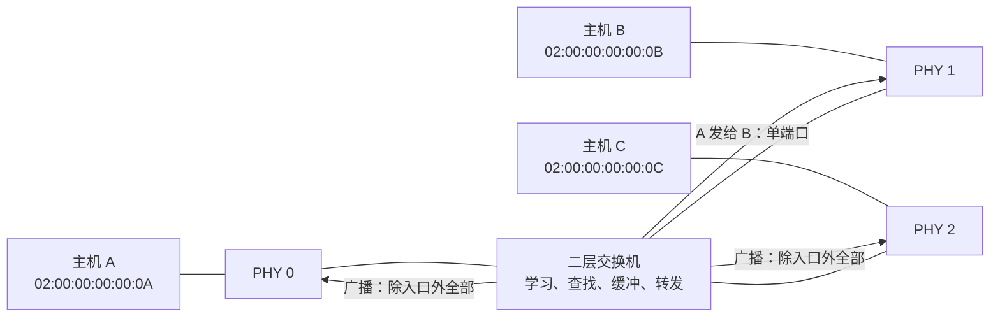

在整帧到齐**之前**就开始转发的做法叫 **cut-through**；先收完整帧、校验、再转发叫
**store-and-forward**。本内核是存储转发，这个选择正是它能保证「坏帧绝不转发」「帧绝不
会先进入出口缓冲再被撤回」「转发判决只做一次」的原因。

### 1.2 本仓库提供什么

| 组成 | 位置 | 说明 |
|---|---|---|
| 交换内核 | `rtl/switch/` | 成帧器、解析器、转发表、交换矩阵与统计 |
| 引脚前端 | `rtl/switch/es_switch_{gmii,mii,rmii}.sv` | 三种 MAC 接口各一个顶层，按需选择 |
| 通用顶层 | `es_switch_gmii` | 默认顶层：GMII 风格八位组引脚，默认四端口 |
| 板级壳 | `board/de2_115/`、`board/vivado/` | 含引脚、时钟、PHY 与用户 I/O 的 FPGA 顶层 |
| 监控 | `rtl/monitor/` | 每端口 64 位计数、速率、队列负载、PHY 状态、MAC 表读取 |
| 控制台 | `rtl/console/` | 基于 UART 的 ASCII 命令壳（`help`、`status`、`port`、`mac`） |
| 外设 | `rtl/perips/` | UART、LCD、MDIO、88E1111 管理、按键消抖 |
| 共享存储/逻辑 | `rtl/mems/`、`rtl/common/` | FIFO、寄存器组、CRC-32、比例运算、BCD、同步器 |
| 回归测试 | `tb/` | 自校验测试台：模块级、矩阵级、整机、三种前端、板级壳 |
| CI 契约 | `ci/`、`Makefile` | 固定工具链、lint、展开、仿真、综合各门 |
| 物理流程 | `librelane/` | LibreLane + sky130A 配置，直至 GDSII |

`rtl/` 下的一切都是**可综合**的。`rtl/` 中没有任何东西依赖测试台、厂商原语、PLL 或
存储编译器：设计仅靠开源工具就能完成读取、展开、综合与布线，这正是 `make synth` 和
CI `gds` 作业所证明的。

### 1.3 它刻意不做什么

| 不包含 | 为什么不在范围内 |
|---|---|
| PCS / PMA / SerDes | PHY 是独立芯片或硬宏；本内核从 MAC 接口开始 |
| 802.3x 暂停帧 | 流控需要协商状态机，以及能在队列中途停下的发送调度器 |
| 生成树 / RSTP | 二层之上的控制协议；洪泛环路由集成者负责 |
| VLAN 过滤、改写、QinQ 压入/弹出 | 解析器**识别** 802.1Q / 802.1ad 只是为了找到真正的 EtherType，并不过滤或改写标签 |
| QoS、优先级队列、调度 | 所有帧尽力而为，每出口端口一个队列 |
| Cut-through 转发 | 与「FCS 失败的帧绝不转发」不兼容 |
| IP 路由、ARP、DHCP | 严格限定在二层 |
| 异步时钟域 | 内核按构造是单时钟的；需要 CDC 的板级壳把 CDC 加在内核**之外** |

真正**包含**的，恰恰是难以做对、且每个交换机都必须做对的部分：帧边界处理、无描述符/
载荷偏斜的缓冲、并发访问下不会丢表项的源地址学习，以及绝不会把两帧交错进同一个出口
缓冲的交换矩阵。

### 1.4 六十秒速览

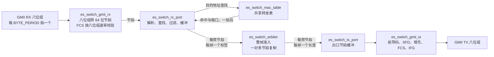

1. **八位组到达。** 接收适配器把八位组流拼成 64 位**节拍**，并随着八位组流过校验 FCS。
2. **解析帧头。** 目的 MAC、源 MAC 以及长度/EtherType 字段从开头一两个节拍中拼出。
3. **查询 CAM。** 载荷还在流入时就发出目的地址查找，答案一拍后到达。
4. **冻结判决。** 入口策略把查找结果变成目的位掩码。坏帧直接从缓冲回滚，绝不生成描述符。
5. **学习源地址。** 通过校验的源地址进入转发表的学习队列，另一端口同拍学习也不会丢。
6. **矩阵对整帧授权。** 每个目的出口都必须装得下**全部**节拍**并且**有空闲长度描述符，
   第一个节拍才会移动。
7. **节拍扇出。** 同一拍把一个节拍写入掩码内所有端口；洪泛不是特例。
8. **重新串行化。** 前导码、SFD、补齐的客户数据、新算的 FCS，以及 12 个八位组的帧间隔。

---

## 2. 快速上手

### 2.1 需要什么

| 工具 | 版本 | 用途 |
|---|---|---|
| Icarus Verilog | 12 或更新 | 仿真（`vvp`）、RTL 展开 |
| Verilator | 5.x | `-Wall` lint，任何警告都算失败 |
| yosys | 任意较新版本 | `make synth`；也是物理流程使用的前端 |
| GNU make、bash | 任意 | 各质量门 |
| Docker（可选） | 任意 | LibreLane 物理流程 |

Debian/Ubuntu 上：

```sh
sudo apt install iverilog verilator yosys build-essential
```

### 2.2 五条命令

```sh
ci/check-toolchain.sh   # 约 0.1 秒：工具版本是否与质量门假设一致？
make lint               # 约 1 秒：  Verilator -Wall，五个顶层全跑
make rtl                # 约 1 秒：  Icarus 仅对 RTL 做展开
make unit               # 数十秒：    模块级测试台与矩阵回归
make sim                # 数分钟：    四端口 10/100/1000/1000 Mbit/s
```

在认为改动完成之前，再跑：

```sh
make param              # 3 端口、50 MHz、非 2 的幂端口数
make mii                # 经 MII 引脚前端的整机
make rmii               # 经 RMII 引脚前端的整机
make vivado             # 八端口板级模板
make synth              # yosys；不在 `all` 中，但它是 CI 的硬门
```

`make all` 运行 `lint mii rmii vivado unit sim param`。它**刻意不**运行 `synth`：综合很
慢、需要 yosys，是宣布完成之前跑一次的门，而不是每次迭代都跑的门。

### 2.3 成功是什么样子

每个自校验测试台都以明确的结论结束。模块级测试台逐项打印 `PASS` 行，最后打印
`sw_crc32_tb: PASSED (N checks)`；系统级测试台打印这样的汇总：

```text
======================================================================
 checks executed : 158
 errors reported  : 0
======================================================================
 TESTBENCH PASSED
```

失败会打印 `*** ERROR`（模块级检查还会打印 `FAIL` 及期望值、实际值），并以 `$fatal`
结束，进程以非零码退出。不存在「静默通过」。

### 2.4 Windows 与 WSL

工具链通常装在 WSL 里。一个小脚本把命令送进去执行：

```sh
bash wsl.sh "make lint"
```

CI 直接在 Linux 上跑，从不需要 `wsl.sh`。本地运行 `ci/check-toolchain.sh` 只**报告**
发行版而不做断言——只有 CI 设置 `ASSERT_OS=1`——所以本地 WSL 发行版比 CI 工具链镜像
更新并不是错误。

---

## 3. 仓库地图

### 3.1 目录结构

| 路径 | 内容 |
|---|---|
| `rtl/es_defs.sv` | 伞形头文件：共享位宽、统计映射，并按顺序包含各域声明库 |
| `rtl/switch/` | 交换机本体：成帧、解析、CAM、矩阵、出口、三个顶层 wrapper |
| `rtl/monitor/` | 监控采样、快照缓存、分页策略、显示格式化 |
| `rtl/console/` | ASCII 命令壳及其命令模块 |
| `rtl/perips/` | UART、LCD、MDIO、88E1111 PHY 管理、按键消抖 |
| `rtl/mems/` | FWFT FIFO、1R1W RAM、并行寄存器组 |
| `rtl/common/` | CRC-32、两级同步器、二进制转 BCD、串行比例运算 |
| `tb/` | 自校验测试台；从不综合，CI 也不对其做 lint |
| `sim/` | 备选运行脚本（Verilator、Questa/ModelSim）与 `.f` 源文件清单；Makefile 仍是权威质量门 |
| `board/de2_115/quartus_ii/` | Quartus II 工程：板级顶层、引脚、SDC、`build.bat` |
| `board/vivado/` | 八端口 MII Vivado 模板（状态说明见 §15） |
| `ci/` | 工具链契约（`check-toolchain.sh`）与工具链镜像定义（`toolchain/Dockerfile`） |
| `librelane/` | 流程配置、时序约束，以及它自己的 README |
| `Makefile` | 全部质量门；目标清单在其文件头中有说明 |
| `AGENTS.md` | 风格与可移植性契约——修改 `rtl/` 前先读 |

### 3.2 每个模块及其职责

**交换域**

| 模块 | 文件 | 职责 |
|---|---|---|
| `es_switch_core` | `switch/es_switch_core.sv` | 接口无关的数据通路：端口实例、CAM、矩阵、统计聚合、静态参数检查 |
| `es_switch_gmii_rx` | `switch/es_switch_gmii_rx.sv` | 八位组流转 64 位节拍，附带 FCS 校验 |
| `es_switch_rx_port` | `switch/es_switch_rx_port.sv` | 帧头解析、CAM 查找、入口策略、缓冲、描述符生成 |
| `es_switch_mac_table` | `switch/es_switch_mac_table.sv` | 共享转发表：`NUM_SETS` x `NUM_WAYS`，并行读，串行化学习队列，老化 |
| `es_switch_arbiter` | `switch/es_switch_arbiter.sv` | 轮转调度、整帧准入、一对多节拍复制、发送侧计数 |
| `es_switch_tx_port` | `switch/es_switch_tx_port.sv` | 出口节拍缓冲、每帧长度描述符、发送完成上报 |
| `es_switch_gmii_tx` | `switch/es_switch_gmii_tx.sv` | 节拍转合法线帧；FCS 比线上快一个八位组生成 |
| `es_switch_mii_adapter` | `switch/es_switch_mii_adapter.sv` | MII 半字节与规范八位组流互转 |
| `es_switch_rmii_adapter` | `switch/es_switch_rmii_adapter.sv` | RMII 2 位块与规范八位组流互转 |
| `es_switch_gmii` | `switch/es_switch_gmii.sv` | 默认顶层：GMII 引脚直通内核 |
| `es_switch_mii` | `switch/es_switch_mii.sv` | MII 顶层：逐端口适配器，仅 10/100 Mbit/s |
| `es_switch_rmii` | `switch/es_switch_rmii.sv` | RMII 顶层：逐端口适配器，仅 10/100 Mbit/s |

**监控与控制台**

| 模块 | 文件 | 职责 |
|---|---|---|
| `es_monitor_core` | `monitor/es_monitor_core.sv` | 原子快照、64 位计数扩展、串行速率计算、CSR 服务 |
| `es_monitor_cache` | `monitor/es_monitor_cache.sv` | 低优先级 CSR 扫描器：读图像前后各读一次序列字，只有两次一致才发布 |
| `es_monitor_page` | `monitor/es_monitor_page.sv` | 消抖后的翻页与清表控制；页号在 `NUM_PORTS + 1` 页内回绕 |
| `es_monitor_display` | `monitor/es_monitor_display.sv` | 数码管与 LCD 字段格式化 |
| `es_console_core` | `console/es_console_core.sv` | 行组装、命令分发、响应串行化 |
| `es_console_cmd_help` | `console/es_console_cmd_help.sv` | `help` |
| `es_console_cmd_status` | `console/es_console_cmd_status.sv` | `status` |
| `es_console_cmd_port` | `console/es_console_cmd_port.sv` | `port <n>` |
| `es_console_cmd_mac` | `console/es_console_cmd_mac.sv` | `mac all`、`mac <n>` |
| `es_console_snapshot` | `console/es_console_snapshot.sv` | 复制快照，使慢速 UART 不会混合两个窗口 |

**共享基础设施**

| 模块 | 文件 | 职责 |
|---|---|---|
| `es_common_crc32` | `common/es_common_crc32.sv` | 八位组串行 IEEE 802.3 FCS 生成与校验，表由函数计算 |
| `es_common_sync_2ff` | `common/es_common_sync_2ff.sv` | 单个异步位的两级同步器 |
| `es_common_bin_to_bcd` | `common/es_common_bin_to_bcd.sv` | 二进制转打包 BCD，供显示使用 |
| `es_common_ratio` | `common/es_common_ratio.sv` | 串行乘除法，用于 pps 与 bit/s |
| `es_mems_sync_fifo` | `mems/es_mems_sync_fifo.sv` | FWFT FIFO，带帧粒度回滚与硬冲刷 |
| `es_mems_ram_1r1w` | `mems/es_mems_ram_1r1w.sv` | 单读单写 RAM |
| `es_mems_reg_bank` | `mems/es_mems_reg_bank.sv` | 并行寄存器组，逐表项写使能 |
| `es_perips_uart` | `perips/es_perips_uart.sv` | UART：5-8 数据位、校验、1/2 停止位、RTS/CTS |
| `es_perips_lcd` | `perips/es_perips_lcd.sv` | HD44780 风格字符 LCD 驱动 |
| `es_perips_mdio` | `perips/es_perips_mdio.sv` | MDIO 主机 |
| `es_perips_phy_88e1111` | `perips/es_perips_phy_88e1111.sv` | 88E1111 配置、自协商与状态轮询 |
| `es_perips_key_debounce` | `perips/es_perips_key_debounce.sv` | 向量按键消抖 |

### 3.3 声明库如何工作

每个 RTL 文件都以同样的三行开头，原因是综合前端的限制，而不是代码风格：

```systemverilog
`include "es_defs.sv"
`include "switch/es_switch_defs.sv"
`default_nettype none
```

`rtl/es_defs.sv` 声明共享位宽与统计映射，然后按依赖顺序包含各域声明库：

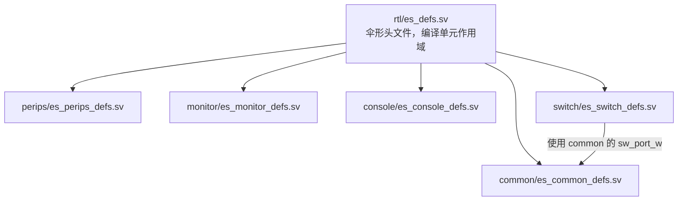

为什么不用 `package`？因为物理流程使用的综合前端在三处独立的地方拒绝 package，而
**两个仿真器都毫无察觉**：

* package 中的条目不是**常量范围**，所以取自 package 的位宽会在端口声明处被拒绝，
  甚至还没解析模块体；
* package 函数必须写成 `pkg::f(x)`，未限定作用域的调用根本无法解析；
* 任何形式的 `import` 都不被接受——模块头里不行，模块体里也不行。

编译单元作用域没有这些限制：这些名字在参数默认值、端口范围、模块体和函数参数列表中
都可见，而且每个常量仍然只有一份定义。详见
[§18.2](#182-三条-yosys-硬限制) 与
[`AGENTS.md`](AGENTS.md#21-the-three-hard-yosys-restrictions)。

---

## 4. 架构

### 4.1 四层结构

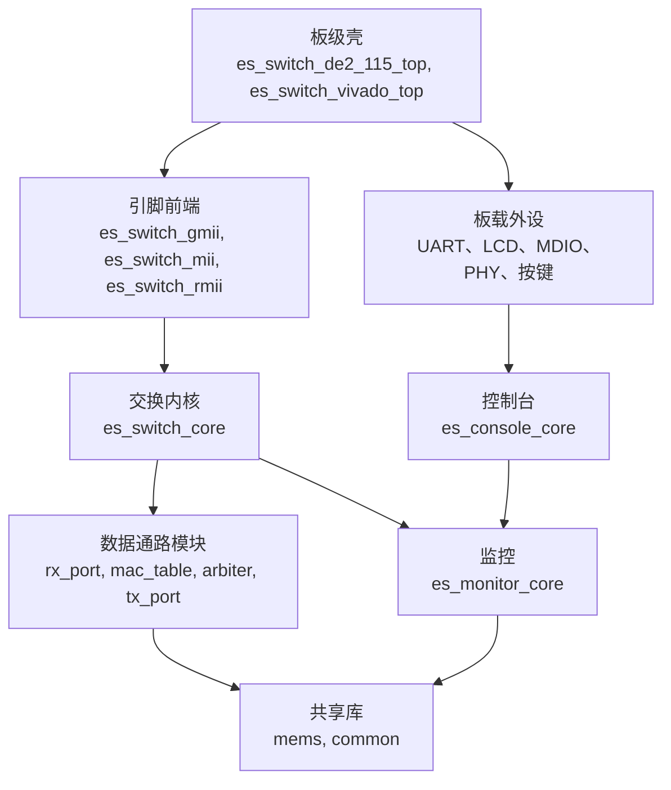

* **内核**对引脚、时钟、PHY 一无所知。它只跟每个端口的一条规范、由时钟使能限定的
  八位组流打交道。
* **wrapper** 把物理 MAC 接口适配到这条流上。共有三个，每次构建只展开其中一个。
* **板级壳**补上板子需要的东西：晶振、复位采样、PHY 管理、显示、按键和 UART。
* **监控**观察内核并提供只读 CSR；**控制台**是该 CSR 的客户端。两者都无法阻塞转发。

### 4.2 一个内核，三种引脚前端

| 顶层模块 | 引脚 | 符号宽度 | 线速率 | 说明 |
|---|---|---|---|---|
| `es_switch_gmii` | `gmii_rx_en_i`、`gmii_rx_data_i`、`gmii_tx_en_o`、`gmii_tx_data_o` | 8 位八位组 | 10 / 100 / 1000 Mbit/s | 默认顶层 |
| `es_switch_mii` | `mii_rx_dv_i`、`mii_rx_er_i`、`mii_rxd_i`、`mii_tx_en_o`、`mii_tx_er_o`、`mii_txd_o` | 每八位组两个 4 位半字节 | 10 / 100 Mbit/s | 1000 Mbit/s 在展开期被拒绝 |
| `es_switch_rmii` | `rmii_crs_dv_i`、`rmii_rxd_i`、`rmii_tx_en_o`、`rmii_txd_o` | 每八位组四个 2 位块 | 10 / 100 Mbit/s | 1000 Mbit/s 在展开期被拒绝 |

三种前端转发同样的参数、同样的统计总线、同样的监控端口。`make lint`、`make rtl`、
`make synth` 每次都展开**全部五个**顶层——三个 wrapper 加上两个板级壳——因为从不被
编译的顶层只会悄悄腐烂。

接口由**哪个 wrapper 被展开为顶层**选择，而不是由参数选择。正因如此，任一构建中只存在
所选接口的引脚：没有需要留空的引脚，也没有需要维护的死引脚列表。

### 4.3 一个时钟，用时钟使能代替多时钟

所有端口共享同一个 `clk_i`。内核中**没有任何时钟域穿越**，这是刻意的选择，有两个后果。

**端口的线速率由时钟使能决定，而不是时钟。** 一个端口唯一需要的展开期常量是
`BYTE_PERIOD`：组成一个八位组时间的 `clk_i` 周期数。它由核心时钟与所配速率推导：

```systemverilog
period = (clk_freq_hz * 8 + baud / 2) / baud;   // 四舍五入，最小为 1
```

| 核心时钟 | 10 Mbit/s | 100 Mbit/s | 1000 Mbit/s |
|---|---|---|---|
| 125 MHz | 100 | 10 | 1 |
| 50 MHz | 40 | 4 | 1 &dagger; |
| 200 MHz | 160 | 16 | 2 &dagger; |

更慢的核心时钟完全不改变数据通路，只是拉长使能周期。由此得到两点：

* **核心时钟决定单端口速率上限。** 125 MHz 时 `BYTE_PERIOD = 1` 已经是 125 Mbaud，
  所以无论如何配置，任何端口都无法超过 1 Gbit/s。
* &dagger; **八位组时间必须是整数个时钟，因此与八位组时间不整除的核心时钟无法表示。**
  1000BASE-T 需要 8 ns 的八位组时间——50 MHz 下是 2.5 个时钟、200 MHz 下是 1.6 个。
  函数会先四舍五入再钳位到 1，所以这些端口的实际驱动速率**快于**配置线速——50 MHz 时
  400 Mbit/s、200 MHz 时 800 Mbit/s。上表三个时钟下较低速率都是精确的，因为 8 ns 整除
  40 ns 和 160 ns。`make param` 使用 50 MHz 并特意只跑 100/100/10 Mbit/s，正好避开此
  问题。**核心时钟与端口速率不匹配时，你得不到所要求的线速**——诚实的修复需要分数
  时钟使能（fractional/DDS），本设计没有实现。

> **新手陷阱。** 在 50 MHz 时钟上构建 1000 Mbit/s 端口，交换机能跑、每个测试台都能过，
> 但端口比 PHY 期望的快 2.5 倍。设计内部无法检测这件事：算术上根本无法表示 2.5 个
> 时钟。千兆端口请选择 125 MHz 的整数倍作为核心时钟。

### 4.4 一个节拍值多少带宽

内部数据通路宽 64 位。一个**节拍**是八个八位组，八位组 0 位于 `[63:56]`。因此 1 Gbit/s
端口在线速下每**八**个核心时钟交付一个节拍，而不是每时钟一个：

| 量 | 125 MHz 核心下的值 | 推导 |
|---|---|---|
| 1 Gbit/s 端口的八位组速率 | 125 M 八位组/秒 | 1e9 / 8 |
| 1 Gbit/s 端口的节拍速率 | 15.625 M 节拍/秒 | 125 M / 8 |
| 一个 1 Gbit/s 端口占用的时钟比例 | 12.5% | 15.625 / 125 |
| 矩阵容量 | 125 M 节拍/秒 | 每时钟一个节拍 |
| 四个 1 Gbit/s 端口同时接收 | 62.5 M 节拍/秒（50%） | 4 x 15.625 |
| 八个 1 Gbit/s 端口同时接收 | 125 M 节拍/秒（100%） | 8 x 15.625 |

最后一行是关键：共享节拍总线按聚合流量定容，八个千兆端口时恰好饱和。默认四端口构建有
2 倍裕量。扇出不额外花费——同一拍把一个节拍写入每个目的端口——所以一次广播是一次矩阵
事务，而不是 N 次。

设计中每个缓冲都以这种节拍计量，所以换算关系值得记住：

| 线上帧长 | 节拍数 | 能装进哪里 |
|---|---|---|
| 64 字节 | 8 | 802.3 最小帧，也是 `TX_FIFO_DEPTH / 8` 规则的计量单位 |
| 128 字节 | 16 | |
| 512 字节 | 64 | 恰好是缩减实例的 FIFO 深度 |
| 1518 字节 | 190 | 默认 `RX_FIFO_DEPTH` / `TX_FIFO_DEPTH` 是 256，即一个最大帧外加 66 个节拍的余量 |

---

## 5. 接收通路

### 5.1 从八位组到节拍，以及 FCS 校验

`es_switch_gmii_rx` 在一个模块里做三件事：重定时入站八位组流、拼装 64 位节拍、运行 CRC。

**重定时。** 适配器运行一个 `BYTE_PERIOD` 状态的自运行相位计数器，在每个八位组时间的
**最后一拍**采样。晚采样带来一整拍的保持裕量，不需要 FIFO，也不需要 CDC。计数器自运行，
因此链路空闲时仍与 PHY 保持相位对齐。

**为什么整节拍要被保持。** 帧结束只能从八位组使能的撤销观察出来。PHY 可能在最后一个
八位组时间的剩余部分一直保持使能有效——在 10 Mbit/s 端口上是好几拍——所以急于发射的
节拍会在帧尾标记存在之前就离开流水线，标记到达时已无处可附。因此适配器把一个完整节拍
**保持**住，直到下一个八位组证明帧继续，或链路空闲证明帧结束。代价是一个八位组时间的
延迟，吞吐不受影响：节拍在下一个八位组被采样的同一拍释放，仍然是每八个八位组出一个
节拍。

| 情形 | 拼装器的行为 |
|---|---|
| 已累积 8 个八位组，第 9 个到达 | 作为普通节拍释放，用第 9 个八位组开始新节拍 |
| 已累积 8 个八位组，链路空闲 | 带 `eof` 和 FCS 判决释放 |
| 已累积 1..7 个八位组，链路空闲 | 释放不完整节拍，带 `eof`，`octets = 计数` |
| 链路空闲 | 保持拼装器清零；CRC 重新播种 |

**FCS 校验**与拼装器使用同一个八位组选通，所以 CRC 始终以八位组速率推进。LFSR 在每个
空闲周期重新播种，因此帧的第一个八位组无需单独的帧首握手就能被正确吸收。最后一个
八位组（含收到的四个 FCS 八位组）之后，好帧会在寄存器里留下残值 `0xDEBB20E3`。

> **为什么是 `0xDEBB20E3` 而不是 `0xC704DD1B`？** 教科书上的魔术残值属于多项式的
> MSB 优先（非反射）形式。本设计使用反射 LFSR（`0xEDB88320`），其寄存器持有的是
> 位反转后的残值。把非反射常数用在反射 LFSR 上会拒绝每一个合法帧——这正是
> `sw_crc32_tb` 存在的意义。

输出是无条件节拍流（没有 ready/valid 握手）。它前面的接收端口总是排空自己的节拍 FIFO，
所以节拍不可能被丢掉，这才使适配器能维持满线速。

### 5.2 解析器状态机

`es_switch_rx_port` 拥有一个端口的弹性节拍 FIFO、解析器、入口缓冲和统计。

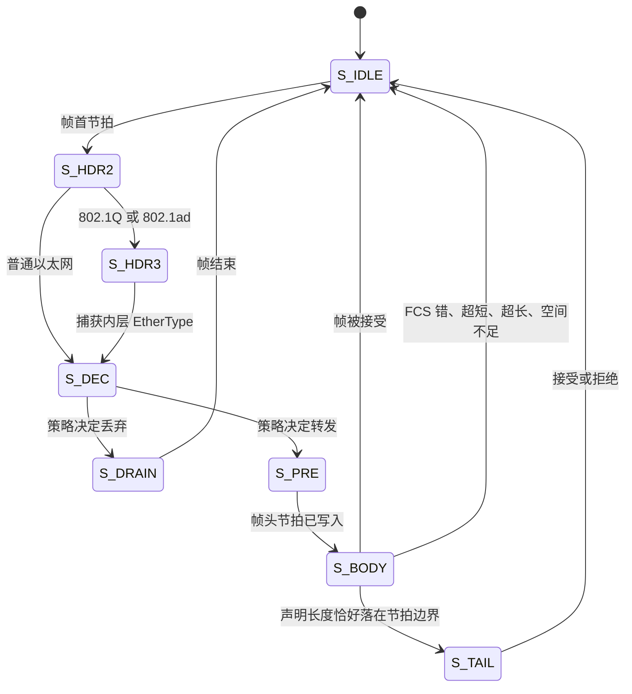

| 状态 | 做什么 | 为什么单独成状态 |
|---|---|---|
| `S_IDLE` | 等待 `sof`；捕获节拍 0 和目的 MAC；发出 CAM 请求 | 请求必须在地址可见的同一拍发出 |
| `S_HDR2` | 捕获节拍 1：源 MAC 与长度/EtherType | 帧头装不进一个节拍 |
| `S_HDR3` | 捕获节拍 2：带标签帧的内层 EtherType | 802.1Q 标签把真正的类型往后推了四个八位组 |
| `S_DEC` | 寄存 CAM 答案；冻结转发判决 | 判决不能依赖后面的节拍 |
| `S_PRE` | 把捕获的帧头节拍推入载荷 FIFO | 节拍在寄存器里，不在 FIFO 头部 |
| `S_BODY` | 流式写入载荷节拍 | 常见路径 |
| `S_TAIL` | 载荷已完整，只剩 FCS 节拍 | 最后一个节拍可能完全不含客户数据 |
| `S_DRAIN` | 丢弃被拒帧的剩余部分 | 即使丢弃也必须把帧消费到结尾 |

一个容易弄错的细节：在 `S_DEC` 和 `S_PRE` 状态下，解析器**不能**弹出弹性 FIFO。在
`S_DEC` 里，头部就是第一个载荷节拍，它将在 `S_BODY` 中被写入载荷 FIFO；在这里弹出会
悄悄丢掉它。在 `S_PRE` 里，帧头节拍已在寄存器中并从那里推入，FIFO 头部必须留在原地。

### 5.3 从 8 字节节拍中拼出 14 字节帧头

MAC 帧头是 14 字节，节拍是 8 字节，永远对不齐。节拍的八位组 0 位于 `[63:56]`：

```
节拍 0：[63:56] dst[0]  [55:48] dst[1]  ...  [23:16] dst[5]  [15:8] src[0]  [7:0] src[1]
节拍 1：[63:56] src[2]  [55:48] src[3]  [47:40] src[4]  [39:32] src[5]  [31:16] l2type  [15:0] 载荷
```

| 字段 | 来源 | 切片 |
|---|---|---|
| 目的 MAC | 节拍 0 | `w_data[63:16]` |
| 源 MAC 第 0-1 字节 | 节拍 0 | `w_data[15:0]` |
| 源 MAC 第 2-5 字节 | 节拍 1 | `w_data[63:32]` |
| 长度或 EtherType | 节拍 1 | `w_data[31:16]` |
| 内层 EtherType（带标签） | 节拍 2 | `w_data[63:48]` |

带标签的帧会多出一个节拍：

```
节拍 1：... l2type = 0x8100 | 0x88A8   tci[0..1]   载荷[0..5]
节拍 2：inner_type[0..1]               载荷[6..13]
```

切分弄错会让每个帧头字段偏移两个八位组，得到一个「看起来能用」的交换机：地址看着合理，
帧也确实被转发了，只有仔细检查它**从哪个端口**出去才会暴露错误。这就是为什么切分方式
写在代码现场，而不是留给读者去推。

### 5.4 帧长如何确定

长度/EtherType 字段里可能是两种东西，解析器必须区分：

| 字段值 | 含义 | 帧长如何得知 |
|---|---|---|
| `<= 1500` | 802.3 **长度**：MAC 客户数据长度 | 从帧头已知，且解析器按此长度校验 |
| `> 1500` | EtherType：载荷类型 | PHY 撤销使能之前**未知**，只能在线测量 |

边界恰好是 1500，也就是合法的 802.3 长度上限。1501..1535 也不是合法 EtherType，但
解析器把所有大于 1500 的值都当作类型并在线测量帧长，于是这类帧会因长度而不是因（毫无
意义的）类型被拒绝。

对 EtherType 帧，长度是 `收到的八位组数 - 4`（FCS）。测量值会写入描述符，也是出口
串行器被告知要发送的长度。

长度字段与实际到达内容矛盾的帧会被拒绝，行为与真实网桥一致：短于最小值或短于声明值是
**超短帧**（runt），长于声明值或长于 `MAX_FRAME_LEN` 是**超长帧**（oversize）。装不进
载荷缓冲的帧也按超长处理，因为在该配置下它不可能是合法帧。

### 5.5 入口策略

策略在 `S_DEC` 中一次求值，产生目的位掩码和一个 `flood` 标志。网桥的行为实际就在这里：

| 条件 | 结果 |
|---|---|
| 源 MAC 是本端口的地址 | 丢弃——反射帧 |
| 目的是本端口自己的地址，且从本端口到达 | 丢弃——这一帧是**发给**本端口的，洪泛它会把单播泄漏到其他所有网段 |
| 目的为 `ff:ff:ff:ff:ff:ff` | 洪泛到除入口外的所有端口 |
| 目的是组播（多播）地址 | 仅当策略允许时才洪泛 |
| 目的是 CAM 中已知端口的单播地址 | 发往该端口，并去掉入口端口；若该端口就是入口端口则丢弃 |
| 目的是未知单播 | 按策略洪泛或丢弃 |

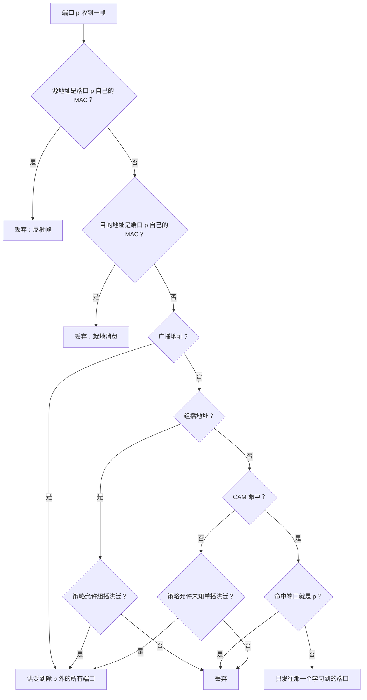

策略既是模块参数，**又支持运行时覆盖**，由 `cfg_ovr_i` 选择。展开期默认值来自
`FLOOD_MODE` 与 `LEARNING_EN`；当 `cfg_ovr_i` 为高时改用 `flood_mode_i` 与
`learning_en_i` 上的值。因此同一份 RTL 不用重新构建，既能当集线器
（`FLOOD_MODE = 2`、关闭学习），也能当学习型交换机（`FLOOD_MODE = 1`、开启学习）。

> **为什么「目的是我自己的地址」这条规则重要。** 端口自己的地址永远不可能出现在 CAM 中，
> 因为源地址规则阻止它被学习。没有这条判断，该地址会查找失败、被当作未知单播、然后从
> 其他每个端口洪泛出去——一帧发给端口 2 的数据会悄悄出现在端口 0 和 1 上。

### 5.6 缓冲，以及为什么丢弃一帧只要一次指针移动

解析器边解析边把载荷追加进载荷 FIFO。这正是存储转发便宜的原因：判决出来时帧已经在
缓冲里，不需要再复制一次。

后来发现是坏帧的帧，通过一次写指针回滚从缓冲中**撤回**，而不是读回：

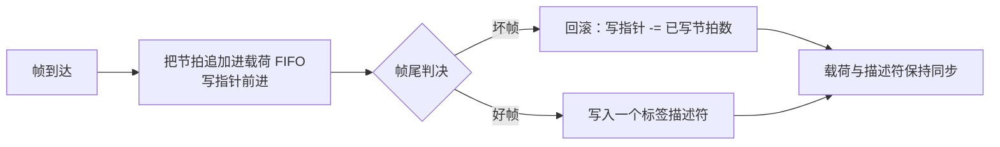

`es_mems_sync_fifo` 以 `undo_i` / `undo_cnt_i` 端口提供这个能力。已被消费者读走的表项
永远不会被回滚触碰，所以读侧正在运行时回滚也是安全的。描述符 FIFO **只为**通过校验的
帧写入，因此无论接收条件如何，载荷与描述符都不会失去帧同步。

模块也提供硬 `flush_i`，但接收端口只在解析器没有驱动载荷写入时接受它——冲刷绝不能把
一帧切成两半。

---

## 6. 转发表

### 6.1 表的结构

`es_switch_mac_table` 是服务于所有端口的一张**共享** CAM：`NUM_SETS` 个桶，每桶
`NUM_WAYS` 路。两者都不必是 2 的幂——哈希做真正的取模，替换指针也被显式约束。

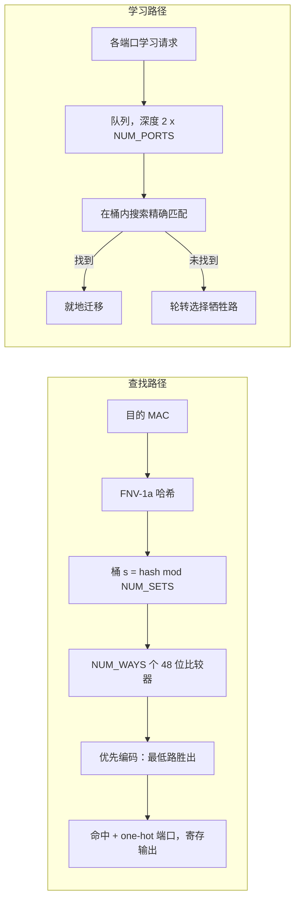

默认几何是 128 桶 x 4 路 = **512 表项**。表项为 `{valid, port, MAC}`：

| 字段 | 宽度 | 说明 |
|---|---|---|
| valid | 1 | 清表与老化过期时清零 |
| port | `sw_port_w(NUM_PORTS)` | 四端口时 2 位，八端口时 3 位 |
| MAC | 48 | 首个发送的八位组位于最高字节 |

### 6.2 一次查找，逐拍展开

每个端口读取自己地址哈希到的那个桶，所以全部 `NUM_PORTS` 个查找并行完成，接收路径
从不为查找而仲裁。

| 时钟 | 发生什么 |
|---|---|
| *t* | 接收端口带目的 MAC 拉高 `req_i`；哈希与桶读取是组合逻辑 |
| *t* | `NUM_WAYS` 个比较器求值；优先编码器选出编号最低的命中路 |
| *t+1* | `hit_o` 与 `port_o` 有效 |

这就是解析器中无需隐藏查找延迟的全部原因：一拍的查找延迟被帧头解析（本来就要两三拍）
吸收了。

搜索刻意拆成两个组合块——一个读表并产生逐路匹配位，一个把它们归约。若写成一个带
「是否已找到」累加器的 `always_comb`，它会读自己写的变量，把该变量放进自己的隐式敏感
列表，然后永远自我触发；仿真时间停止前进，运行挂死。综合出的硬件完全相同。

### 6.3 学习不会丢表项

CAM 只有一个写端口，但每个端口都可能在同一拍结束一帧。因此请求被收进内部队列，每拍
排空一个：

* 队列深度是 `2 * NUM_PORTS`，不是 `NUM_PORTS`。深度恰好等于 `NUM_PORTS` 是在悬崖边：
  队列会被填满，下一个请求被丢弃。每端口多一个空位，才能吸收同时学习的突发。
* 一拍内编号最小的请求端口胜出，行为完全确定。
* 无法入队的学习请求会被丢弃，并体现在学习计数的行为上，而不是破坏某个表项。

插入时先在桶内**搜索精确匹配**，若存在就迁移该站点。搬到别的端口的站点不会留下过期
副本。只有真正的新插入才推进轮转替换指针：

| 事件 | 表写入 | 替换指针 | 占用数 |
|---|---|---|---|
| 新站点，有空路 | 写入该路 | 前进 | +1 |
| 新站点，所有路已满 | 覆盖牺牲路 | 前进 | 不变 |
| 站点搬到另一端口 | 重写匹配的那一路 | **不变** | 不变 |
| 老化过期 | 清除 valid 位 | 不变 | -1 |
| 清表 | 全部清除 | 复位 | 0 |

占用数由写表的同一个时钟维护，因此不可能与表内实际内容漂移。它会双向移动，而清表直接
清零，而不是应用一个「清表前」的增量——那会下溢。

### 6.4 老化

老化**默认关闭**（`CAM_AGE_EN = 0`）。启用后，一个慢速分频器驱动指针遍历整张表，每个
tick 处理一个表项。每个表项存的是到期**倒计时**，而不是年龄计数：

* 每次学习或重新学习时，倒计时重装为 `CAM_AGE_LIMIT`；
* 每被扫描一次减一；
* 倒计时为零表示「立即过期」。

这种写法让 `CAM_AGE_LIMIT = 0` 自然退化为「最后一次刷新后的第一次扫描即过期」，无需
任何特判。有效空闲超时为：

```
timeout_clocks = CAM_AGE_CYCLES * NUM_SETS * NUM_WAYS * (CAM_AGE_LIMIT + 1)
```

按默认值（1,000,000 x 128 x 4 x 5）是 2.56e9 个时钟，125 MHz 下约 **20.5 秒**。

刷新是隐式的：每个被接受的帧都会重新学习其源地址，从而重装倒计时。没有单独的「刷新」
命令。

### 6.5 清表、占用率，以及这张表不是什么

* `cam_flush_i` 使所有表项失效并清零占用计数。监控直接上报清表请求而不计数它，因为它是
  一次性软件动作，而不是表能观察到的事件。
* 这张表是**寄存器组**，不是存储器。一个带多个分布式读口、又在 generate 循环里逐表项
  写入的存储器，Icarus 处理不了：写使能与数据都正确，存储就是不落地，学到的表项悄悄
  从不出现。声明为寄存器后，每个读口都是普通的连续赋值。当表足够大时，FPGA 工具会从
  完全相同的逐表项 `always_ff` 块重新推断出块 RAM。
* 它是**已学习地址的缓存**，不是接入设备清单。只有开启老化时表项才会过期，否则安静下来
  的站点会一直留在表里。控制台这样表述，你也应当这样理解。

---

## 7. 交换矩阵

`es_switch_arbiter` 是各种故障所在之处，所以值得把它的保证写明白。

### 7.1 保证

| 保证 | 机制 | 防止的故障 |
|---|---|---|
| 同一时刻只有一帧在飞 | 只有 `xfer_active` 为低时才发授权 | 两帧节拍交错进同一个出口 FIFO |
| 整帧准入 | 第一个节拍移动前，检查每个目的端口装得下全部节拍**且**有空闲描述符 | 帧被困在缓冲里，没有描述符可串行化 |
| 一对多由构造保证 | 一次授权产生掩码；同一拍把一个节拍写入掩码内每个端口 | 洪泛成为可能出错的特殊分支 |
| 首节拍带标志 | `dst_fr_o` 只在节拍 0 有效 | 出口排错长度描述符的数量 |
| 队头保护可选 | `STALL_LIMIT` 界定等待上限，超时丢弃 | 一个拥塞出口永久拖住其他所有端口 |

### 7.2 准入，一个不等式

传输开始前，矩阵对帧掩码中的每个目的端口 `j` 求值：

```
slot[j]  AND  free_beats[j] >= ceil(frame_len / 8)
```

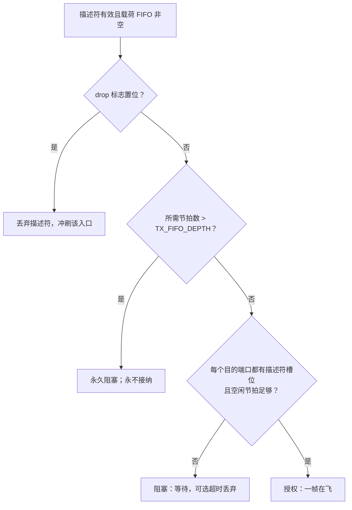

检查的两半都必要，只检查前一半是经典 bug：

* 节拍 FIFO 能容纳 `TX_FIFO_DEPTH / 8` 个最短帧——默认 256 时是 32 个——而长度描述符
  只有 `LEN_FIFO_DEPTH`（8）个；
* 描述符写入被丢的帧永远无法发送，因为串行器是靠描述符启动一帧的；
* 它会永远留在缓冲里，端口把有描述符的八帧发完后就带着背后的死载荷空转；一旦节拍 FIFO
  填满，**每一个**目的端口包含该端口的帧都会准入失败。

在端口互相洪泛的交换机上，这就是一帧卡死整个矩阵。这就是为什么 `es_switch_tx_port`
报告两个独立容量数字——`free_o`（节拍）与 `slot_o`（是否还装得下一整帧）——而矩阵两者
都要用。

因为检查一次性提前完成、且同一时刻只有一帧在飞，所以传输永远不会中途停顿，也永远不会
丢节拍。串行器一次都不会停顿。

### 7.3 轮转调度，以及为什么回绕要写出来

指针记住上一次服务到哪个端口；扫描从那里开始，绕端口列表一圈，因此没有端口会被饿死。
`rr_order[slot]` 是 `(rr_ptr + slot) mod NUM_PORTS`，构造成一个打包向量，所以非 2 的幂
端口数也能正确回绕——用的是整数运算，不是掩码。

指针本身用显式回绕更新：

```systemverilog
rr_next = (grant_idx == PW'(NUM_PORTS - 1)) ? '0 : (grant_idx + PW'(1));
```

`PW` 位计数器只有在 `NUM_PORTS` 是 2 的幂时才自然溢出到零。三个端口时，截断会落到不存在
的端口 3 上。`rr_order` 里的取模仍然会访问每个真实端口，所以调度依旧公平、缺陷从不显现
——它只会在回绕结果被用于其他用途的那一刻重新浮现。把回绕写出来就消除了这个潜在 bug。

### 7.4 一对多由构造保证

一次授权产生一个目的**掩码**，同一拍把一个节拍写入掩码内每个端口：

```systemverilog
dst_wr_en_o = beat_dst;                       // 整个掩码，同一拍
for (j = 0; j < NUM_PORTS; j++)
    dst_wr_data_o[j*64 +: 64] = beat_word;    // 同一个节拍送给每个端口
```

因此洪泛不是需要专门维护正确性的特例——它就是矩阵的本职工作。一次广播是矩阵的一趟
传输和 N 次写入，而不是 N 趟。

### 7.5 队头阻塞

被阻塞的队头帧会阻止它后面的帧被服务，这就是队头阻塞。`STALL_LIMIT` 给它设上限：在
那么多个无授权的仲裁周期之后，队头帧被丢弃，其入口队列被冲刷。默认值是 `0`，即永远
等待、绝不丢弃。

该特性是**显式**关闭的（`STALL_LIMIT != 0`），而不是让阈值下溢到一个计数器永远到不了
的值。用 `16'(0) - 16'd1` 比较 16 位计数器会得到 0xFFFF，这是计数器的性质而不是意图的
性质，一旦计数器加宽就会失效。这个判断是常量表达式，因此关闭配置在硬件上零成本。

### 7.6 发送统计如何避开那个显而易见的错误

`TX_FRAMES` 统计的是**注入发送端口的帧副本**，所以其单位是（帧，目的端口），而不是
（帧，授权）。

* 按每份副本的首节拍计数才对。按 `grant_now` 计的是**授权**：无论多少个端口收到，
  一次授权只发生一次，所以到三个端口的广播会被报成一而不是三。按每个节拍计数则会把
  一帧数很多次。
* 首节拍标志是**每个目的端口**一位，因此要用 population count 归约。用 `|` 折叠就成了
  数授权：到三个端口的广播在线上是三份副本，但只有一次授权。

```systemverilog
tx_copy_b[gc]  = beat_write && beat_fr[gc];      // 每个目的端口
tx_copies      = count_copies(tx_copy_b);        // popcount
cnt_tx_frames <= cnt_tx_frames + tx_copies;
cnt_tx_octets <= cnt_tx_octets + len * tx_copies; // 移位加法，不是乘法器
```

`count_copies` 与 `octets_x_copies` 是**函数**，不是累加式 `always_comb`。一个写累加器
又回读它的块会把这个信号放进自己的敏感列表，永远无法稳定；函数根本没有敏感列表。
`octets_x_copies` 还刻意写成移位加法而不是 `len * copies`：两个操作数都是 32 位向量，
综合工具会为一个只可能达到 `NUM_PORTS` 的值构建完整的 32x32 乘法器。

---

## 8. 发送通路

### 8.1 描述符与节拍永不漂移

`es_switch_tx_port` 把一个帧的节拍缓存在一个 FIFO 中、把每帧长度缓存在另一个更小的
FIFO 中：

* 长度描述符**每帧只写一次**，由 `wr_fr_i` 限定；而帧的每个节拍各有自己的写脉冲；
* 当描述符可用**且**串行化器已完成上一个帧间隔时，帧开始；
* 描述符在节拍开始的同一时刻弹出，所以两条流不会漂移。

矩阵保证整帧装得下才开始写入，因此串行器永不停顿。`done_o` 标记最后一个 FCS 八位组
窗口结束——含义是「本 MAC 完成了串行化」，而不是「对端收到了」。

### 8.2 帧序列器

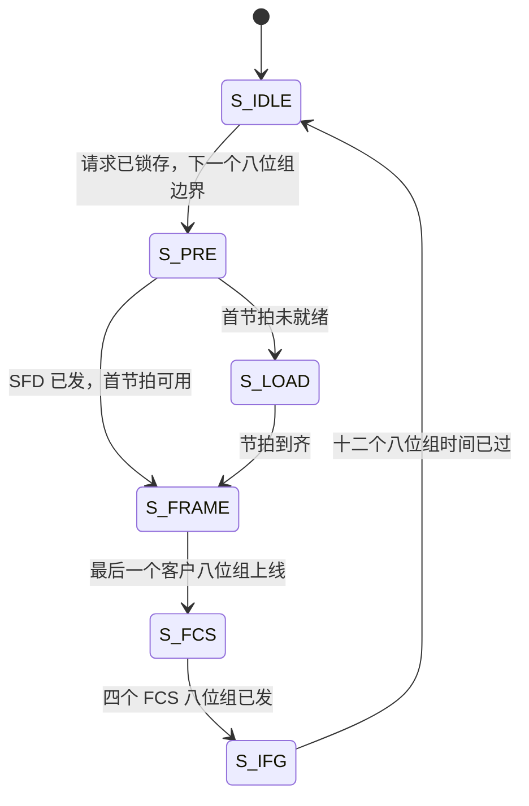

请求是被**锁存**的，不是立即执行。立即开始会让第一个八位组窗口短于 `BYTE_PERIOD`，
因为请求可能在窗口内任意时刻到达。在不完整的八位组时间上启动帧不是 GMII 合法行为，
还会迫使接收端猜测八位组边界在哪里。等到下一个八位组边界，就使帧的每个窗口在任何线速
下都恰好是 `BYTE_PERIOD` 拍。

`S_LOAD` 是节拍源未就绪时的安全网；存储转发矩阵永远用不到它。

### 8.3 前导码、填充、FCS、帧间隔

线上实际发送的内容，按顺序：

| 字段 | 长度 | 由谁生成 |
|---|---|---|
| 前导码 | 7 个 `0x55` | `es_switch_gmii_tx` |
| 帧起始定界符 | 1 个 `0xD5` | `es_switch_gmii_tx` |
| 目的 MAC + 源 MAC + 类型/长度 | 14 字节；带 802.1Q 标签时 18 字节 | 载荷，来自入口缓冲 |
| MAC 客户数据 | 描述符给出的 `len` 个字节，不足 `SW_MIN_PAYLOAD`（46）时补零 | 载荷 |
| FCS | 4 字节，最低有效字节在先 | `es_switch_gmii_tx` |
| 帧间隔 | 至少 12 个八位组时间 | `es_switch_gmii_tx` |

`len` 是解析器测量出的 MAC 客户数据长度：含帧头，不含 FCS。它受 `MAX_FRAME_LEN` 约束。
补零路径只在单独使用 `es_switch_gmii_tx` 时才有意义，因为解析器绝不会转发短于
`SW_MIN_FRAME_LEN` 的帧。

填充**计入 FCS**，因为它在 CRC 吸收八位组之前生成。若在 FCS 之后补填充，每个接收端都会
拒收该帧。

`oct_en_o` 由状态组合驱动，因此它恰好在 `oct_d_o` 持有数据的那些窗口有效。若改为寄存
输出，它会相对八位组寄存器延迟一拍，并吃掉第一个前导码八位组。序列器的写法保证「离开
某个状态」永远不会与「装载某个八位组」同拍发生——特别是最后一个 FCS 八位组会在帧间隔
开始前整整一个八位组时间被装载。

### 8.4 为什么 FCS 比线上快一个八位组

CRC 发生器恰好在同一时钟边沿吸收正在寄存到 `oct_d_o` 上的那个八位组。所以当最后一个
客户八位组离开 MAC 时，LFSR 已持有最终结果，第一个 FCS 八位组可以在下一个八位组时间
立即驱动出去：

```
八位组时间    ...  n-1      n         n+1   n+2   n+3   n+4
线上          ...  数据     数据      FCS0  FCS1  FCS2  FCS3
CRC 吸收      ...  数据     数据      -     -     -     -      <- 在 n 已稳定
```

没有气泡，关键路径上也没有额外流水线寄存器。使能要与八位组选通相与
（`crc_en = crc_en_n && tick`），这在所有低于 1000 Mbit/s 的速率下都是必需的：组合使能
会在整个八位组窗口保持有效——100 Mbit/s 时十拍、10 Mbit/s 时一百拍——未限定的使能会
每个时钟吸收同一个八位组一次，让每一帧的 FCS 都算错。

---

## 9. 一帧的一生

这里以一帧从端口 0 到端口 3 的单播为例走读，并点出每一步行使的保证。

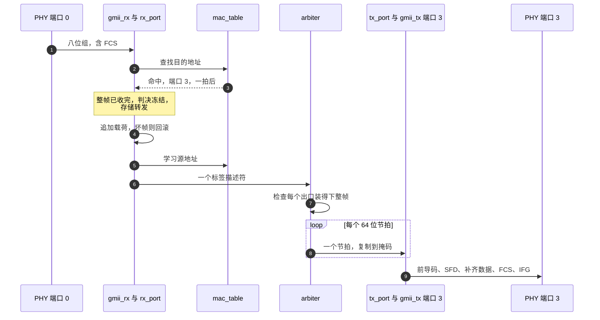

1. **八位组到达。** `es_switch_gmii_rx` 在自运行相位计数器上采样，随着八位组流过校验
   FCS，并组装 64 位节拍。最后一个节拍被刻意保持到下一个八位组或链路空闲，帧尾标记不会
   丢失。
2. **解析帧头。** 解析器从前一两个节拍（带标签则三个）中拼出目的、源地址，并解析帧长
   ——头部带传统长度字段时用之，否则在线测量。
3. **查询 CAM。** 载荷还在流入缓冲时就发出查找，答案一拍后到达。
4. **冻结判决。** 转发决定被提交之前帧已被**完整**接收。FCS、长度或入口策略校验失败的
   帧以一次写指针回滚撤出载荷 FIFO，且永远不会为它写描述符。
5. **学习源地址。** 通过校验的源地址被送入 CAM 的学习队列；若另一端口同拍也在学习，
   本请求在队列中等待一拍，两个都不会丢。已存在的地址会被迁移而非复制。
6. **矩阵对整帧授权。** 矩阵弹出描述符，确认掩码内每个出口既装得下整帧的全部节拍**又**
   有空闲长度描述符，然后才开始传输。同一时刻只有一帧在飞；新授权不可能与前帧最后一拍
   竞争。
7. **节拍扇出。** 每个载荷节拍在同一拍写入掩码内所有端口。首节拍带标志，出口由此知道
   节拍属于哪个描述符。
8. **重新串行化。** `es_switch_tx_port` 等到描述符可用且帧间隔已走完，在节拍开始的同一
   时刻弹出描述符；`es_switch_gmii_tx` 发出前导码、SFD、补齐的客户数据和新算的 FCS。

广播与上述流程相同，只是第 6 步的掩码有多个位。矩阵按每份副本的首节拍把它计为 N 份
——每收到它的端口各一份。

**延迟。** 存储转发意味着帧必须被完整接收后才能转发，所以延迟至少是入口串行化时间 +
出口串行化时间 + 矩阵与缓冲开销：

```
latency ~= (帧八位组数 / 入口八位组速率)
         + (帧八位组数 / 出口八位组速率)
         + 矩阵与仲裁开销
         + 12 个八位组时间的帧间隔
```

两个 1 Gbit/s 端口之间传 1518 字节的帧，约 12.1 微秒进、12.1 微秒出，再加上几微秒的
缓冲与仲裁——总共约 26 微秒；64 字节的帧约 2.5 微秒。没有 cut-through 模式可以退而
求其次；这就是「坏帧绝不转发」的代价。

---

## 10. 帧描述符

每个被缓冲的帧由描述符 FIFO 中的一个**标签**（tag）字描述，与载荷同行。字段偏移在
`es_switch_defs.sv` 中以 `sw_tag_*_lsb()` 辅助函数定义一次、两端共用，所以二者不可能
漂移。

```
位    TAGW-1                                       0
    +----------------+-------------+-------+------+-----+
    | dst_mask       | len         | src   |flood |drop |
    | NUM_PORTS 位   | SW_LEN_W=11 | PW    | 1    | 1   |
    +----------------+-------------+-------+------+-----+
```

| 字段 | 宽度 | 偏移辅助 | 含义 |
|---|---|---|---|
| `dst_mask` | `NUM_PORTS` | `sw_tag_dstm_lsb` | 入口过滤决定的出口位掩码，已冻结 |
| `src` | `sw_port_w(NUM_PORTS)` | `sw_tag_src_lsb` | 入口端口索引，用于可观测性 |
| `len` | `SW_LEN_W`（11） | `sw_tag_len_lsb` | MAC 客户数据长度，不含 FCS |
| `flood` | 1 | `sw_tag_flood_lsb` | `dst_mask` 来自洪泛决定时置位 |
| `drop` | 1 | `sw_tag_drop_lsb` | 防御性：描述符描述一帧矩阵应丢弃的帧 |

总宽度：

| `NUM_PORTS` | `dst_mask` | `src` | `len` | `flood` | `drop` | `TAGW` |
|---|---|---|---|---|---|---|
| 2 | 2 | 1 | 11 | 1 | 1 | 16 |
| 3 | 3 | 2 | 11 | 1 | 1 | 18 |
| 4 | 4 | 2 | 11 | 1 | 1 | 19 |
| 8 | 8 | 3 | 11 | 1 | 1 | 24 |

`drop` 在当前设计中恒为零。入口过滤在缓冲**之前**就拒绝帧——这正是 `es_mems_sync_fifo`
的回滚存在的意义——所以描述符只为通过校验的帧写入。矩阵保留了丢弃此类描述符的能力，
字段提取逻辑是活的，不是意外遗留的死代码：「先缓冲后过滤」的设计会需要它。

---

## 11. 统计计数器

一条 14 个计数器的只读总线，顶层按端口求和，每计数器 32 位，由 `sw_stat_id_e` 选择。
计数器按其记录的**事件**命名，而非按恰好拥有它的模块命名。

| ID | 计数器 | 计数位置 | 含义与注意事项 |
|---|---|---|---|
| 0 | `RX_FRAMES` | rx_port | 入口过滤接受并转发进矩阵的帧 |
| 1 | `RX_OCTETS` | rx_port | 这些帧的 MAC 客户八位组，不含 FCS |
| 2 | `RX_FILTERED` | rx_port | 被入口策略丢弃的帧 |
| 3 | `RX_CRC_ERR` | rx_port | FCS 校验失败的帧 |
| 4 | `RX_RUNT` | rx_port | 短于最小值，或短于声明值的帧 |
| 5 | `RX_OVERSIZE` | rx_port | 长于配置最大值，或长于声明值的帧 |
| 6 | `RX_OVERFLOW` | rx_port | 因入口缓冲耗尽而丢弃的帧 |
| 7 | `TX_FRAMES` | arbiter | 注入发送端口的帧**副本**，按每份副本的首节拍计数 |
| 8 | `TX_OCTETS` | arbiter | 注入的客户八位组，乘以复制份数 |
| 9 | `TX_STALLED` | arbiter | 被队头阻塞保护丢弃的帧 |
| 10 | `CAM_HIT` | mac_table | 解析到端口的查找 |
| 11 | `CAM_MISS` | mac_table | 落到洪泛的查找 |
| 12 | `CAM_LEARN` | mac_table | 写入表的插入数 |
| 13 | `CAM_FLUSH` | core | 直接由冲刷请求线报告，不计数 |

引用这些数字之前值得知道的几件事：

* **`RX_OVERFLOW` 不是 `RX_OVERSIZE`。** 溢出指向「缓冲对当前流量太小」，超长帧指向
  「坏帧」。把两者相加会掩盖你真正面临的问题。
* **`TX_FRAMES` 数的是副本，不是授权。** 到三个端口的广播是三份副本，按授权计数只会
  报一。
* **两个端口同拍命中则两个都计。** 计数是对逐端口限定位做 population count，不是顺序
  循环。
* **`RX_OCTETS` 不含 FCS**，`TX_OCTETS` 不含前导码、FCS 和帧间隔。监控 ABI 另有一套
  基于发送完成的计数器，它记录的是另一个事件（完成串行化，而不是被接纳），因此两者
  不能直接比较。
* **错误类别并不互斥。** 一帧可能既畸形又过短；解析器按固定优先级只增加一个类别。

完整的监控 ABI——每端口 64 位计数、速率、队列/负载快照、PHY 元数据、独立 MAC 表读取
——见 [`docs/monitor.zh-Hans.md`](docs/monitor.zh-Hans.md)（英文：
[`docs/monitor.md`](docs/monitor.md)）。

---

## 12. 监控与串口控制台

### 12.1 快照模型

监控不直接暴露实时计数器。每 `REFRESH_INTERVAL_MS`（默认 500 ms）它：

1. 捕获原始计数器，并把每个 32 位计数器扩展为 64 位，使长时间窗口内的回绕也被保留；
2. 通过一个共享的乘除法器串行计算速率；
3. 带着新的序列号**原子**发布整幅图像。

想要一致视图的读者先读序列字、再读各字段、再读一次序列字，若变化就重试。显示扫描器
正是这样做的；控制台复制扫描器已经完成的图像，所以慢速 UART 也不会混合两个窗口。

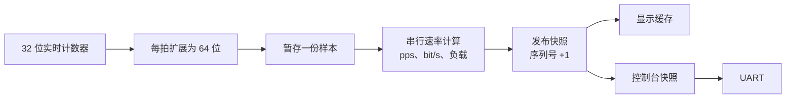

任何请求、显示、UART 或管理握手都无法阻塞转发。监控是只读观察者。

### 12.2 CSR 映射，一页看完

| 区域 | 地址 | 内容 |
|---|---|---|
| 系统记录 | `0x0000_0000` | 状态、端口数、保留字、运行秒数、窗口、序列号、CAM 状态 |
| 每端口记录 `p` | `0x1000_0000 + p*256` | PHY 状态、队列占用与峰值、负载、14 对计数器、四对速率 |
| MAC 表项 `i` | `0x2000_0000 + i*16` | MAC[31:0]、MAC[47:32]、端口、有效位 |
| 实时时间戳 | `0x0000_00f0` / `f4` / `f8` | 实时时钟低/高字与清表代数 |

* 值为小字在先：64 位字段占两个连续 32 位字，低字在前。
* 带字节地址拉高 `mon_req_i`，在 `mon_ready_o` 为高时被接受；`mon_valid_o` 为高时数据
  才有意义。
* 普通读一拍响应；MAC 读可能多拍，请求必须遵守 ready。
* 未映射或未对齐的读返回零。

每端口的 PHY 状态字节在 `phy_status_i` 与快照中含义相同：

| 位 | 含义 |
|---|---|
| 0 | PHY 状态有效 |
| 1 | 链路 up |
| 2 | 全双工 |
| 4:3 | 速率：0 = 10M、1 = 100M、2 = 1000M、3 = 保留 |
| 5 | 管理错误 |
| 7:6 | 保留，为零 |

状态无效的端口没有已知链路容量，其负载读为零；区分「空闲」与「未知」的正是有效位与
链路位。

重要的语义细节：

* **统计的是发送完成，不是准入。** 监控的发送计数在 MAC 发完最后一个 FCS 八位组时推进，
  因此排队的副本不会被报成已发送。管理上被禁用的出口完成不计入。
* **监控的八位组计数来自完成时报出的客户数据长度**（`done_len_o`），因此不含前导码、
  FCS 与帧间隔。`stat_o` 的 `TX_OCTETS` 数的是注入而不是完成；两者回答的是不同问题。
* **负载是链路容量的千分比**，RX/TX 分开计算；PHY 报告未知或断链时为零。解读零之前
  先看有效位与链路位。
* **队列占用以 64 位节拍为单位**，不是包数，也不包含正在串行化的节拍或描述符槽位。
* **MAC 列表是实时视图，不是原子转储。** 遍历期间表项可能移动或过期；控制台打印开始/
  结束时钟与清表代数，使被中断的扫描可见。

### 12.3 控制台

板级壳与 `es_console_core` 接受以下编译期参数：

| 参数 | 默认值 | 允许范围 |
|---|---|---|
| `UART_BAUD_RATE` | 115200 | 整数分频周期至少 4 拍且误差在 2% 以内的任意速率 |
| `UART_DATA_BITS` | 8 | UART 支持 5..8；ASCII 控制台要求 7 或 8 |
| `UART_PARITY` | 无 | 无、奇、偶 |
| `UART_STOP_BITS` | 1 | 1 或 2 |
| `UART_FLOW_CONTROL` | 无 | 无或 RTS/CTS（低有效） |

命令为小写 ASCII，以 CR、LF 或 CRLF 结尾：

```text
help
status
port 0
mac all
mac 0
```

* `status` 报告汇总与每个端口。
* 端口号是十进制、从零开始。
* 输出为带字段名的十六进制整数，前缀 `0x`；`_pps`、`_bit_per_second`、`_permille`、
  `_octets` 表示单位。
* 同一时刻只处理一条命令。超过 32 字节的行会被排空到结尾并拒绝；忙时输入被丢弃并给出
  诊断。
* 校验、帧格式与溢出错误与命令错误分开计数，因此坏线缆与坏命令可以区分。

`cts` 只在字符之间检查，绝不在字符内部；处理命令期间 `rts` 撤销。没有流控的上位机应
等待完整响应后再发送下一条命令。

---

## 13. 参数与配置配方

### 13.1 参数表

| 参数 | 默认值 | 含义与约束 |
|---|---|---|
| `NUM_PORTS` | 4 | 端口数；任意 >= 1 的值，不必是 2 的幂 |
| `CLK_FREQ_HZ` | 125 000 000 | 核心时钟；决定每个端口的八位组周期 |
| `PORT_MAC` | `'0` | 每端口 48 位，端口 *p* 位于 `[48*p +: 48]`；全零端口获得 `02:00:00:00:00:<p>` |
| `PORT_SPEED` | 全 1000BASE-T | 每端口 2 位，端口 *p* 位于 `[2*p +: 2]`：0 = 10、1 = 100、2 = 1000 Mbit/s、3 = down |
| `MAX_FRAME_LEN` | 1518 | 接受的最大帧长，不含 FCS |
| `RX_FIFO_DEPTH` | 256 | 每入口端口的载荷节拍数；必须 >= `ceil(MAX_FRAME_LEN/8)`，默认值下即 190 |
| `TX_FIFO_DEPTH` | 256 | 每出口端口的载荷节拍数；同上，默认值下 190 |
| `TAG_FIFO_DEPTH` | 16 | 每入口端口缓冲的描述符数 |
| `WF_DEPTH` | 16 | 八位组适配器与解析器之间的弹性节拍 FIFO |
| `FLOOD_MODE` | 1 | 0 = 阻塞未知单播，1 = 洪泛，2 = 未知组播也洪泛 |
| `LEARNING_EN` | 1 | 源地址学习默认值 |
| `STALL_LIMIT` | 0 | 队头帧被丢弃前的最长等待周期数；0 表示永不丢弃 |
| `CAM_SETS` `CAM_WAYS` | 128、4 | 转发表几何；512 个表项 |
| `CAM_AGE_EN` | 0 | 老化默认关闭 |
| `CAM_AGE_CYCLES` | 1 000 000 | 两次老化步进之间的时钟数 |
| `CAM_AGE_LIMIT` | 4 | 老化倒计时重装值 |
| `REFRESH_INTERVAL_MS` | 500 | 监控采样间隔，必须为正；三个 wrapper 均转发它 |

`LEN_FIFO_DEPTH`（默认 8）是 `es_switch_tx_port` 的参数，不在顶层内核的参数表中。它是
一个出口端口描述符 FIFO 能排队的帧数，也是矩阵 `slot_o` 检查所保护的资源。直接实例化
`es_switch_tx_port` 时，请有意识地设定它。

> **帧长单位。** `MAX_FRAME_LEN` 与 `SW_MIN_FRAME_LEN` 都是与测得的 MAC 客户数据长度
> 比较，不含 FCS。按随仓库提供的常量，可接受窗口是 64..1518 字节客户数据，即线上
> 68..1522 字节。标准 64 字节以太网帧携带 60 字节客户数据，因此会低于
> `SW_MIN_FRAME_LEN` 并被判为超短帧；若你的流量包含最小尺寸帧，请连同钉住该行为的
> 测试台一起、有意识地重新审视这个常量。

### 13.2 为什么每端口参数是扁平向量

`PORT_MAC` 与 `PORT_SPEED` 是打包向量而非解包数组参数，因为解包数组参数并非被普遍
支持——Icarus 就没有实现——而打包形式的代价为零。缓冲尺寸错误会在展开期报告（在仿真中
——错误参数的实例实际上会在仿真中构建出来）；综合出的网表永远看不到这项检查。

### 13.3 配方

**普通学习型交换机（默认）。** 四端口全千兆、开启洪泛、开启学习、关闭老化：

```systemverilog
es_switch_gmii #(
    .NUM_PORTS  (4),
    .PORT_SPEED ({4{2'd2}})
) u_switch ( ... );
```

**集线器。** 全部洪泛、不学习：

```systemverilog
es_switch_gmii #(
    .FLOOD_MODE  (2'd2),
    .LEARNING_EN (1'b0)
) u_switch ( ... );
```

**50 MHz 板上的两个 100 Mbit/s 端口**——DE2-115 配置：

```systemverilog
es_switch_mii #(
    .NUM_PORTS   (2),
    .CLK_FREQ_HZ (50_000_000),
    .PORT_SPEED  ({2'b01, 2'b01})
) u_switch ( ... );
```

此时 `BYTE_PERIOD` 是每八位组 4 拍，MII 适配器把每个八位组拆成两个各 2 拍的半字节窗口。

**八个 100 Mbit/s 端口**——Vivado 模板。注意八个千兆端口在 125 MHz 上会恰好压满节拍
总线（见 §4.4）；随仓库提供的模板是 100 Mbit/s 的 MII。

**更大的帧。** 提高 `MAX_FRAME_LEN` 时必须同步提高 FIFO 深度：`RX_FIFO_DEPTH` 与
`TX_FIFO_DEPTH` 至少要 `ceil(MAX_FRAME_LEN/8)`，而 `SW_LEN_W`（11 位）把字段上限锁在
2047 字节。展开期检查会在缓冲太小时告警，但它不能替你调整尺寸。

---

## 14. PHY 接口

### 14.1 三种接口共享的约定

每个端口都呈现同一条规范、由时钟使能限定、与 `clk_i` 同步的八位组流：

* 每 `BYTE_PERIOD` 个时钟传输一个八位组；
* 使能在整个八位组时间保持有效，数据在同一窗口内稳定；
* 帧间隔期间使能至少撤销一个时钟。

前导码和帧起始定界符在接收端由 PHY 剥除、在发送端重新插入，与真实 MAC 完全一致。因此
八位组流从目的 MAC 的第一个字节开始，以四个 FCS 字节结束。

> **wrapper 里没有什么。** 没有 `RX_CLK`、`TX_CLK` 或 `REF_CLK` 引脚，也没有 PLL。
> 适配器是**同步模型**：它们期望一条已经处于 `clk_i` 域的流。捕获真实 PHY 自己的时钟
> 是板级壳的职责；无法满足单时钟约定的外壳需要在核心外加异步 FIFO——交换机内部无需
> 任何改动。

### 14.2 MII 与 RMII 适配器

| 属性 | MII | RMII |
|---|---|---|
| 符号宽度 | 4 位（半字节） | 2 位（双位） |
| 每八位组符号数 | 2 | 4 |
| `BYTE_PERIOD` | 必须是偶数且 >= 2 | 必须是 4 的倍数且 >= 4 |
| 接收成帧 | `RX_DV` 在整个八位组时间有效 | `CRS_DV` 在整个八位组时间有效 |
| 线速率 | 10 / 100 Mbit/s | 10 / 100 Mbit/s |
| 1000 Mbit/s | 展开期拒绝 | 展开期拒绝 |

MII 适配器的接收侧在链路空闲时**停住**窗口计数器，所以每一帧的窗口都从该帧自己的 `DV`
上升沿开始数——前端或测试台都不必把帧对齐到任何网格。拼装好的八位组呈现整整一个八位组
时间，比线上晚一个八位组；一个呈现倒计数器让**最后一个**八位组在链路空闲后仍保持完整
`BYTE_PERIOD`，这正是 `es_switch_gmii_rx` 采样所需的。

链路使能期间出现 `RX_ER` 会置起粘滞标志，从该八位组起撤销使能，于是出错帧在适配器处
被截断，而不是进入矩阵。它随后会作为超短帧或 CRC 错误被下游拒绝，绝不转发。

---

## 15. 板级壳

### 15.1 DE2-115：一台真实的双端口交换机

`board/de2_115/quartus_ii/` 是 Terasic DE2-115（Cyclone IV E，`EP4CE115F29C7`）的完整
Quartus II 工程：

| 项目 | 值 |
|---|---|
| 端口 | 2 个，MII，100 Mbit/s 全双工 |
| 核心时钟 | 直接使用 `CLOCK_50` 的 50 MHz，**无 PLL** |
| 八位组周期 | 100 Mbit/s 下 4 个核心时钟 |
| PHY | 两片 Marvell 88E1111，MDIO 地址 16 与 17 |
| 复位 | `KEY0`，经两级寄存器采样；启动期间请保持 |
| 板卡设置 | JP1 必须选择 **MII**；JP7 保持默认 2.5 V |
| 控制台 | 默认 115200 8N1，无流控 |

**编译与下载。** 安装支持 Cyclone IV E 的 Quartus II 13.0sp1/13.1 Web Edition，然后：

```bat
build.bat
build.bat C:\altera\13.1\quartus
```

GUI 可打开 `ethernet_switch.qpf`；产物为 `output_files/ethernet_switch.sof`。QSF 包含
源文件、引脚与电平标准，SDC 包含时钟与板级约束。个别板卡使用 C8 速度等级——请按实际
器件修改 QSF 中的 `DEVICE`。网口对端须支持自协商 100 Mbit/s 全双工。

外壳在核心之外补上了：

* **PHY 管理。** 复位后等待 20 ms，逐地址探测 MDIO，仅通告 100 Mbit/s 全双工，重启
  自协商，然后每 100 ms 轮询。`BMSR` 读两次以处理 latch-low 位，再读寄存器 17 确认
  速率、双工与解析完成。只有在确认 100 Mbit/s 全双工后才允许收发；未知、无应答或不
  兼容的 PHY 不会被假报为正常。
* **显示。** `HEX7..4` 显示 RX pps，`HEX3..0` 显示 TX pps；超过 10000 时除以 1000，
  `LEDG4/5` 指示单位。LCD 上行 RX、下行 TX，六位十进制加 `k` 后缀；没有有效采样时显示
  横线。
* **LED。** 绿色：心跳、采样/PHY 就绪、逐端口使能、kpps 单位、页面指示。红色：逐端口
  活动（保持 100 ms）、端口错误、PHY 管理错误、控制台错误、队列峰值达到 224/256 节拍、
  以及四条每格 10% 的负载条。
* **按键。** `KEY0` 保持复位，`KEY1` 清空 MAC 表，`KEY2`/`KEY3` 在汇总与逐端口页面之间
  循环切换。功能键消抖 20 ms；同时按下两个翻页键不切页。

> **板级的诚实说明。** RX 通路直接采样 PHY 的异步数据，没有异步 FIFO，因此本外壳
> **不**声称 RX 时钟域穿越已闭合。TX 时钟由负沿分频器产生，SDC 预算（5 ns 建立、5 ns
> 偏斜）低于 IEEE 通用的 15 ns 要求。上一次 Quartus 完整编译因开发机的 Remote Desktop
> 许可限制（`Error (292032)`）无法完成，因此当前版本的 Fitter、资源占用、时序与实板
> 运行都**尚未**验证。请把板级工程看作「设计可用，但仍需一次有许可的编译和上板调试」。

### 15.2 Vivado：八端口模板

`board/vivado/` 是 50 MHz / 100 Mbit/s 的八端口 MII 模板。其顶层
`es_switch_vivado_top` 是纯 RTL，属于同一套质量门：`make lint`、`make rtl`、
`make synth` 与 `make vivado` 都会展开它，`make unit` 会跑它的回归。该回归让每个入口
向七个出口洪泛一次，然后交换一圈定向帧（包括端口 7 到端口 0），在时钟边沿之间驱动复位
以暴露缺失的同步器，并检查空闲时 MDIO 未被驱动。

**物理 PHY 适配尚未完成**：预留的 PHY 时钟未与核心锁相，XDC 引脚位置与时序都是占位值。
回归证明的是同步 MII 帧约定；它不是 CDC、PHY 初始化或物理 MII 时序测试。

---

## 16. 构建与测试

### 16.1 每个质量门的作用

| 质量门 | 工具 | 它抓住而其他门抓不住的问题 | 典型失败特征 |
|---|---|---|---|
| `ci/check-toolchain.sh` | shell | 自质量门编写以来跨过大版本的工具 | 打印工具名与期望版本 |
| `make lint` | Verilator `--lint-only -Wall` | 位宽不匹配、未使用信号、锁存器、case 覆盖不全、隐式敏感 | 一条警告；**任何警告都算失败** |
| `make rtl` | Icarus `-g2012`，仅 RTL | 只因为测试台恰好声明了某个信号才能展开的东西 | 未声明标识符、端口不匹配 |
| `make unit` | Icarus + `vvp` | 模块级与矩阵级行为 | 带期望/实际值的 `FAIL` |
| `make mii` / `rmii` | Icarus + `vvp` | 适配后的引脚驱动真实数据通路 | PHY 模型处帧丢失或损坏 |
| `make vivado` | Icarus + `vvp` | 八端口板级壳、复位行为、MDIO 三态 | 某端口从不转发，或空闲时 MDIO 被驱动 |
| `make sim` | Icarus + `vvp` | 四种混合线速下的系统行为 | 帧从错误端口出来、丢帧、FCS 错 |
| `make param` | Icarus + `vvp` | 非 2 的幂端口数、不同的核心时钟 | `BYTE_PERIOD` 错误导致帧损坏 |
| `make synth` | yosys `read_verilog -sv` | 仿真器接受但硅片不接受的一切 | 第一个声明处的解析错误 |
| CI 作业 `gds` | LibreLane 3.0.14、sky130A | 时序、保持、DRC、LVS | 流程步骤失败，需人工批准 |

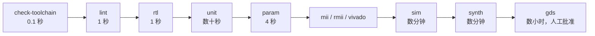

各门按「失败速度」排序。请按这个顺序运行：lint 错误比挂死的仿真便宜得多。

`sim/` 提供了一套备选运行脚本，用于「换一个仿真器再看一眼」：`sim/run_lint.sh` 用
Verilator 对 RTL 与测试台做 lint，`sim/run_verilator.sh <top>` 用 Verilator
`--binary --timing` 构建并运行单个测试台，`sim/run_questa.sh <top>` 用 Questa/ModelSim
做同样的事，`sim/run_all.sh` 用其中之一跑完整套。把难缠的失败放到第二个仿真器上复现，
是区分「设计 bug」与「仿真器怪癖」最快的方法。Makefile 与 CI 仍是权威质量门——注意
`run_verilator.sh` 带 `-Wno-fatal`，那里的警告会被打印但不会让运行失败；真正让警告
失败的是 `make lint`。

### 16.2 测试台清单

| 目标 | 测试台 | 证明什么 |
|---|---|---|
| `make unit` | `sw_crc32_tb` | CRC 残值、种子与位序对已知向量 |
| | `sw_sync_fifo_tb` | FWFT 行为、满/空、回滚、冲刷 |
| | `sw_mac_table_tb` | 查找、迁移、替换、老化、清表、占用 |
| | `sw_mii_tb` | 半字节拼装与串行化符合约定 |
| | `sw_rmii_tb` | 双位拼装与串行化符合约定 |
| | `sw_flood_tb` | 小 CAM 下的多帧洪泛；线速与一个 10 Mbit/s 端口两种形态 |
| | `sw_uart_tb` | 成帧、校验、停止位、RTS/CTS |
| | `sw_phy_monitor_tb` | 88E1111 寄存器序列对线级模型 |
| | `sw_monitor_tb` | 采样算术、32→64 位回绕、MAC 字一致性 |
| | `sw_monitor_interval_tb` | 非整数采样窗口 |
| | `sw_monitor_ui_tb` | 1/2/3/5 端口的分页循环、数码管与 LCD 格式 |
| | `sw_console_tb` | 真实 UART 控制台、命令分发、错误诊断 |
| | `sw_tx_completion_tb` | 发送完成、填充、禁用出口的排除 |
| | `sw_shared_tb` | 共享原语（CRC、比例、BCD、分页） |
| | `check_monitor_params.sh` | 被拒绝的参数组合 |
| `make mii` | `tb_sw_switch_mii` | 两个 100 Mbit/s MII 端口：先洪泛，再双向已知单播，无反射 |
| `make rmii` | `tb_sw_switch_rmii` | 两个 RMII 端口，同一 50 MHz 时钟下 100 与 10 Mbit/s |
| `make vivado` | `tb_sw_vivado_top` | 八端口、洪泛到七个、一圈定向帧、复位恢复 |
| `make sim` | `tb_sw_switch` | 15 个测试、158 项检查，四端口 10/100/1000/1000 Mbit/s |
| `make param` | `sw_switch_param_tb` | 同一份 RTL 在 3 端口、50 MHz、10/100/100 Mbit/s 下 |

`tb_sw_switch` 是主回归，改动行为之前值得先读它的测试清单：

| # | 测试 | 覆盖什么 |
|---|---|---|
| 1 | 复位与空闲 | 复位释放前不发出任何帧 |
| 2 | 学习后的单播 | 查找、转发、不洪泛 |
| 3 | 广播洪泛 | 全 1 掩码去掉入口 |
| 4 | 未知单播洪泛 | 未命中路径 |
| 5 | 未知单播过滤 | `FLOOD_MODE = 0` |
| 6 | 组播地址处理 | I/G 位与组播策略 |
| 7 | 站点搬到另一端口 | 迁移、不产生重复表项 |
| 8 | 自反射帧 | 源地址过滤 |
| 9 | 802.1Q 带标签转发 | 三节拍帧头 |
| 10 | 超短 / 超长 / FCS 错 / 截断 | 拒绝与回滚 |
| 11 | 最小与最大帧长 | 填充、FCS 覆盖、缓冲边界 |
| 12 | 同时背靠背流量 | 排队压力下的矩阵 |
| 13 | 统计计数器 | 事件映射 |
| 14 | CAM 清表 | 失效与恢复 |
| 15 | 运行时关闭学习 | `cfg_ovr_i` 路径 |

出口端口上观察到的每一帧都会与注入的帧逐项比较——目的地址、源地址、长度、前导码和
FCS——对照测试台自己维护的参考模型。PHY 模型独立地从八位组流重拼节拍，所以即使设计与
测试台共享了同一个错误假设，测试仍然会失败。

### 16.3 如何调试失败

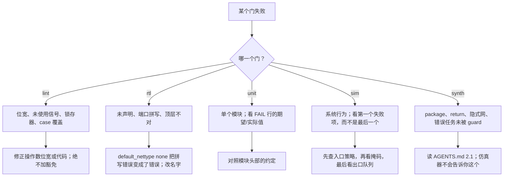

实用提示：

* **仿真挂死、时间不前进**，几乎总是 `always_comb` 读了自己写的变量，或在 `always_comb`
  里读存储器。把累加器移进函数，或用连续赋值把读暂存成扁平向量。
* **学到的表项从不出现**，通常是解包数组上的循环下标写入。改用 generate 循环里的逐表项
  `always_ff`。
* **读到陈旧值**，是用运行时值索引解包数组。改用打包向量。
* **本地 lint 干净、CI 变红**，是 Verilator 版本差异。修正位宽，不要加豁免。
* **同一帧无限重复**，是描述符被重复读取：矩阵寄存描述符的那一拍没有弹出标签 FIFO。
* **出口端口几帧后卡死**，是缺少 `slot_o` 检查：节拍 FIFO 有空间，描述符 FIFO 没有。

### 16.4 完成定义

在认为改动完成之前：

- [ ] `ci/check-toolchain.sh`、`make lint`、`make rtl`、`make unit`、`make sim`、
      `make param` 全部通过。
- [ ] `make synth` 能展开并综合全部五个顶层。
- [ ] 行为改动配有一个「没有该改动就会失败」的测试。
- [ ] 没有新增 `verilator lint_off`，没有新增 `initial` 块。
- [ ] 新的共享常量放在对应的 `es_*_defs.sv` 库中。
- [ ] 新的模块参数由 `localparam` 推导，并在端口列表中写明。
- [ ] 对 `librelane/config.json` 的改动记录在 `librelane/README.md` 中。
- [ ] 文件头仍然描述该模块的用途。

### 16.5 CI 流水线

CI 运行在**自托管** runner 上，改动它之前值得知道职责是怎么划分的：宿主机只提供
Docker，别的一概没有；EDA 工具链来自本仓库自己构建的容器镜像。

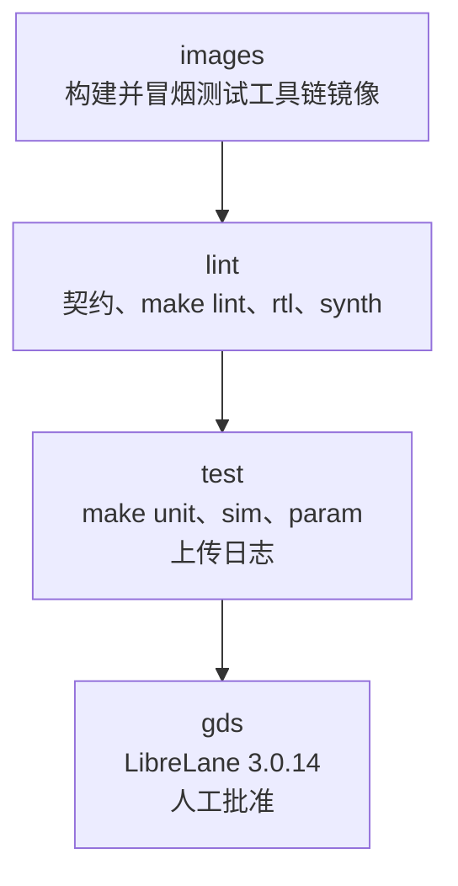

| 作业 | 做什么 |
|---|---|
| `images` | 把 `ci/toolchain/Dockerfile` 构建进 runner 的本地 Docker 存储，并对六个必需工具做冒烟测试 |
| `lint` | 带 `ASSERT_OS=1` 运行 `ci/check-toolchain.sh`，然后在镜像内跑 `make lint`、`make rtl`、`make synth` |
| `test` | 运行 `make unit`、`make sim`、`make param`；把仿真日志作为产物上传，**即使作业失败也上传** |
| `gds` | 在人工批准之后运行 LibreLane 流程，上传 GDSII 与完整运行目录 |

为什么「钉住」的是 Dockerfile 而不是 registry 标签：发行版构建会带上安全更新，而在
「给每次提交设门」的作业的供应链里引入第三方 APT 仓库，不值得为了一个更新的 linter 去
冒险。`EXPECTED_OS` 加 `ASSERT_OS=1` 让这个钉住真正生效——基础发行版变了的工具链镜像会
**按名字**失败，而不是悄悄改变 `make lint` 的报告内容。

镜像必须是基于 glibc 的（Debian 或 Ubuntu），不能是 Alpine：容器作业会用从 runner
绑定挂载进来的 Node 二进制执行 JavaScript action 步骤，而该二进制在 musl 上无法启动。
镜像还需要 `git`、`bash`、`make` 与三个 EDA 工具在 `PATH` 上；`images` 里的冒烟测试会
点出缺失的工具名，这比「runner 看起来坏了」清楚得多。

`test` 作业运行 `make unit`（它本身依赖八端口板级回归）、`make sim` 与 `make param`。
MII 与 RMII 的系统级冒烟回归属于 `make all`，需要在本地运行——改动前端之后请务必先跑
它们再推送。

---

## 17. 物理实现

`librelane/` 保存流程配置与时序约束，在固定版本的 LibreLane 容器中针对开源 `sky130A`
PDK 运行。

```sh
mkdir -p .cache/librelane
docker run --rm \
  --user "$(id -u):$(id -g)" \
  -e HOME=/work/.cache/librelane \
  -v "$PWD:/work" -w /work \
  ghcr.io/librelane/librelane:3.0.14 \
  librelane --pdk sky130A -s sky130_fd_sc_hd librelane/config.json
```

**必须固定标签。** 该镜像是 Nix 闭包，工具链恰好是流程发布时的版本。RTL 是针对镜像内的
yosys 展开的，所以浮动的 `latest` 会让 GDSII 不可复现：同一提交的两次运行可能因为前端
在脚下变化而结果不同。

### 17.1 流程实际构建的是什么

物理实现刻意展开一个**缩减规模**的核心实例。全尺寸参数需要商业级流程和存储编译器才现实；
缩减实例证明的是本设计在开源 PDK 上能端到端地完成读取、展开、综合与布线。

| | 模块默认值（回归测试的对象） | `SYNTH_PARAMETERS`（本次运行） |
|---|---|---|
| `MAX_FRAME_LEN` | 1518 | 256 |
| `RX_FIFO_DEPTH` / `TX_FIFO_DEPTH` | 256 节拍 | 64 节拍 |
| `TAG_FIFO_DEPTH` | 16 | 8 |
| `WF_DEPTH` | 16 | 8 |
| `CAM_SETS` x `CAM_WAYS` | 128 x 4 | 16 x 2 |
| 综合单元数 | 663 923 | 132 678 |
| 触发器数 | 168 593 | 42 748 |
| 单元面积（sky130） | 3.59 mm² | 1.911 mm² |

这些数字是用 LibreLane 2.4.2 测得的。3.0 运行搭载不同的 yosys、OpenROAD 与 ABC，请重新
测量，而不是从此表推导。

缩减实例保持自洽：`sw_beats_of(256)` 是 32 个节拍，而缓冲是 64，因此设计自带的展开期
检查保持安静，核心仍然接受最长 256 字节的帧。

> **这次运行不是什么。** 它不代表全尺寸配置已经完成布局布线。它证明的是设计在开源 PDK
> 上、以流程能完成的规模跑完了整条链路。全尺寸数字是全尺寸实现的起点；它们需要商业级
> 流程、长得多的运行时间和存储编译器。

### 17.2 两个会咬人的配置细节

* **`CLOCK_PERIOD = 10`（100 MHz）。** RTL 默认是 8 ns，而设计在开源 PDK 上收不到 8 ns：
  转发表是 128x4 组相联 CAM，读口要求单拍完成；入口缓冲又串了 FIFO 读、解析器状态机和
  64 位写。10 ns 是这个核心站得住的目标，也让 CI 有意义。周期过小表现为布线失败，绝不会
  表现为「错误的 GDSII」。
* **`RT_MIN_LAYER` / `RT_MAX_LAYER` 是 `met1` / `met5`。** 这些是**技术 LEF** 的层名。
  写错会让 RC 层列表在好几步之后变空，OpenROAD 报 `[RSZ-0015] layer NULL not found`——
  一条指向不到 `config.json` 的错误。

`constraints/io.sdc` 由 OpenSTA 读取，它只实现 SDC 的一个子集。三种在 PrimeTime 里稀松
平常的写法会让 OpenSTA 在**读文件时**就中止：`remove_from_collection`、
`set_driving_cell` 指定了库里不存在的单元、以及单参数的 `set_max_transition` 简写。
因此该文件显式列出端口、指定 `sky130_fd_sc_hd__buf_1` 驱动单元，并把转换限制的对象
列表写全。

CI 的 `gds` 作业在**人工批准**之后运行同一个容器，因为它是唯一会产生「有人可能据此
行动」的产出的作业。2.4 到 3.0 的迁移表与完整测量历史见
[`librelane/README.md`](librelane/README.md)。

---

## 18. 在本仓库上工作

### 18.1 不是风格的规则

[`AGENTS.md`](AGENTS.md) 是风格与可移植性契约。四种工具会读这份代码——Verilator、
Icarus、yosys 和 Quartus——其中最严格的不是仿真器。下面这些规则存在，是因为「另一种
写法」已经以测试台看不见的方式弄坏过这个设计。

读任何模块之前，有一套约定值得先记住，因为它被毫无例外地使用：

| 形式 | 含义 | 示例 |
|---|---|---|
| `clk_i`、`rst_ni` | 时钟，以及低有效同步复位 | |
| `<name>_i` / `<name>_o` | 端口方向 | `beat_valid_i`、`gmii_d_o` |
| `<name>_q` | 寄存后的值 | `len_q`、`cam_hit_q` |
| `<name>_d`、`<name>_n` | 组合逻辑的**下一值** | `count_d`、`crc_en_n` |
| `S_XXX` | `typedef enum` 中的状态机状态 | `S_PRE`、`S_TAIL` |
| `es_<domain>_*` / `sw_*` | 设计模块 / 共享声明 | `es_mems_sync_fifo`、`sw_is_unicast` |
| `cnt_*`、`stat_o` | 统计量 | `cnt_tx_octets` |
| `unused_*` | 为无人读取的信号刻意准备的哑消费者 | `unused_crc_ok` |

### 18.2 三条 yosys 硬限制

它们都是解析错误，而且三者对 Icarus 与 Verilator 都不可见，所以违反其中一条的改动会
通过所有本地测试，然后在流程里失败。

**1. 禁止 `package`，禁止任何形式的 `import`。**

```systemverilog
// 被拒绝：package 中的条目对前端不是常量范围
package sw_pkg;
  localparam int unsigned W = 8;
endpackage

// 被接受：es_defs.sv 中的编译单元作用域
localparam int unsigned SW_W = 8;
```

取自 package 的位宽会在端口声明处被拒绝，甚至还没解析模块体。
`module X import pkg::*; (...)` 与模块体内的 `import pkg::*;` 都不被接受。

**2. 任何函数中禁止 `return`。**

```systemverilog
// 被拒绝
function automatic int f(input int a);
  return a + 1;
endfunction

// 被接受：给函数名赋值
function automatic int f(input int a);
  f = a + 1;
endfunction
```

**3. `read_verilog` 必须带 `-sv`。** `.sv` 扩展名并不隐含它；没有它，解析会在第一个声明
处失败，报错信息看起来像 package 问题，其实不是。`make synth` 会传它，LibreLane 自己
也会传。

### 18.3 位宽纪律

**算术或位运算的每个操作数都必须同宽，而且那个宽度必须是你想要的那个。**

```systemverilog
// 错：字面量使表达式变成 32 位，a 被零扩展
count <= count + 1;

// 对：使用计数器自身宽度的定宽常量
count <= count + W'(1);
```

写错的后果：

* 在较老的 Verilator 上是 `WIDTHEXPAND` 警告，直接让构建失败；
* 在较新的版本上则完全沉默，所以不能指望 linter 告诉你；
* 综合出的加法器比需要的宽，结果在一个没人选择的位宽上被截断。

其他位宽规则：

* `W'(x)` 是类型转换，不是让 linter 闭嘴的工具。先决定正确位宽，再让表达式产生它。
* 需要回绕的地方把回绕写出来（`cond ? '0 : cur + W'(1)`）——靠溢出回绕的计数器只有在
  计数是 2 的幂时才正确。
* 由参数关闭的特性要**显式**关闭（`if (PARAM != 0) ...`），绝不要靠阈值下溢。
* 不要用两个 32 位向量之间的 `*` 表达「计数 x 计数」。写成移位加法，或收窄操作数，就像
  `octets_x_copies` 那样。

### 18.4 进程规则

* 状态用 `always_ff @(posedge clk_i)`，组合逻辑用 `always_comb`。绝不用 `always @*`，
  绝不用裸 `always`。
* `always_ff` 中用非阻塞 `<=`，`always_comb` 与函数中用阻塞 `=`。
* 每个 `always_comb` 先给所有输出赋默认值，每个 `case` 都有 `default`。
* **绝不要让 `always_comb` 读自己写的变量。** 那会把它放进块自己的隐式敏感列表；块会
  永远自我触发，仿真时间停滞——看起来就像时钟死了，别的什么也看不出来。把累加器放进
  函数。
* **绝不要在 `always_comb` 里用运行时值索引存储器。** 用连续赋值把读暂存成扁平向量。
* **写入解包数组要通过 generate 循环里的逐表项 `always_ff`。** 循环下标的存储在 Icarus
  里会被静默丢弃。
* 复位是同步、低有效、名为 `rst_ni`，并且是每个带状态 `always_ff` 的第一个分支。

### 18.5 `rtl/` 中绝不能出现的东西

延时（`#`）、`fork`/`join`、`wait`、`disable`、`real`、`$display`/`$finish`、动态数组、
队列、类、数据通路中的断言、`import`，以及 `initial`。`rtl/` 里已经没有任何 `initial`
块。

存在两个范围很窄、有文档说明的例外：

* `es_common_crc32.sv` 用函数计算查找表，而不是 `initial` 块。表形式遇到过 Quartus：
  它的常量求值器对一个由 initial 块初始化的存储器需要每个实例**几十个 CPU 分钟**；函数
  在所有工具里算出完全相同的值。
* `es_switch_core.sv` 与 MII/RMII wrapper 在 `` `ifndef SYNTHESIS `` 里用
  `$error`/`$warning` 报告展开期参数检查，因为 yosys 没有它们的实现，遇到就会中止。

### 18.6 Quartus 的四个坑

`board/de2_115/quartus_ii/` 由 Quartus II 编译，它的 Verilog 前端既接受另外三种工具
拒绝的写法，也拒绝另外三种工具接受的写法。四个坑，对 Verilator、Icarus 和 yosys 全部
不可见：

| 坑 | 症状 | 规则 |
|---|---|---|
| 内联 genvar（`for (genvar g = 0; ...)`） | 语法错误 | 单独声明 `genvar g;` |
| 模块级裸 `for` | `syntax error ... expecting "endmodule"` | 每个模块级循环都包在 `generate ... endgenerate` 里 |
| 注释的第一个词是 `synthesis` | `Unrecognized synthesis attribute "flow"` | 注释绝不以工具 pragma 关键字开头 |
| 由 `initial` 初始化的存储器 | 每实例 27 CPU 分钟仍未完成 | 展开期表格用函数计算 |

### 18.7 添加模块、参数、计数器

**新模块。** 一个模块一个文件，`es_<domain>_<block>.sv`，与模块同名。从标准文件头开始
（文件、描述、接口约定），包含 `es_defs.sv` 与所属域库，在 include 之后断言
`` `default_nettype none ``，在 `` `endif `` 之前恢复 `` `default_nettype wire ``。它拥有
的常量放进所属的 `es_*_defs.sv`，不要放模块里；除非跨域，也不要放 `es_defs.sv`。

**新参数。** 模块参数是配置面，必须保持一份简短、有文档的清单。派生量一律走
`localparam`，让位宽只声明一次。每端口量用扁平打包向量，不用解包数组。如果错误取值
最终会表现为神秘的丢帧，就在 `ifndef SYNTHESIS` 下加一条展开期检查。

**新统计计数器。** 只往 `sw_stat_id_e` 追加一个 ID 并增加 `SW_STAT_COUNT` 是不够的：
监控的计数块固定是第 8..35 字的 14 对，速率块从第 36 字开始。第 15 个计数器会与速率块
重叠，所以新增计数器是一次 ABI 变更：同一个提交里要扩展监控字映射、控制台格式化与
`docs/monitor.md`，并提升 `SW_MON_ABI_VERSION`。每个不拥有新计数器的模块都必须把它
驱动为零：监控会把接收与发送的逐端口总线按位或起来，`stat_o` 又会跨端口求和，未驱动的
字段会把其他模块恰好留下的值累加进来。

### 18.8 新手的阅读顺序

1. 本文 §1 与 §4，先建立整体形状。
2. `rtl/es_defs.sv` 与 `rtl/switch/es_switch_defs.sv`——先掌握词汇。
3. 按此顺序读 `es_switch_gmii_rx` → `es_switch_rx_port` → `es_switch_arbiter` →
   `es_switch_tx_port` → `es_switch_gmii_tx`。
4. 数据通路看懂之后，再读 `es_switch_mac_table`。
5. 读 `tb/sw_gmii_if.sv` 与 `tb/tb_sw_switch.sv`，理解「正确」意味着什么。
6. 动任何一行之前，读 `AGENTS.md`。

---

## 19. 故障排查

| 症状 | 最可能的原因 | 去哪里看 |
|---|---|---|
| 所有单播都被洪泛，且从不学习 | I/G 位读错位置，所有地址都像组播地址 | `SW_MAC_IG_BIT`（第 40 位）、`sw_is_unicast` |
| 帧能转发，但每个 FCS 都错 | CRC 残值错、种子错，或填充在 FCS 之后生成 | `es_common_crc32`、`es_switch_gmii_tx` |
| 50 MHz 核心上 1000 Mbit/s 端口只跑 400 Mbit/s | `BYTE_PERIOD` 把 2.5 拍舍入成 1 | `sw_byte_period`、§4.3 |
| 同一帧无限重复 | 矩阵寄存描述符的那一拍没有弹出标签 FIFO | `src_tag_rd_en_o`、矩阵中的预取寄存器 |
| 出口端口几帧后卡死 | 节拍 FIFO 有空间但描述符 FIFO 没有 | `slot_o`、`LEN_FIFO_DEPTH` |
| 仿真挂死、时间不前进 | `always_comb` 累加器，或在 `always_comb` 里读存储器 | §18.4 |
| 学到的站点从不出现 | 解包数组上的循环下标写入 | `es_switch_mac_table`，改用逐表项 generate |
| 查找返回陈旧端口 | 用运行时值索引解包数组 | 改用打包向量 |
| 本地 lint 干净，CI 变红 | Verilator 版本差异 | 修正操作数位宽，§18.3 |
| `make synth` 在端口位宽处失败 | 位宽取自 package | §18.2 |
| Quartus 在 generate 循环处失败 | 内联 genvar 或隐式 generate | §18.6 |
| LibreLane 报 `Unknown key` | 流程变量被改名或删除 | `librelane/README.md` 迁移表 |
| 板上显示横线、无流量 | PHY 未协商到 100FD，或 MDIO 地址不对 | 板级 README、PHY 管理 |
| 控制台无输出 | 波特率分频超范围，或数据位不对 | `es_perips_uart` 的展开期检查 |

---

## 20. 术语表

| 术语 | 在本文中的含义 |
|---|---|
| **节拍（beat）** | 内部数据通路的一个 64 位字 = 8 个八位组，八位组 0 在 `[63:56]` |
| **BYTE_PERIOD** | 一个端口上一个八位组时间包含的 `clk_i` 周期数 |
| **CAM** | 内容可寻址存储器；这里指组相联转发表 |
| **CDC** | 时钟域穿越；本内核没有 |
| **时钟使能（clock enable）** | 限定同步传输的选通信号，用来代替第二个时钟 |
| **CSR** | 控制/状态寄存器；这里指只读监控接口 |
| **cut-through** | 整帧到齐前就转发；本设计**不**实现 |
| **展开（elaboration）** | 把参数化 RTL 变成具体实例；参数检查在此运行 |
| **FCS** | 帧校验序列，帧尾的 32 位 CRC |
| **洪泛（flooding）** | 从除入口外的每个端口发出 |
| **FWFT** | 先字直通：FIFO 头部在弹出前就可见 |
| **队头阻塞** | 被阻塞的队头帧阻止其后帧被服务 |
| **IFG** | 帧间隔；帧之间至少 12 个八位组时间的空闲 |
| **MDIO** | 通往 PHY 的两线管理接口 |
| **MII / GMII / RMII** | MAC 与 PHY 之间的接口，符号宽度分别为 4 / 8 / 2 位 |
| **PDK** | 工艺设计套件；这里是 `sky130A` |
| **PHY** | 物理层收发器，位于本内核之外 |
| **超短帧（runt）** | 短于 802.3 最小值，或短于帧头声明值的帧 |
| **SFD** | 帧起始定界符 `0xD5`，8 字节前导码的最后一个字节 |
| **存储转发（store-and-forward）** | 收完并校验整帧后再转发 |
| **标签（tag）** | 与载荷同行的帧描述符字 |

---

## 21. 接下来读什么

| 文档 | 内容 |
|---|---|
| [`AGENTS.md`](AGENTS.md) | 完整的风格与可移植性契约、工具流程、位宽纪律、测试台规则 |
| [`docs/monitor.zh-Hans.md`](docs/monitor.zh-Hans.md) | 完整的监控 ABI，逐字逐句 |
| [`docs/monitor.md`](docs/monitor.md) | 同上，英文版 |
| [`librelane/README.md`](librelane/README.md) | 运行物理流程、每个配置值的含义、2.4→3.0 迁移 |
| [`board/de2_115/quartus_ii/README.md`](board/de2_115/quartus_ii/README.md) | 板级引脚、显示、MDIO、控制台、时钟限制 |
| `rtl/*/es_*_defs.sv` | 常量，以及解释「为什么取这个值」的注释 |

## 许可证

见 [LICENSE](LICENSE)。
